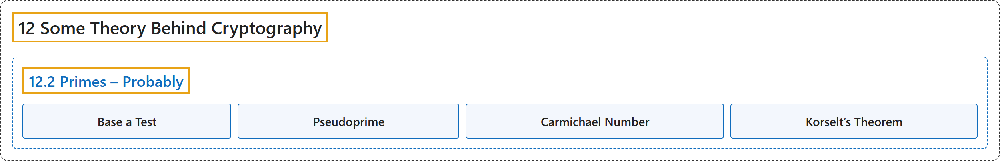

# 12.2 Primes – Probably

## Classification

## Glossary

| Term | Definition | 中文翻译 | Source |
|---|---|---|---|
| **12.2 Primes – Probably** 可能是素数 | (No definition) | （无定义） | [Crisman, 2024, section 12.2](https://math.gordon.edu/ntic/ntic/section-probable-primes.html) |
| **Base a Test** 以 a 为底的检验 | "If **$a^n\equiv a$ (mod $n$)**, we say $n$ passes the **base $a$ test**." | 若 **$a^n\equiv a$（mod $n$）**，就说 $n$ 通过了**以 $a$ 为底的检验**。 | [Crisman, 2024, Definition 12.2.3](https://math.gordon.edu/ntic/ntic/section-probable-primes.html#definition-base-a-test) |
| **Pseudoprime** 伪素数 | "If **$a^n\equiv a$ (mod $n$) but $n$ is not prime**, we say it is a **pseudoprime** base $a$." | 若 **$a^n\equiv a$（mod $n$）但 $n$ 不是素数**，就说它是以 $a$ 为底的**伪素数**。 | [Crisman, 2024, Definition 12.2.5](https://math.gordon.edu/ntic/ntic/section-probable-primes.html#definition-pseudoprime) |
| **Carmichael Number** 卡迈克尔数 | "We call a number which is **pseudoprime to every base $a$, but is not a prime number** a **Carmichael number**, in honor of the first person to actually produce such numbers, Robert Carmichael (in 1912)." | 我们把**对每个底 $a$ 都是伪素数、但本身不是素数**的数称为**卡迈克尔数**，以纪念第一个真正造出这种数的人罗伯特卡迈克尔（1912 年）。 | [Crisman, 2024, Definition 12.2.9](https://math.gordon.edu/ntic/ntic/section-probable-primes.html#definition-carmichael) |
| **Korselt’s Theorem** 科塞特定理 | "Carmichael numbers are precisely those composite $n$ for which **$n$ is a product of at least two distinct primes $p_i$ (no squares)** $n=p_1p_2p_3\cdots p_k\text{ with }p_i\neq p_j$ such that **$p_i-1\mid n-1$** for all the prime factors." | 卡迈克尔数恰好是这样的合数 $n$：**$n$ 是至少两个不同素数 $p_i$ 之积（无平方因子）**，$n=p_1p_2p_3\cdots p_k\text{ with }p_i\neq p_j$，并且对所有素因数都有 **$p_i-1\mid n-1$**。 | [Crisman, 2024, Proposition 12.2.10](https://math.gordon.edu/ntic/ntic/section-probable-primes.html#prop-korselt) |

## References

Crisman, K.-D. (2024). *Number theory: In context and interactive* (June 26, 2024 edition). Gordon College. Retrieved October 29, 2026, from <https://math.gordon.edu/ntic/ntic/>
