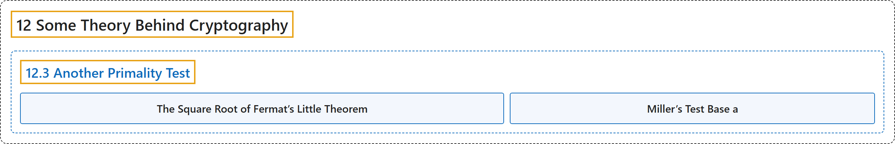

# 12.3 Another Primality Test

## Classification

## Glossary

| Term | Definition | 中文翻译 | Source |
|---|---|---|---|
| **12.3 Another Primality Test** 另一种素性检验 | (No definition) | （无定义） | [Crisman, 2024, section 12.3](https://math.gordon.edu/ntic/ntic/section-another-primality-test.html) |
| **The Square Root of Fermat’s Little Theorem** 费马小定理的平方根 | "**$\text{For any odd prime modulus }p\nmid a\text{, we have }a^{(p-1)/2}\equiv \pm 1\text{ (mod }p)$**." | **$\text{For any odd prime modulus }p\nmid a\text{, we have }a^{(p-1)/2}\equiv \pm 1\text{ (mod }p)$**（对任意不整除 $a$ 的奇素数模 $p$，有 $a^{(p-1)/2}\equiv \pm 1$）。 | [Crisman, 2024, Theorem 12.3.2](https://math.gordon.edu/ntic/ntic/section-another-primality-test.html#theorem-flt-sqrt) |
| **Miller’s Test Base a** 以 a 为底的米勒检验 | "**A slightly stronger variant of this test** is called **Miller’s test base $a$** for primality, after American computer scientist Gary Miller." | 这种检验的**一个稍强的变体**称为素性的**以 $a$ 为底的米勒检验**，以美国计算机科学家加里米勒命名。 | [Crisman, 2024, subsection 12.3.2](https://math.gordon.edu/ntic/ntic/section-another-primality-test.html#subsection-millers-test-2) |

## References

Crisman, K.-D. (2024). *Number theory: In context and interactive* (June 26, 2024 edition). Gordon College. Retrieved October 29, 2026, from <https://math.gordon.edu/ntic/ntic/>
