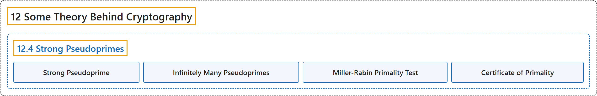

# 12.4 Strong Pseudoprimes

## Classification

## Glossary

| Term | Definition | 中文翻译 | Source |
|---|---|---|---|
| **12.4 Strong Pseudoprimes** 强伪素数 | (No definition) | （无定义） | [Crisman, 2024, section 12.4](https://math.gordon.edu/ntic/ntic/section-strong-pseudoprime.html) |
| **Strong Pseudoprime** 强伪素数 | "We call **a composite number $n$ that passes Miller’s test base $a$** a **strong pseudoprime base $a$**." | 我们把**通过以 $a$ 为底的米勒检验的合数 $n$** 称为**以 $a$ 为底的强伪素数**。 | [Crisman, 2024, Definition 12.4.1](https://math.gordon.edu/ntic/ntic/section-strong-pseudoprime.html#definition-strong-pseudoprime) |
| **Infinitely Many Pseudoprimes** 无穷多个伪素数 | "**There are infinitely many strong pseudoprimes (and hence pseudoprimes) base 2.**" | **以 2 为底的强伪素数（因而伪素数）有无穷多个**。 | [Crisman, 2024, Corollary 12.4.4](https://math.gordon.edu/ntic/ntic/section-strong-pseudoprime.html#cor-inf-pseudoprime) |
| **Miller-Rabin Primality Test** 米勒-拉宾素性检验 | "**Run Miller’s test for $k$ different bases less than $n-1$.** If a number passes all of them, the probability of failure is less than $\left(\frac{1}{4}\right)^k$." | **对小于 $n-1$ 的 $k$ 个不同的底运行米勒检验**。若一个数全部通过，失败的概率小于 $\left(\frac{1}{4}\right)^k$。 | [Crisman, 2024, Algorithm 12.4.7](https://math.gordon.edu/ntic/ntic/section-strong-pseudoprime.html#algorithm-miller-rabin) |
| **Certificate of Primality** 素性证明 | "You can also always use **some slow test to prove primality**. That is what is called a **certificate of primality**, and although you may not believe it, programs that reliably generate reasonably large (100-200 digits, right now) primes and can verify it are hot items on the virtual shelves of those who care about such things." | 你也总可以用**某种较慢的检验来证明素性**。这就是所谓的**素性证明**；说来你可能不信，能可靠地生成相当大的素数（目前是 100 到 200 位）并能验证它的程序，在关心这些事的人的虚拟货架上是抢手货。 | [Crisman, 2024, section 12.4](https://math.gordon.edu/ntic/ntic/section-strong-pseudoprime.html#section-strong-pseudoprime-17) |

## References

Crisman, K.-D. (2024). *Number theory: In context and interactive* (June 26, 2024 edition). Gordon College. Retrieved October 29, 2026, from <https://math.gordon.edu/ntic/ntic/>
