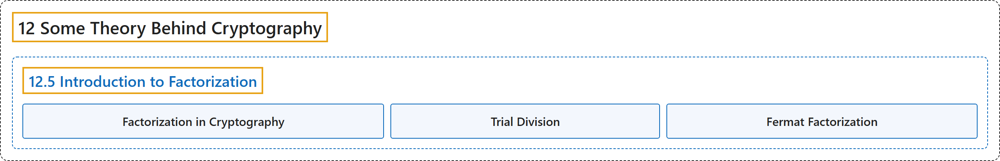

# 12.5 Introduction to Factorization

## Classification

## Glossary

| Term | Definition | 中文翻译 | Source |
|---|---|---|---|
| **12.5 Introduction to Factorization** 因数分解简介 | (No definition) | （无定义） | [Crisman, 2024, section 12.5](https://math.gordon.edu/ntic/ntic/section-intro-factor.html) |
| **Factorization in Cryptography** 密码学中的因数分解 | "We will focus on the main *attack* on the RSA algorithm, namely **finding nontrivial factorizations**, or **factorization**." | 我们将关注对 RSA 算法的主要*攻击*，即**寻找非平凡的因数分解**，也就是**因数分解**。 | [Crisman, 2024, section 12.5](https://math.gordon.edu/ntic/ntic/section-intro-factor.html#section-intro-factor-2-2) |
| **Trial Division** 试除法 | "The first, and oldest, method of factoring is one you already know, and maybe used a few minutes ago – **trial factorization**, or **trial division**. It is the method we used with the Sieve of Eratosthenes; **you just try each prime number, one by one**." | 第一种、也是最古老的因数分解方法你已经知道，也许几分钟前还用过，那就是**试除分解**，或**试除法**。它就是我们用埃拉托色尼筛法时的方法：**逐个试每个素数**。 | [Crisman, 2024, subsection 12.5.2](https://math.gordon.edu/ntic/ntic/section-intro-factor.html#subsection-trial-factor-5) |
| **Fermat Factorization** 费马分解法 | "To find a factor for a number $n$, begin by seeking a perfect square $s^2$ bigger than $n$, but still as close as possible. Now, do the following until you succeed, increasing $s$ by one each time. Check whether **$s^2-n$ is *itself* a perfect square $t^2$**." | 要找数 $n$ 的一个因数，先找一个比 $n$ 大但尽量接近的完全平方数 $s^2$。然后每次把 $s$ 加一，重复下面的步骤直到成功。检验 **$s^2-n$ *本身*是否是完全平方数 $t^2$**。 | [Crisman, 2024, Algorithm 12.5.9](https://math.gordon.edu/ntic/ntic/section-intro-factor.html#algorithm-fermat-factor) |

## References

Crisman, K.-D. (2024). *Number theory: In context and interactive* (June 26, 2024 edition). Gordon College. Retrieved October 29, 2026, from <https://math.gordon.edu/ntic/ntic/>
