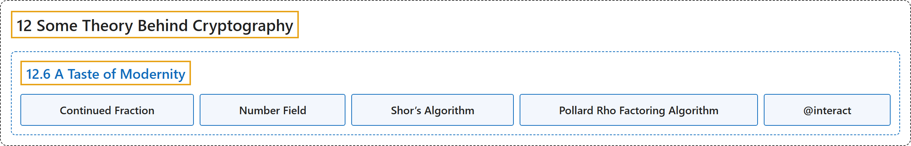

# 12.6 A Taste of Modernity

## Classification

## Glossary

| Term | Definition | 中文翻译 | Source |
|---|---|---|---|
| **12.6 A Taste of Modernity** 现代方法一瞥 | (No definition) | （无定义） | [Crisman, 2024, section 12.6](https://math.gordon.edu/ntic/ntic/section-modern-factoring.html) |
| **Continued Fraction** 连分数 | "There are many answers to this question, some of which involve cool things called **continued fractions** or **number fields**." | 这个问题有很多答案，其中一些涉及称为**连分数**或**数域**的有趣东西。 | [Crisman, 2024, section 12.6](https://math.gordon.edu/ntic/ntic/section-modern-factoring.html#section-modern-factoring-2-3) |
| **Number Field** 数域 | "There are many answers to this question, some of which involve cool things called **continued fractions** or **number fields**." | 这个问题有很多答案，其中一些涉及称为**连分数**或**数域**的有趣东西。 | [Crisman, 2024, section 12.6](https://math.gordon.edu/ntic/ntic/section-modern-factoring.html#section-modern-factoring-2-3) |
| **Shor’s Algorithm** 肖尔算法 | "A rather less elementary, but potentially extremely important, technique for factoring is *Shor’s algorithm*. Explaining this quantum computational algorithm in any detail goes *well* beyond this text; its main significance is that *if* a sizable quantum computer implementing this algorithm could be built, it could **perform the specific tasks of factoring large RSA moduli in polynomial (rather than exponential) time**." | 一种远不那么初等、但可能极其重要的因数分解技术是*肖尔算法*。详细解释这种量子计算算法*远远*超出了本书的范围；它的主要意义在于，*如果*能造出实现该算法的相当规模的量子计算机，它就能**在多项式（而非指数）时间内完成分解大的 RSA 模数这一特定任务**。 | [Crisman, 2024, section 12.6](https://math.gordon.edu/ntic/ntic/section-modern-factoring.html#section-modern-factoring-2-5) |
| **Pollard Rho Factoring Algorithm** 波拉德 rho 因数分解算法 | "Pick some polynomial $f(x)$ that will be easy to compute (mod $n$) (such as $x^2+1$, though other quadratics might be used). Plug in an essentially random seed value $x_0$. (Often the seed is $2$ or $3$.) Compute the polynomial’s value at the seed, $f(x_0)=x_1$. Continue plugging in $f(x_i)=x_{i+1}$, modulo $n$. For each $k$ we check whether **$1<\gcd(x_{2k}-x_k,n)=d<n$**." | 取某个容易（模 $n$）计算的多项式 $f(x)$（如 $x^2+1$，也可用其他二次多项式）。代入一个基本随机的种子值 $x_0$（种子常取 $2$ 或 $3$）。计算多项式在种子处的值 $f(x_0)=x_1$。继续代入 $f(x_i)=x_{i+1}$，模 $n$。对每个 $k$ 检验是否 **$1<\gcd(x_{2k}-x_k,n)=d<n$**。 | [Crisman, 2024, Algorithm 12.6.3](https://math.gordon.edu/ntic/ntic/section-modern-factoring.html#algorithm-pollard-rho) |
| **\@interact** \@interact | "An interact is just **a Sage/Python function, except with `@interact` before it**." | 一个交互就是**一个前面加了 `@interact` 的 Sage/Python 函数**。 | [Crisman, 2024, Sage note 12.6.8](https://math.gordon.edu/ntic/ntic/section-modern-factoring.html#sagenote-build-interact) |

## References

Crisman, K.-D. (2024). *Number theory: In context and interactive* (June 26, 2024 edition). Gordon College. Retrieved October 29, 2026, from <https://math.gordon.edu/ntic/ntic/>
