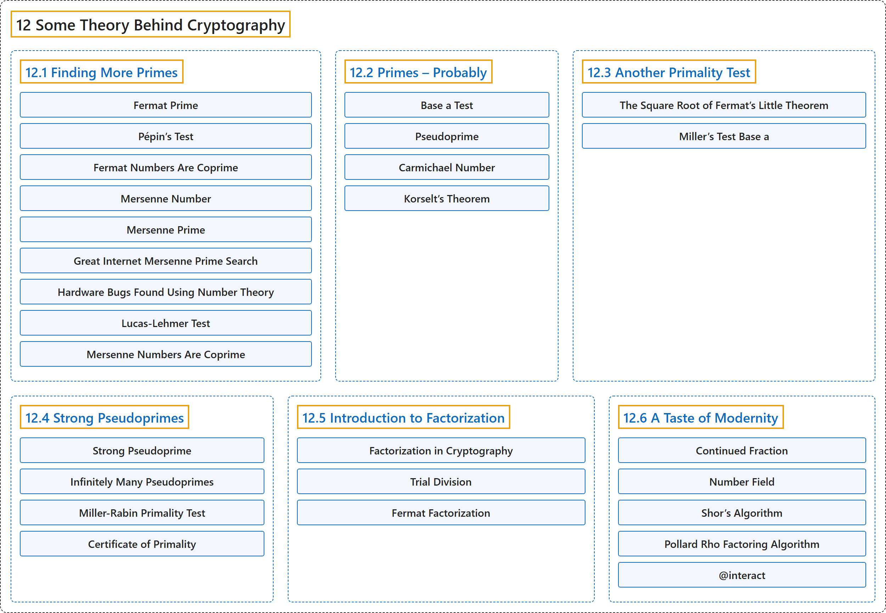

# 12 Some Theory Behind Cryptography

## Classification

## Glossary

| Term | Definition | 中文翻译 | Source |
|---|---|---|---|
| **12 Some Theory Behind Cryptography** 密码学背后的一些理论 | (No definition) | （无定义） | [Crisman, 2024, chapter 12](https://math.gordon.edu/ntic/ntic/chapter-crypto-theory.html) |
| **[12.1 Finding More Primes](12-1-finding-more-primes.md)** 寻找更多素数 | (No definition) | （无定义） | [Crisman, 2024, section 12.1](https://math.gordon.edu/ntic/ntic/section-finding-primes.html) |
| **[12.2 Primes – Probably](12-2-primes-probably.md)** 可能是素数 | (No definition) | （无定义） | [Crisman, 2024, section 12.2](https://math.gordon.edu/ntic/ntic/section-probable-primes.html) |
| **[12.3 Another Primality Test](12-3-another-primality-test.md)** 另一种素性检验 | (No definition) | （无定义） | [Crisman, 2024, section 12.3](https://math.gordon.edu/ntic/ntic/section-another-primality-test.html) |
| **[12.4 Strong Pseudoprimes](12-4-strong-pseudoprimes.md)** 强伪素数 | (No definition) | （无定义） | [Crisman, 2024, section 12.4](https://math.gordon.edu/ntic/ntic/section-strong-pseudoprime.html) |
| **[12.5 Introduction to Factorization](12-5-introduction-to-factorization.md)** 因数分解简介 | (No definition) | （无定义） | [Crisman, 2024, section 12.5](https://math.gordon.edu/ntic/ntic/section-intro-factor.html) |
| **[12.6 A Taste of Modernity](12-6-a-taste-of-modernity.md)** 现代方法一瞥 | (No definition) | （无定义） | [Crisman, 2024, section 12.6](https://math.gordon.edu/ntic/ntic/section-modern-factoring.html) |

## References

Crisman, K.-D. (2024). *Number theory: In context and interactive* (June 26, 2024 edition). Gordon College. Retrieved October 29, 2026, from <https://math.gordon.edu/ntic/ntic/>
