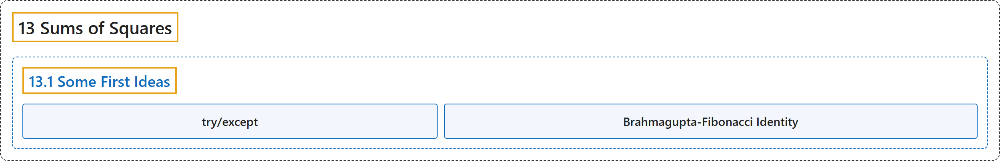

# 13.1 Some First Ideas

## Classification

## Glossary

| Term | Definition | 中文翻译 | Source |
|---|---|---|---|
| **13.1 Some First Ideas** 初步想法 | (No definition) | （无定义） | [Crisman, 2024, section 13.1](https://math.gordon.edu/ntic/ntic/section-first-squares.html) |
| **try/except** try/except | "Most computer languages have a way to “handle” errors if we don’t want to think of them as errors. In Python, this is the `try/except` syntax you see above. Basically, we are **trying to use the two squares command, but if it hiccups, we instead just print a nice message**." | 大多数计算机语言都有办法“处理”我们不想当成错误的错误。在 Python 中，这就是上面看到的 `try/except` 语法。基本上，我们**尝试使用求两个平方的命令，如果出了岔子，就改为打印一条友好的消息**。 | [Crisman, 2024, Sage note 13.1.3](https://math.gordon.edu/ntic/ntic/section-first-squares.html#sagenote-handle-errors) |
| **Brahmagupta-Fibonacci Identity** 婆罗摩笈多-斐波那契恒等式 | "**$\left(a^2+b^2\right)\left(c^2+d^2\right)= \left(ac-bd\right)^2+\left(ad+bc\right)^2$**" | **$\left(a^2+b^2\right)\left(c^2+d^2\right)= \left(ac-bd\right)^2+\left(ad+bc\right)^2$** | [Crisman, 2024, Fact 13.1.7](https://math.gordon.edu/ntic/ntic/section-first-squares.html#fact-brahma-fib) |

## References

Crisman, K.-D. (2024). *Number theory: In context and interactive* (June 26, 2024 edition). Gordon College. Retrieved October 29, 2026, from <https://math.gordon.edu/ntic/ntic/>
