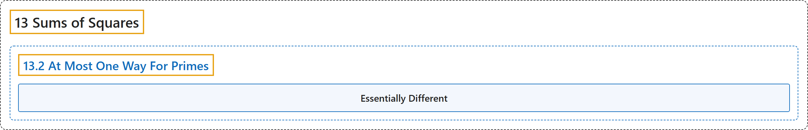

# 13.2 At Most One Way For Primes

## Classification

## Glossary

| Term | Definition | 中文翻译 | Source |
|---|---|---|---|
| **13.2 At Most One Way For Primes** 素数至多一种表示 | (No definition) | （无定义） | [Crisman, 2024, section 13.2](https://math.gordon.edu/ntic/ntic/section-prime-squares-1.html) |
| **Essentially Different** 本质上不同 | "We say the latter ways are **essentially different**, because they **involve two different pairs of nonnegative integers**." | 我们说后者的两种写法是**本质上不同**的，因为它们**涉及两对不同的非负整数**。 | [Crisman, 2024, section 13.2](https://math.gordon.edu/ntic/ntic/section-prime-squares-1.html#section-prime-squares-1-4) |

## References

Crisman, K.-D. (2024). *Number theory: In context and interactive* (June 26, 2024 edition). Gordon College. Retrieved October 29, 2026, from <https://math.gordon.edu/ntic/ntic/>
