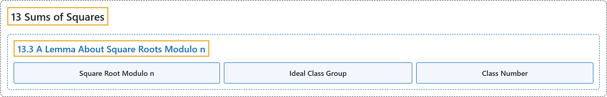

# 13.3 A Lemma About Square Roots Modulo n

## Classification

## Glossary

| Term | Definition | 中文翻译 | Source |
|---|---|---|---|
| **13.3 A Lemma About Square Roots Modulo n** 关于模 n 平方根的一个引理 | (No definition) | （无定义） | [Crisman, 2024, section 13.3](https://math.gordon.edu/ntic/ntic/section-sqrt-mod-n-lemma.html) |
| **Square Root Modulo n** 模 n 平方根 | "We say that a number $a$ has a **square root modulo $n$** if **there is some number $x$ with $x^2\equiv a\text{ (mod }n)$**." | 若**存在某个数 $x$ 使 $x^2\equiv a\text{ (mod }n)$**，就说数 $a$ 有**模 $n$ 平方根**。 | [Crisman, 2024, Definition 13.3.1](https://math.gordon.edu/ntic/ntic/section-sqrt-mod-n-lemma.html#definition-sqrt-mod-n) |
| **Ideal Class Group** 理想类群 | "Foreshadowing Definition 14.1.2, if we define the number system $\{a+b\frac{1+\sqrt{-p}}{2}\mid a,b\in\mathbb{Z}\}$ (ignoring whether that actually makes sense to do), one can define a special group (recall Definition 8.3.3) called the **ideal class group** of this number system. **The order of this group** is denoted by $h$." | 预先借用定义 14.1.2，若定义数系 $\{a+b\frac{1+\sqrt{-p}}{2}\mid a,b\in\mathbb{Z}\}$（先不管这样做是否真的有意义），就可以定义这个数系的一个特殊的群（回忆定义 8.3.3），称为**理想类群**。**这个群的阶**记作 $h$。 | [Crisman, 2024, Remark 13.3.4](https://math.gordon.edu/ntic/ntic/section-sqrt-mod-n-lemma.html#remark-class-number) |
| **Class Number** 类数 | "Foreshadowing Definition 14.1.2, if we define the number system $\{a+b\frac{1+\sqrt{-p}}{2}\mid a,b\in\mathbb{Z}\}$ (ignoring whether that actually makes sense to do), one can define a special group (recall Definition 8.3.3) called the **ideal class group** of this number system. **The order of this group** is denoted by $h$." | 预先借用定义 14.1.2，若定义数系 $\{a+b\frac{1+\sqrt{-p}}{2}\mid a,b\in\mathbb{Z}\}$（先不管这样做是否真的有意义），就可以定义这个数系的一个特殊的群（回忆定义 8.3.3），称为**理想类群**。**这个群的阶**记作 $h$。 | [Crisman, 2024, Remark 13.3.4](https://math.gordon.edu/ntic/ntic/section-sqrt-mod-n-lemma.html#remark-class-number) |

## References

Crisman, K.-D. (2024). *Number theory: In context and interactive* (June 26, 2024 edition). Gordon College. Retrieved October 29, 2026, from <https://math.gordon.edu/ntic/ntic/>
