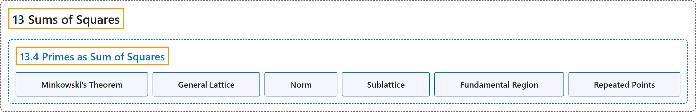

# 13.4 Primes as Sum of Squares

## Classification

## Glossary

| Term | Definition | 中文翻译 | Source |
|---|---|---|---|
| **13.4 Primes as Sum of Squares** 素数表为平方和 | "**Every prime $p$ of the form $4k+1$ can be written as a sum of squares.**" | **每个形如 $4k+1$ 的素数 $p$ 都能写成平方和**。 | [Crisman, 2024, Theorem 13.4.5](https://math.gordon.edu/ntic/ntic/section-prime-squares-2.html#theorem-prime-squares) |
| **Minkowski’s Theorem** 闵可夫斯基定理 | "We roughly follow [E.2.1, Chapter 10.6], but expanded greatly to avoid any direct reference to Hermann **Minkowski’s theorem** on **lattice points in a convex symmetric set**." | 我们大致沿用 [E.2.1, Chapter 10.6]，但作了大幅展开，以避免直接引用赫尔曼闵可夫斯基关于**凸对称集中的格点**的**闵可夫斯基定理**。 | [Crisman, 2024, Remark 13.4.1](https://math.gordon.edu/ntic/ntic/section-prime-squares-2.html#remark-minkowski) |
| **General Lattice** 一般的格 | "Sometimes we call things like the set of blue dots a **lattice**, though in this text I will usually use the word lattice only to refer to the usual integer lattice of the black dots. A general lattice is something related to a concept from linear algebra – **vectors generated by a basis, except instead of being vectors over $\mathbb{Q}$ or $\mathbb{R}$, they are over $\mathbb{Z}$**." | 有时我们把蓝点组成的这类集合称为**格**，不过本书中我通常只用格这个词指黑点组成的通常的整数格。一般的格与线性代数中的一个概念有关：**由一组基生成的向量，只是这些向量不是在 $\mathbb{Q}$ 或 $\mathbb{R}$ 上，而是在 $\mathbb{Z}$ 上**。 | [Crisman, 2024, Remark 13.4.3](https://math.gordon.edu/ntic/ntic/section-prime-squares-2.html#remark-general-lattice) |
| **Norm** 范数 | "We call the **norm** of a point $(x,y)$ **the sum of squares, $N(x,y)=x^2+y^2$**." | 我们把**平方和 $N(x,y)=x^2+y^2$** 称为点 $(x,y)$ 的**范数**。 | [Crisman, 2024, Definition 13.4.4](https://math.gordon.edu/ntic/ntic/section-prime-squares-2.html#definition-norm) |
| **Sublattice** 子格 | "What we do now is to create a **sublattice** of the blue dots, which we will color green. (This is **just a subset of a lattice which still otherwise satisfies the conditions for being a lattice**.)" | 现在我们构造蓝点的一个**子格**，把它涂成绿色。（这**只是格的一个子集，它在其他方面仍满足作为格的条件**。） | [Crisman, 2024, subsection 13.4.3](https://math.gordon.edu/ntic/ntic/section-prime-squares-2.html#subsection-visualize-prime-squares-9) |
| **Fundamental Region** 基本区域 | "Because all points inside the parallelogram (not just green, blue, or lattice points) will “repeat” outside of it in another parallelogram, **$4p$ is the biggest area of a region that you can have and *not* “repeat” some point**. (This parallelogram is often called a **fundamental region** in more general treatments.)" | 由于平行四边形内的所有点（不只是绿点、蓝点或格点）都会在它外面的另一个平行四边形中“重复”，**$4p$ 是一个区域在*不*“重复”任何点的情况下所能有的最大面积**。（在更一般的论述中，这个平行四边形常称为**基本区域**。） | [Crisman, 2024, subsection 13.4.4](https://math.gordon.edu/ntic/ntic/section-prime-squares-2.html#subsection-finish-prime-squares-4-2-1) |
| **Repeated Points** 重复点 | "We say that two distinct points $v,w$ in a plane region are “**repeated**” if they are **both rigid translations of the same point in $L$**, where the allowed translations are those described in Fact 13.4.9." | 若平面区域中两个不同的点 $v,w$ **都是 $L$ 中同一个点的刚性平移**（允许的平移是事实 13.4.9 所描述的那些），就说它们是“**重复**”的。 | [Crisman, 2024, Definition 13.4.10](https://math.gordon.edu/ntic/ntic/section-prime-squares-2.html#definition-repeating-points) |

## References

Crisman, K.-D. (2024). *Number theory: In context and interactive* (June 26, 2024 edition). Gordon College. Retrieved October 29, 2026, from <https://math.gordon.edu/ntic/ntic/>
