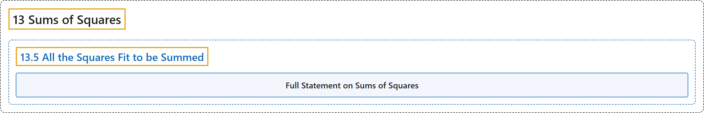

# 13.5 All the Squares Fit to be Summed

## Classification

## Glossary

| Term | Definition | 中文翻译 | Source |
|---|---|---|---|
| **13.5 All the Squares Fit to be Summed** 所有可表为平方和的数 | (No definition) | （无定义） | [Crisman, 2024, section 13.5](https://math.gordon.edu/ntic/ntic/section-all-squares.html) |
| **Full Statement on Sums of Squares** 平方和的完整结论 | "$N$ can be written as a sum of two perfect squares precisely if **it has only even powers (including zeroth powers) of any primes of the form $4k+3$**." | $N$ 能写成两个完全平方数之和，当且仅当**它所含的形如 $4k+3$ 的素数都只有偶数次幂（包括零次幂）**。 | [Crisman, 2024, Theorem 13.5.5](https://math.gordon.edu/ntic/ntic/section-all-squares.html#theorem-sum-two-squares) |

## References

Crisman, K.-D. (2024). *Number theory: In context and interactive* (June 26, 2024 edition). Gordon College. Retrieved October 29, 2026, from <https://math.gordon.edu/ntic/ntic/>
