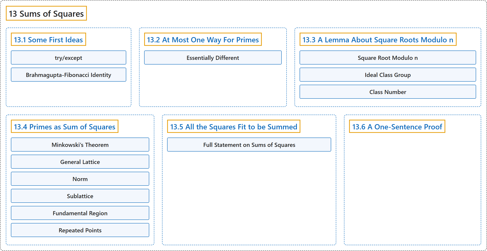

# 13 Sums of Squares

## Classification

## Glossary

| Term | Definition | 中文翻译 | Source |
|---|---|---|---|
| **13 Sums of Squares** 平方和 | "This chapter examines the question of **what numbers may be written as a sum of two perfect (integer) squares**." | 本章考察**哪些数可以写成两个（整数）完全平方数之和**的问题。 | [Crisman, 2024, chapter 13](https://math.gordon.edu/ntic/ntic/chapter-square-sums.html#summary-square-sums-2-1) |
| **[13.1 Some First Ideas](13-1-some-first-ideas.md)** 初步想法 | (No definition) | （无定义） | [Crisman, 2024, section 13.1](https://math.gordon.edu/ntic/ntic/section-first-squares.html) |
| **[13.2 At Most One Way For Primes](13-2-at-most-one-way-for-primes.md)** 素数至多一种表示 | (No definition) | （无定义） | [Crisman, 2024, section 13.2](https://math.gordon.edu/ntic/ntic/section-prime-squares-1.html) |
| **[13.3 A Lemma About Square Roots Modulo n](13-3-a-lemma-about-square-roots-modulo-n.md)** 关于模 n 平方根的一个引理 | (No definition) | （无定义） | [Crisman, 2024, section 13.3](https://math.gordon.edu/ntic/ntic/section-sqrt-mod-n-lemma.html) |
| **[13.4 Primes as Sum of Squares](13-4-primes-as-sum-of-squares.md)** 素数表为平方和 | (No definition) | （无定义） | [Crisman, 2024, section 13.4](https://math.gordon.edu/ntic/ntic/section-prime-squares-2.html) |
| **[13.5 All the Squares Fit to be Summed](13-5-all-the-squares-fit-to-be-summed.md)** 所有可表为平方和的数 | (No definition) | （无定义） | [Crisman, 2024, section 13.5](https://math.gordon.edu/ntic/ntic/section-all-squares.html) |
| **[13.6 A One-Sentence Proof](13-6-a-one-sentence-proof.md)** 一句话证明 | (No definition) | （无定义） | [Crisman, 2024, section 13.6](https://math.gordon.edu/ntic/ntic/section-one-sentence.html) |

## References

Crisman, K.-D. (2024). *Number theory: In context and interactive* (June 26, 2024 edition). Gordon College. Retrieved October 29, 2026, from <https://math.gordon.edu/ntic/ntic/>
