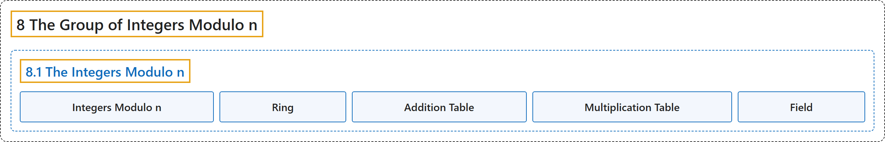

# 8.1 The Integers Modulo n

## Classification

## Glossary

| Term | Definition | 中文翻译 | Source |
|---|---|---|---|
| **8.1 The Integers Modulo n** 模 n 整数 | (No definition) | （无定义） | [Crisman, 2024, section 8.1](https://math.gordon.edu/ntic/ntic/section-integers-mod-n.html) |
| **Integers Modulo n** 模 n 整数 | "For a positive integer $n$, **the set of equivalence classes of integers modulo $n$** is called the **integers modulo $n$**. We denote it $\mathbb{Z}_n$." | 对正整数 $n$，**模 $n$ 的整数等价类组成的集合**称为**模 $n$ 整数**，记作 $\mathbb{Z}_n$。 | [Crisman, 2024, Definition 8.1.1](https://math.gordon.edu/ntic/ntic/section-integers-mod-n.html#definition-integers-mod-n) |
| **Ring** 环 | "Like all of our number systems in this class, **you can add and multiply elements** of $\mathbb{Z}_n$ (we call something like that a **ring**)." | 和本课程中所有的数系一样，$\mathbb{Z}_n$ 的元素**可以相加和相乘**（我们把这样的东西称为**环**）。 | [Crisman, 2024, subsection 8.1.1](https://math.gordon.edu/ntic/ntic/section-integers-mod-n.html#subsection-ints-mod-n-defn-5) |
| **Addition Table** 加法表 | "As a first step in visualizing, we can make an **addition table**." | 作为可视化的第一步，我们可以做一张**加法表**。 | [Crisman, 2024, subsection 8.1.1](https://math.gordon.edu/ntic/ntic/section-integers-mod-n.html#subsection-ints-mod-n-defn-6) |
| **Multiplication Table** 乘法表 | "It’s also possible to make a **multiplication table**." | 也可以做一张**乘法表**。 | [Crisman, 2024, subsection 8.1.1](https://math.gordon.edu/ntic/ntic/section-integers-mod-n.html#subsection-ints-mod-n-defn-10) |
| **Field** 域 | "So for prime moduli, **every non-zero element has a unique inverse** in $\mathbb{Z}_p$. (In algebraic nomenclature, this means $\mathbb{Z}_p$ is a **field**, yet another example of bizarre but fun math terminology.)" | 所以对素数模，$\mathbb{Z}_p$ 中**每个非零元素都有唯一的逆**。（用代数的术语说，这意味着 $\mathbb{Z}_p$ 是一个**域**，这又是一个古怪但有趣的数学术语。） | [Crisman, 2024, subsection 8.1.3](https://math.gordon.edu/ntic/ntic/section-integers-mod-n.html#subsection-ints-mod-n-inverse-5) |

## References

Crisman, K.-D. (2024). *Number theory: In context and interactive* (June 26, 2024 edition). Gordon College. Retrieved October 29, 2026, from <https://math.gordon.edu/ntic/ntic/>
