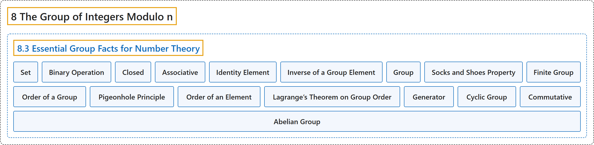

# 8.3 Essential Group Facts for Number Theory

## Classification

## Glossary

| Term | Definition | 中文翻译 | Source |
|---|---|---|---|
| **8.3 Essential Group Facts for Number Theory** 数论必需的群论事实 | (No definition) | （无定义） | [Crisman, 2024, section 8.3](https://math.gordon.edu/ntic/ntic/section-intro-groups.html) |
| **Set** 集合 | "**Sets** are just what you think. They are **collections of (mathematical) stuff**." | **集合**就是你想的那样，是 **（数学）对象的汇集**。 | [Crisman, 2024, subsubsection 8.3.1.1](https://math.gordon.edu/ntic/ntic/section-intro-groups.html#subsubsection-sets) |
| **Binary Operation** 二元运算 | "A **binary operation** is **a set with a multiplication table on it**. That’s it." | **二元运算**就是**带有一张乘法表的集合**。仅此而已。 | [Crisman, 2024, subsubsection 8.3.1.2](https://math.gordon.edu/ntic/ntic/section-intro-groups.html#subsubsection-binary-ops) |
| **Closed** 封闭的 | "A binary operation is called **closed** if **you don’t get anything outside the set with your operation**." | 若**运算的结果不会跑到集合之外**，就称这个二元运算是**封闭的**。 | [Crisman, 2024, subsubsection 8.3.1.3](https://math.gordon.edu/ntic/ntic/section-intro-groups.html#subsubsection-closed-ops) |
| **Associative** 结合的 | "An operation is **associative** if **it doesn’t matter how you put parentheses in**." | 若**括号怎么加都无所谓**，就称运算是**结合的**。 | [Crisman, 2024, subsubsection 8.3.1.4](https://math.gordon.edu/ntic/ntic/section-intro-groups.html#subsubsection-assoc-ops) |
| **Identity Element** 单位元 | "*Much* more important is whether your operation has an **identity element**. You have seen this many times before in addition and multiplication. $a+0=a=0+a\text{ and }a\cdot 1=a=1\cdot a$. When we turn this into abstract math, we say that an identity for a general operation $*$ on a set $S$ is **an element, conveniently called $e$, which has the very nice property that if you $*$ by it, you get the same thing back**." | *更*重要的是你的运算是否有**单位元**。你以前在加法和乘法中已经多次见过它。$a+0=a=0+a\text{ and }a\cdot 1=a=1\cdot a$。把它变成抽象数学时，我们说集合 $S$ 上一般运算 $*$ 的单位元是**一个元素，方便起见记作 $e$，它有一个很好的性质：用它去 $*$，得到的还是原来的东西**。 | [Crisman, 2024, subsubsection 8.3.1.5](https://math.gordon.edu/ntic/ntic/section-intro-groups.html#subsubsection-group-identity) |
| **Inverse of a Group Element** 群元素的逆 | "Generalizing this, if $a$ is an element of your set $S$ and there is another element $a'$ such that $a*a'=e=a'*a$, then we call $a'$ **an inverse of $a$**." | 推广一下，若 $a$ 是集合 $S$ 的元素，且有另一个元素 $a'$ 使 $a*a'=e=a'*a$，就称 $a'$ 是 **$a$ 的逆**。 | [Crisman, 2024, subsubsection 8.3.1.6](https://math.gordon.edu/ntic/ntic/section-intro-groups.html#subsubsection-group-inverse) |
| **Group** 群 | "If a set and binary operation on that set is **closed and associative with identity and inverses for *every* element**, we call that set a **group**." | 若一个集合及其上的二元运算**封闭、满足结合律、有单位元，并且*每个*元素都有逆**，就称这个集合为**群**。 | [Crisman, 2024, Definition 8.3.3](https://math.gordon.edu/ntic/ntic/section-intro-groups.html#definition-groups) |
| **Socks and Shoes Property** 袜子与鞋子性质 | "**The inverse of $ab$ is $b^{-1}a^{-1}$.**" | **$ab$ 的逆是 $b^{-1}a^{-1}$。** | [Crisman, 2024, Fact 8.3.7](https://math.gordon.edu/ntic/ntic/section-intro-groups.html#fact-socks-shoes) |
| **Finite Group** 有限群 | "A group **with finitely many elements** is called, unimaginatively, a **finite group**." | **元素个数有限**的群，被毫无想象力地称为**有限群**。 | [Crisman, 2024, subsubsection 8.3.3.3](https://math.gordon.edu/ntic/ntic/section-intro-groups.html#subsubsection-finite-groups-5) |
| **Order of a Group** 群的阶 | "**The number of elements of a finite group** is called the **order** of the group. For any old group $G$, we use $\vert G\vert$ as notation for its order." | **有限群的元素个数**称为这个群的**阶**。对任意一个群 $G$，我们用 $\vert G\vert$ 表示它的阶。 | [Crisman, 2024, Definition 8.3.8](https://math.gordon.edu/ntic/ntic/section-intro-groups.html#definition-order-grup) |
| **Pigeonhole Principle** 鸽巢原理 | "(This argument, that **if you fit $n+1$ objects into $n$ slots then there must be a repeat**, is called the **pigeonhole principle**, among other names.)" | （这个论证，即**把 $n+1$ 个物体放进 $n$ 个格子里必然有重复**，称为**鸽巢原理**，也有别的名字。） | [Crisman, 2024, subsubsection 8.3.3.5](https://math.gordon.edu/ntic/ntic/section-intro-groups.html#subsubsection-element-order-5) |
| **Order of an Element** 元素的阶 | "For a group element $x\in G$, **the least (positive) integer $k$ such that $x^k = e$** is called the **order** of the element $x$. We write it $\vert x\vert$, by analogy with the order of a group." | 对群元素 $x\in G$，**使 $x^k = e$ 的最小（正）整数 $k$** 称为元素 $x$ 的**阶**，记作 $\vert x\vert$，与群的阶类比。 | [Crisman, 2024, Definition 8.3.10](https://math.gordon.edu/ntic/ntic/section-intro-groups.html#definition-order-element) |
| **Lagrange’s Theorem on Group Order** 关于群的阶的拉格朗日定理 | "**The order of any element $x$ of $G$ divides the order of the group itself.** We can write this as $\vert x\vert\mid \vert G\vert$" | **$G$ 的任何元素 $x$ 的阶都整除群本身的阶**。可以写成 $\vert x\vert\mid \vert G\vert$ | [Crisman, 2024, Theorem 8.3.12](https://math.gordon.edu/ntic/ntic/section-intro-groups.html#theorem-lagrange-groups) |
| **Generator** 生成元 | "This element, **whose powers run through all $n$ elements of $G$**, is called a **generator** of the group." | 这个**其幂遍历 $G$ 的全部 $n$ 个元素**的元素，称为群的**生成元**。 | [Crisman, 2024, subsubsection 8.3.3.7](https://math.gordon.edu/ntic/ntic/section-intro-groups.html#subsubsection-cyclic-groups) |
| **Cyclic Group** 循环群 | "Any group **that has a generator** (again, an element whose powers hit *all* elements of the group) is called a **cyclic group**." | 任何**有生成元**的群（再说一遍，生成元是其幂能取遍群的*所有*元素的元素）称为**循环群**。 | [Crisman, 2024, subsubsection 8.3.3.7](https://math.gordon.edu/ntic/ntic/section-intro-groups.html#subsubsection-cyclic-groups) |
| **Commutative** 交换的 | "Namely, **it doesn’t matter what order you do the operation in**. (Such an operation is called **commutative**.)" | 也就是说，**运算的先后顺序无所谓**。（这样的运算称为**交换的**。） | [Crisman, 2024, subsubsection 8.3.3.8](https://math.gordon.edu/ntic/ntic/section-intro-groups.html#subsubsection-abelian-groups-4) |
| **Abelian Group** 阿贝尔群 | "Any group which has this property, that **$a*b=b*a$ for all $a,b\in G$**, is called an **Abelian group**." | 任何具有这个性质，即**对所有 $a,b\in G$ 都有 $a*b=b*a$** 的群，称为**阿贝尔群**。 | [Crisman, 2024, subsubsection 8.3.3.8](https://math.gordon.edu/ntic/ntic/section-intro-groups.html#subsubsection-abelian-groups) |

## References

Crisman, K.-D. (2024). *Number theory: In context and interactive* (June 26, 2024 edition). Gordon College. Retrieved October 29, 2026, from <https://math.gordon.edu/ntic/ntic/>
