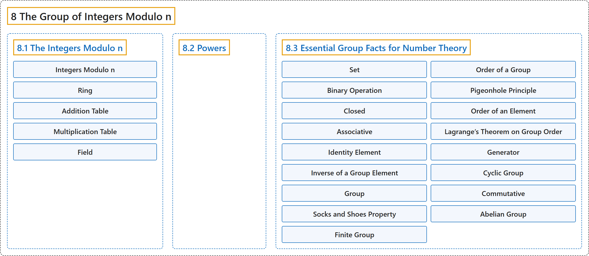

# 8 The Group of Integers Modulo n

## Classification

## Glossary

| Term | Definition | 中文翻译 | Source |
|---|---|---|---|
| **8 The Group of Integers Modulo n** 模 n 整数群 | (No definition) | （无定义） | [Crisman, 2024, chapter 8](https://math.gordon.edu/ntic/ntic/chapter-integers-mod-n.html) |
| **[8.1 The Integers Modulo n](8-1-the-integers-modulo-n.md)** 模 n 整数 | (No definition) | （无定义） | [Crisman, 2024, section 8.1](https://math.gordon.edu/ntic/ntic/section-integers-mod-n.html) |
| **[8.2 Powers](8-2-powers.md)** 幂 | (No definition) | （无定义） | [Crisman, 2024, section 8.2](https://math.gordon.edu/ntic/ntic/section-powers-mod-n.html) |
| **[8.3 Essential Group Facts for Number Theory](8-3-essential-group-facts-for-number-theory.md)** 数论必需的群论事实 | (No definition) | （无定义） | [Crisman, 2024, section 8.3](https://math.gordon.edu/ntic/ntic/section-intro-groups.html) |

## References

Crisman, K.-D. (2024). *Number theory: In context and interactive* (June 26, 2024 edition). Gordon College. Retrieved October 29, 2026, from <https://math.gordon.edu/ntic/ntic/>
