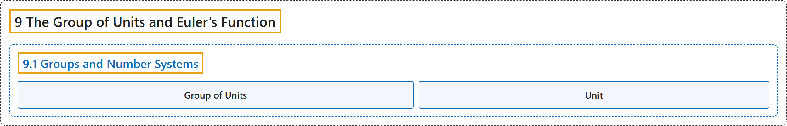

# 9.1 Groups and Number Systems

## Classification

## Glossary

| Term | Definition | 中文翻译 | Source |
|---|---|---|---|
| **9.1 Groups and Number Systems** 群与数系 | (No definition) | （无定义） | [Crisman, 2024, section 9.1](https://math.gordon.edu/ntic/ntic/section-groups-numbers.html) |
| **Group of Units** 单位群 | "We let $U_n$, the **group of units modulo $n$**, be **the set of equivalence classes $[a]$ modulo $n$ such that $\gcd(a,n)=1$**." | 令 $U_n$，即**模 $n$ 的单位群**，为**满足 $\gcd(a,n)=1$ 的模 $n$ 等价类 $[a]$ 组成的集合**。 | [Crisman, 2024, Definition 9.1.2](https://math.gordon.edu/ntic/ntic/section-groups-numbers.html#definition-group-units) |
| **Unit** 单位 | "The terminology **units** makes sense too. If you are in a number system with addition *and* multiplication, then a unit is **an element that has a multiplicative inverse**." | **单位**这个术语也说得通。如果你在一个既有加法*又*有乘法的数系里，那么单位就是**有乘法逆元的元素**。 | [Crisman, 2024, subsubsection 9.1.2.2](https://math.gordon.edu/ntic/ntic/section-groups-numbers.html#subsubsection-more-unit-group-facts-3) |

## References

Crisman, K.-D. (2024). *Number theory: In context and interactive* (June 26, 2024 edition). Gordon College. Retrieved October 29, 2026, from <https://math.gordon.edu/ntic/ntic/>
