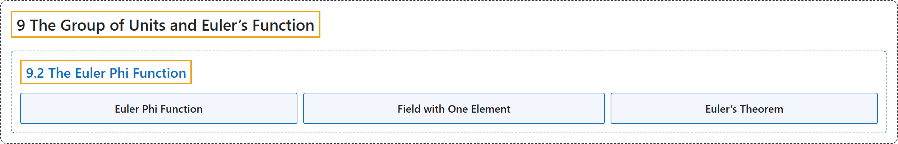

# 9.2 The Euler Phi Function

## Classification

## Glossary

| Term | Definition | 中文翻译 | Source |
|---|---|---|---|
| **9.2 The Euler Phi Function** 欧拉 φ 函数 | (No definition) | （无定义） | [Crisman, 2024, section 9.2](https://math.gordon.edu/ntic/ntic/section-euler-phi.html) |
| **Euler Phi Function** 欧拉 φ 函数 | "We give **the order of $U_n$** the name $\phi(n)$. That is, by definition, $\phi(n)=\vert U_n \vert$. This is the so-called **Euler $\phi$ function**." | 我们给 **$U_n$ 的阶**取名为 $\phi(n)$。也就是说，按定义，$\phi(n)=\vert U_n \vert$。这就是所谓的**欧拉 $\phi$ 函数**。 | [Crisman, 2024, Definition 9.2.1](https://math.gordon.edu/ntic/ntic/section-euler-phi.html#definition-euler-phi) |
| **Field with One Element** 单元素域 | "Since modulo one everything is one, we say $U_1=\{[1]\}$ and $\phi(1)=1$ since $\gcd(1,1)=1$, despite the fact that also everything is zero. If this bothers you, you are nearly at the algebraic notion of a field mentioned toward the end of Section 8.1, and may wish to read some discussions of the **field with one element**" | 由于模 1 时一切都是 1，我们说 $U_1=\{[1]\}$ 且 $\phi(1)=1$，因为 $\gcd(1,1)=1$，尽管一切也都是零。如果这让你困扰，那你已经接近 8.1 节末尾提到的域这一代数概念了，或许想读一些关于**单元素域**的讨论 | [Crisman, 2024, Remark 9.2.2](https://math.gordon.edu/ntic/ntic/section-euler-phi.html#remark-field-one-element) |
| **Euler’s Theorem** 欧拉定理 | "If $\gcd(a,n)=1$, then **$a^{\phi(n)}\equiv 1$ (mod $n$)**." | 若 $\gcd(a,n)=1$，则 **$a^{\phi(n)}\equiv 1$（mod $n$）**。 | [Crisman, 2024, Theorem 9.2.5](https://math.gordon.edu/ntic/ntic/section-euler-phi.html#theorem-eulers-theorem) |

## References

Crisman, K.-D. (2024). *Number theory: In context and interactive* (June 26, 2024 edition). Gordon College. Retrieved October 29, 2026, from <https://math.gordon.edu/ntic/ntic/>
