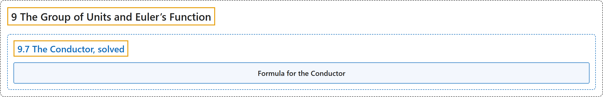

# 9.7 The Conductor, solved

## Classification

## Glossary

| Term | Definition | 中文翻译 | Source |
|---|---|---|---|
| **9.7 The Conductor, solved** 导子问题的解答 | (No definition) | （无定义） | [Crisman, 2024, section 9.7](https://math.gordon.edu/ntic/ntic/section-conductor-solved.html) |
| **Formula for the Conductor** 导子公式 | "Given $m,n$ positive coprime integers, **the conductor exists and is $(m-1)(n-1)$**. Exactly half the integers less than the conductor cannot be represented (and so half of them *can* be)." | 给定互素的正整数 $m,n$，**导子存在且等于 $(m-1)(n-1)$**。小于导子的整数中恰有一半不能表示（因而有一半*能*表示）。 | [Crisman, 2024, Fact 9.7.3](https://math.gordon.edu/ntic/ntic/section-conductor-solved.html#fact-conductor-solved) |

## References

Crisman, K.-D. (2024). *Number theory: In context and interactive* (June 26, 2024 edition). Gordon College. Retrieved October 29, 2026, from <https://math.gordon.edu/ntic/ntic/>
