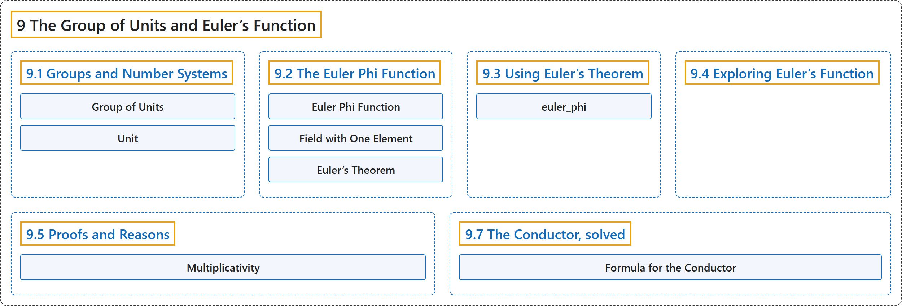

# 9 The Group of Units and Euler’s Function

## Classification

## Glossary

| Term | Definition | 中文翻译 | Source |
|---|---|---|---|
| **9 The Group of Units and Euler’s Function** 单位群与欧拉函数 | (No definition) | （无定义） | [Crisman, 2024, chapter 9](https://math.gordon.edu/ntic/ntic/chapter-units-euler-phi.html) |
| **[9.1 Groups and Number Systems](9-1-groups-and-number-systems.md)** 群与数系 | (No definition) | （无定义） | [Crisman, 2024, section 9.1](https://math.gordon.edu/ntic/ntic/section-groups-numbers.html) |
| **[9.2 The Euler Phi Function](9-2-the-euler-phi-function.md)** 欧拉 φ 函数 | (No definition) | （无定义） | [Crisman, 2024, section 9.2](https://math.gordon.edu/ntic/ntic/section-euler-phi.html) |
| **[9.3 Using Euler’s Theorem](9-3-using-eulers-theorem.md)** 使用欧拉定理 | (No definition) | （无定义） | [Crisman, 2024, section 9.3](https://math.gordon.edu/ntic/ntic/section-using-euler.html) |
| **[9.4 Exploring Euler’s Function](9-4-exploring-eulers-function.md)** 探索欧拉函数 | (No definition) | （无定义） | [Crisman, 2024, section 9.4](https://math.gordon.edu/ntic/ntic/section-explore-euler.html) |
| **[9.5 Proofs and Reasons](9-5-proofs-and-reasons.md)** 证明与理由 | (No definition) | （无定义） | [Crisman, 2024, section 9.5](https://math.gordon.edu/ntic/ntic/section-euler-proofs.html) |
| **[9.7 The Conductor, solved](9-7-the-conductor-solved.md)** 导子问题的解答 | (No definition) | （无定义） | [Crisman, 2024, section 9.7](https://math.gordon.edu/ntic/ntic/section-conductor-solved.html) |

## References

Crisman, K.-D. (2024). *Number theory: In context and interactive* (June 26, 2024 edition). Gordon College. Retrieved October 29, 2026, from <https://math.gordon.edu/ntic/ntic/>
