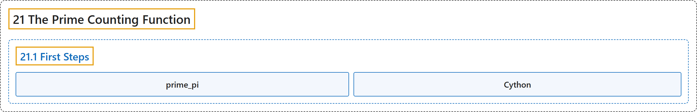

# 21.1 First Steps

## Classification

## Glossary

| Term | Definition | 中文翻译 | Source |
|---|---|---|---|
| **21.1 First Steps** 初步 | (No definition) | （无定义） | [Crisman, 2024, section 21.1](https://math.gordon.edu/ntic/ntic/section-first-prime-pi.html) |
| **prime_pi** prime_pi | "**The syntax for this function** is `prime_pi(n)`." | **这个函数的语法**是 `prime_pi(n)`。 | [Crisman, 2024, Sage note 21.1.2](https://math.gordon.edu/ntic/ntic/section-first-prime-pi.html#sagenote-syntax-prime-pi) |
| **Cython** Cython | "It’s possible to significantly speed up many such computations by converting to Cython, **a way to take Python/Sage and turn it into the much-faster compiled language C**." | 把这类计算转换成 Cython 可以大大加快它们；Cython 是**把 Python/Sage 转成快得多的编译型语言 C 的一种方式**。 | [Crisman, 2024, Sage note 21.1.3](https://math.gordon.edu/ntic/ntic/section-first-prime-pi.html#sagenote-cython) |

## References

Crisman, K.-D. (2024). *Number theory: In context and interactive* (June 26, 2024 edition). Gordon College. Retrieved October 29, 2026, from <https://math.gordon.edu/ntic/ntic/>
