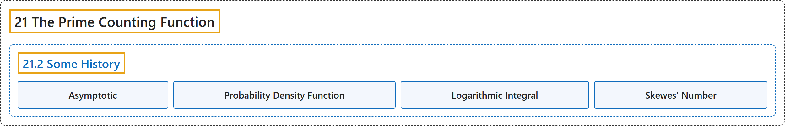

# 21.2 Some History

## Classification

## Glossary

| Term | Definition | 中文翻译 | Source |
|---|---|---|---|
| **21.2 Some History** 一些历史 | (No definition) | （无定义） | [Crisman, 2024, section 21.2](https://math.gordon.edu/ntic/ntic/section-hist-prime-pi.html) |
| **Asymptotic** 渐近 | "We say that two functions $f(x)$ and $g(x)$ are **asymptotic** to each other when **$\lim_{x\to\infty}\frac{f(x)}{g(x)}=1$** Essentially, in the long run these functions get as close to each other as you like, on a percentage basis." | 当 **$\lim_{x\to\infty}\frac{f(x)}{g(x)}=1$** 时，就说两个函数 $f(x)$ 与 $g(x)$ 彼此**渐近**。本质上，从长远看，这两个函数按百分比要多接近就有多接近。 | [Crisman, 2024, Definition 21.2.1](https://math.gordon.edu/ntic/ntic/section-hist-prime-pi.html#definition-asymptotic) |
| **Probability Density Function** 概率密度函数 | "First, reinterpret the proportion as suggesting that $1/\log(x)$ integers near $x$ are prime. If we do that, then we can think of $1/\log(x)$ as a **probability density function**. What do we do with such functions? We ***integrate* the function to get the cumulative amount**!" | 首先，把这个比例重新解读为：$x$ 附近有 $1/\log(x)$ 比例的整数是素数。这样就可以把 $1/\log(x)$ 看成一个**概率密度函数**。对这样的函数我们做什么？我们**对它*积分*，得到累积的量**！ | [Crisman, 2024, subsection 21.2.1](https://math.gordon.edu/ntic/ntic/section-hist-prime-pi.html#subsection-gauss-pi-estimate-3) |
| **Logarithmic Integral** 对数积分 | "We give the name **logarithmic integral** to **the (convergent) integral $Li(x)=\int_2^x \frac{dt}{\log(t)}$**." | 我们把 **（收敛的）积分 $Li(x)=\int_2^x \frac{dt}{\log(t)}$** 称为**对数积分**。 | [Crisman, 2024, Definition 21.2.2](https://math.gordon.edu/ntic/ntic/section-hist-prime-pi.html#definition-log-int) |
| **Skewes’ Number** 斯奎斯数 | "Both of these bounds are known as **Skewes’ number**" | 这两个界都称为**斯奎斯数** | [Crisman, 2024, Historical remark 21.2.7](https://math.gordon.edu/ntic/ntic/section-hist-prime-pi.html#remark-littlewood-skewes) |

## References

Crisman, K.-D. (2024). *Number theory: In context and interactive* (June 26, 2024 edition). Gordon College. Retrieved October 29, 2026, from <https://math.gordon.edu/ntic/ntic/>
