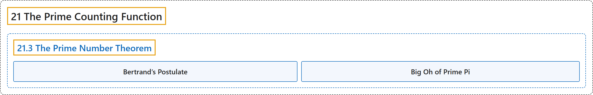

# 21.3 The Prime Number Theorem

## Classification

## Glossary

| Term | Definition | 中文翻译 | Source |
|---|---|---|---|
| **21.3 The Prime Number Theorem** 素数定理 | "If $\pi(x)$ is the number of primes $p\leq x$, then **$\lim_{x\to\infty}\frac{\pi(x)}{Li(x)}=1$**." | 若 $\pi(x)$ 是满足 $p\leq x$ 的素数的个数，则 **$\lim_{x\to\infty}\frac{\pi(x)}{Li(x)}=1$**。 | [Crisman, 2024, Theorem 21.3.1](https://math.gordon.edu/ntic/ntic/section-pnt-intro.html#theorem-pnt) |
| **Bertrand’s Postulate** 伯特兰公设 | "For any integer $n\geq 2$, **there is a prime between $n$ and $2n$**." | 对任意整数 $n\geq 2$，**$n$ 与 $2n$ 之间存在素数**。 | [Crisman, 2024, Theorem 21.3.4](https://math.gordon.edu/ntic/ntic/section-pnt-intro.html#theorem-bertrand-postulate) |
| **Big Oh of Prime Pi** 素数计数函数的大 O 估计 | "It is true both that: **$\pi(x)$ is $O\left(\frac{x}{\log(x)}\right)$** *and* **$\frac{x}{\log(x)}$ is $O(\pi(x))$**." | 以下两点都成立：**$\pi(x)$ 是 $O\left(\frac{x}{\log(x)}\right)$**，*而且* **$\frac{x}{\log(x)}$ 是 $O(\pi(x))$**。 | [Crisman, 2024, Theorem 21.3.6](https://math.gordon.edu/ntic/ntic/section-pnt-intro.html#theorem-big-oh-prime-pi) |

## References

Crisman, K.-D. (2024). *Number theory: In context and interactive* (June 26, 2024 edition). Gordon College. Retrieved October 29, 2026, from <https://math.gordon.edu/ntic/ntic/>
