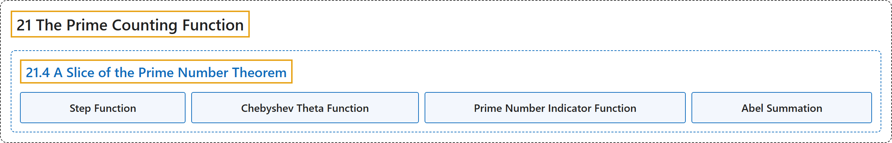

# 21.4 A Slice of the Prime Number Theorem

## Classification

## Glossary

| Term | Definition | 中文翻译 | Source |
|---|---|---|---|
| **21.4 A Slice of the Prime Number Theorem** 素数定理的一个片段 | (No definition) | （无定义） | [Crisman, 2024, section 21.4](https://math.gordon.edu/ntic/ntic/section-pnt-slice.html) |
| **Step Function** 阶梯函数 | "Think of the prime counting function $\pi$ as a so-called **step function**, where **every time you hit a new prime you add 1**." | 把素数计数函数 $\pi$ 看成所谓的**阶梯函数**：**每遇到一个新的素数就加 1**。 | [Crisman, 2024, subsection 21.4.1](https://math.gordon.edu/ntic/ntic/section-pnt-slice.html#subsection-pnt-funcs-2) |
| **Chebyshev Theta Function** 切比雪夫 theta 函数 | "We call the function given by this formula **Chebyshev’s theta function**: **$\Theta(x)=\sum_{p\leq x}\log(p)$**." | 我们把由下式给出的函数称为**切比雪夫 theta 函数**：**$\Theta(x)=\sum_{p\leq x}\log(p)$**。 | [Crisman, 2024, Definition 21.4.3](https://math.gordon.edu/ntic/ntic/section-pnt-slice.html#definition-chebyshev-theta) |
| **Prime Number Indicator Function** 素数指示函数 | "We let $a(n)$ be the **prime number indicator function** defined by" | 令 $a(n)$ 为如下定义的**素数指示函数** | [Crisman, 2024, Definition 21.4.7](https://math.gordon.edu/ntic/ntic/section-pnt-slice.html#definition-prime-indicator) |
| **Abel Summation** 阿贝尔求和 | "This difference of sums can be combined into a single sum, with just two left over terms" | 这个和之差可以合并成一个和，只剩下两个多出来的项 | [Crisman, 2024, subsection 21.4.2](https://math.gordon.edu/ntic/ntic/section-pnt-slice.html#subsection-theta-formula-8) |

## References

Crisman, K.-D. (2024). *Number theory: In context and interactive* (June 26, 2024 edition). Gordon College. Retrieved October 29, 2026, from <https://math.gordon.edu/ntic/ntic/>
