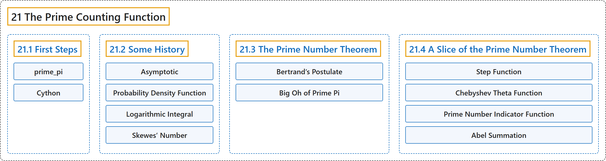

# 21 The Prime Counting Function

## Classification

## Glossary

| Term | Definition | 中文翻译 | Source |
|---|---|---|---|
| **21 The Prime Counting Function** 素数计数函数 | "The **prime counting function** $\pi(x)$ is defined, for all positive numbers $x$, as **the number of primes less than or equal to $x$**, denoted $\pi(x)=\#\{p\leq x\mid p\text{ is prime }\}$." | **素数计数函数** $\pi(x)$ 对所有正数 $x$ 定义为**小于或等于 $x$ 的素数的个数**，记作 $\pi(x)=\#\{p\leq x\mid p\text{ is prime }\}$。 | [Crisman, 2024, Definition 21.0.1](https://math.gordon.edu/ntic/ntic/chapter-prime-pi.html#definition-prime-pi) |
| **[21.1 First Steps](21-1-first-steps.md)** 初步 | (No definition) | （无定义） | [Crisman, 2024, section 21.1](https://math.gordon.edu/ntic/ntic/section-first-prime-pi.html) |
| **[21.2 Some History](21-2-some-history.md)** 一些历史 | (No definition) | （无定义） | [Crisman, 2024, section 21.2](https://math.gordon.edu/ntic/ntic/section-hist-prime-pi.html) |
| **[21.3 The Prime Number Theorem](21-3-the-prime-number-theorem.md)** 素数定理 | (No definition) | （无定义） | [Crisman, 2024, section 21.3](https://math.gordon.edu/ntic/ntic/section-pnt-intro.html) |
| **[21.4 A Slice of the Prime Number Theorem](21-4-a-slice-of-the-prime-number-theorem.md)** 素数定理的一个片段 | (No definition) | （无定义） | [Crisman, 2024, section 21.4](https://math.gordon.edu/ntic/ntic/section-pnt-slice.html) |

## References

Crisman, K.-D. (2024). *Number theory: In context and interactive* (June 26, 2024 edition). Gordon College. Retrieved October 29, 2026, from <https://math.gordon.edu/ntic/ntic/>
