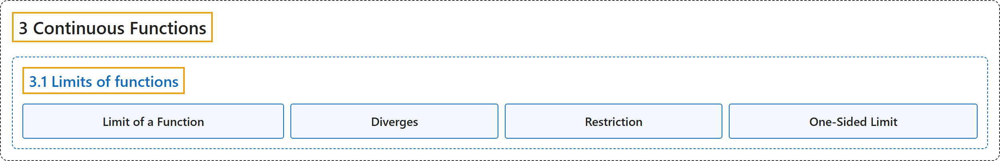

# 3.1 Limits of functions

## Classification

## Glossary

| Term | Definition | 中文翻译 | Source |
|---|---|---|---|
| **3.1 Limits of functions** 函数的极限 | (No definition) | （无定义） | [Lebl, 2026, section 3.1](https://www.jirka.org/ra/html/sec_limoffunc.html) |
| **Limit of a Function** 函数的极限 | "Let $f \colon S \to \mathbb{R}$ be a function and $c$ a cluster point of $S \subset \mathbb{R}$. Suppose there exists an $L \in \mathbb{R}$ and **for every $\epsilon > 0$, there exists a $\delta > 0$ such that whenever $x \in S \setminus \{ c \}$ and $\lvert x - c \rvert < \delta$, we have $\bigl\lvert f(x) - L \bigr\rvert < \epsilon$**. We then say $f(x)$ **converges to $L$ as $x$ goes to $c$**." | 设 $f \colon S \to \mathbb{R}$ 是函数，$c$ 是 $S \subset \mathbb{R}$ 的聚点。假设存在 $L \in \mathbb{R}$，使得**对每个 $\epsilon > 0$，存在 $\delta > 0$，只要 $x \in S \setminus \{ c \}$ 且 $\lvert x - c \rvert < \delta$，就有 $\bigl\lvert f(x) - L \bigr\rvert < \epsilon$**。这时就说**当 $x$ 趋于 $c$ 时 $f(x)$ 收敛到 $L$**。 | [Lebl, 2026, Definition 3.1.3](https://www.jirka.org/ra/html/sec_limoffunc.html#sec_limoffunc-4-3) |
| **Diverges** 发散 | "If **no such $L$ exists**, then we say that the limit does not exist or that $f$ **diverges** at $c$." | 若**这样的 $L$ 不存在**，就说极限不存在，或说 $f$ 在 $c$ 处**发散**。 | [Lebl, 2026, Definition 3.1.3](https://www.jirka.org/ra/html/sec_limoffunc.html#sec_limoffunc-4-3) |
| **Restriction** 限制 | "Let $f \colon S \to \mathbb{R}$ be a function and $A \subset S$. Define the function $f|_A \colon A \to \mathbb{R}$ by **$f|_A (x) := f(x) \qquad \text{for } x \in A.$** We call $f|_A$ the **restriction** of $f$ to $A$." | 设 $f \colon S \to \mathbb{R}$ 是函数，$A \subset S$。定义函数 $f|_A \colon A \to \mathbb{R}$ 为 **$f|_A (x) := f(x) \qquad \text{for } x \in A.$** 称 $f|_A$ 为 $f$ 在 $A$ 上的**限制**。 | [Lebl, 2026, Definition 3.1.14](https://www.jirka.org/ra/html/sec_limoffunc.html#sec_limoffunc-6-3) |
| **One-Sided Limit** 单侧极限 | "Let $f \colon S \to \mathbb{R}$ be a function and let $c \in \mathbb{R}$. If $c$ is a cluster point of $S \cap (c,\infty)$ and the limit of the restriction of $f$ to $S \cap (c,\infty)$ as $x \to c$ exists, define **$\lim_{x \to c^+} f(x) := \lim_{x\to c} f|_{S \cap (c,\infty)}(x)$**." | 设 $f \colon S \to \mathbb{R}$ 是函数，$c \in \mathbb{R}$。若 $c$ 是 $S \cap (c,\infty)$ 的聚点，且 $f$ 在 $S \cap (c,\infty)$ 上的限制当 $x \to c$ 时的极限存在，就定义 **$\lim_{x \to c^+} f(x) := \lim_{x\to c} f|_{S \cap (c,\infty)}(x)$**。 | [Lebl, 2026, Definition 3.1.16](https://www.jirka.org/ra/html/sec_limoffunc.html#defn_onesidedlimits) |

## References

Lebl, J. (2026). *Basic analysis I & II: Introduction to real analysis* (May 22, 2026 edition). Retrieved October 29, 2026, from <https://www.jirka.org/ra/html/>
