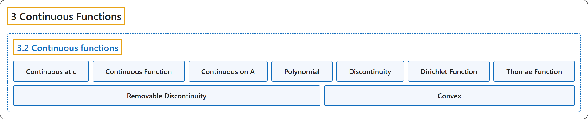

# 3.2 Continuous functions

## Classification

## Glossary

| Term | Definition | 中文翻译 | Source |
|---|---|---|---|
| **3.2 Continuous functions** 连续函数 | (No definition) | （无定义） | [Lebl, 2026, section 3.2](https://www.jirka.org/ra/html/sec_cont.html) |
| **Continuous at c** 在 c 处连续 | "Suppose $S \subset \mathbb{R}$ and $c \in S$. We say $f \colon S \to \mathbb{R}$ is **continuous at $c$** if **for every $\epsilon > 0$ there is a $\delta > 0$ such that whenever $x \in S$ and $\lvert x-c \rvert < \delta$, we have $\bigl\lvert f(x)-f(c) \bigr\rvert < \epsilon$**." | 设 $S \subset \mathbb{R}$，$c \in S$。若**对每个 $\epsilon > 0$，存在 $\delta > 0$，只要 $x \in S$ 且 $\lvert x-c \rvert < \delta$，就有 $\bigl\lvert f(x)-f(c) \bigr\rvert < \epsilon$**，则称 $f \colon S \to \mathbb{R}$ **在 $c$ 处连续**。 | [Lebl, 2026, Definition 3.2.1](https://www.jirka.org/ra/html/sec_cont.html#sec_cont-3-2) |
| **Continuous Function** 连续函数 | "When $f \colon S \to \mathbb{R}$ is **continuous at all $c \in S$**, then we simply say $f$ is a **continuous function**." | 当 $f \colon S \to \mathbb{R}$ **在所有 $c \in S$ 处连续**时，就简单地说 $f$ 是**连续函数**。 | [Lebl, 2026, Definition 3.2.1](https://www.jirka.org/ra/html/sec_cont.html#sec_cont-3-2) |
| **Continuous on A** 在 A 上连续 | "If $f$ is **continuous for all $c \in A$**, we say $f$ is **continuous on $A \subset S$**." | 若 $f$ **对所有 $c \in A$ 都连续**，就说 $f$ **在 $A \subset S$ 上连续**。 | [Lebl, 2026, section 3.2](https://www.jirka.org/ra/html/sec_cont.html#sec_cont-3-6) |
| **Polynomial** 多项式 | "Let $f \colon \mathbb{R} \to \mathbb{R}$ be a **polynomial**. That is, **$f(x) = a_d x^d + a_{d-1} x^{d-1} + \cdots + a_1 x + a_0$, for some constants $a_0, a_1, \ldots, a_d$**." | 设 $f \colon \mathbb{R} \to \mathbb{R}$ 是**多项式**，即**对某些常数 $a_0, a_1, \ldots, a_d$ 有 $f(x) = a_d x^d + a_{d-1} x^{d-1} + \cdots + a_1 x + a_0$**。 | [Lebl, 2026, Proposition 3.2.4](https://www.jirka.org/ra/html/sec_cont.html#sec_cont-3-13) |
| **Discontinuity** 间断 | "When **$f$ is not continuous at $c$**, we say $f$ is **discontinuous** at $c$, or that it has a **discontinuity** at $c$." | 当 **$f$ 在 $c$ 处不连续**时，就说 $f$ 在 $c$ 处**间断**，或说它在 $c$ 处有一个**间断点**。 | [Lebl, 2026, section 3.2](https://www.jirka.org/ra/html/sec_cont.html#sec_cont-5-2) |
| **Dirichlet Function** 狄利克雷函数 | "For an extreme example, consider the **Dirichlet function**. **$f(x) := \begin{cases} 1 & \text{if } x \text{ is rational,} \\ 0 & \text{if } x \text{ is irrational.} \end{cases}$**" | 作为一个极端的例子，考虑**狄利克雷函数**：**$f(x) := \begin{cases} 1 & \text{if } x \text{ is rational,} \\ 0 & \text{if } x \text{ is irrational.} \end{cases}$** | [Lebl, 2026, Example 3.2.11](https://www.jirka.org/ra/html/sec_cont.html#sec_cont-5-6) |
| **Thomae Function** 托马函数 | "Can there exist **a function continuous at all irrational numbers, but discontinuous at all rational numbers**? There are rational numbers arbitrarily close to any irrational number. Perhaps strangely, the answer is yes, such a function exists. The following example is called the **Thomae function** or the **popcorn function**." | 能否存在**在所有无理数处连续、在所有有理数处间断的函数**？任何无理数附近都有任意接近的有理数。也许奇怪，答案是肯定的，这样的函数存在。下面的例子称为**托马函数**或**爆米花函数**。 | [Lebl, 2026, section 3.2](https://www.jirka.org/ra/html/sec_cont.html#sec_cont-5-7) |
| **Removable Discontinuity** 可去间断点 | "The point $x=0$ is called a **removable discontinuity**. That is because **if we would change the definition of $g$, by insisting that $g(0)$ be $0$, we would obtain a continuous function**." | 点 $x=0$ 称为**可去间断点**。这是因为**如果改变 $g$ 的定义，令 $g(0)$ 为 $0$，就会得到一个连续函数**。 | [Lebl, 2026, Example 3.2.13](https://www.jirka.org/ra/html/sec_cont.html#example_removablediscont) |
| **Convex** 凸 | "A function $f \colon I \to \mathbb{R}$ is **convex** if whenever $a \leq x \leq b$ for $a,x,b$ in $I$, we have **$f(x) \leq f(a) \frac{b-x}{b-a} + f(b) \frac{x-a}{b-a}$**." | 函数 $f \colon I \to \mathbb{R}$ 称为**凸的**，如果对 $I$ 中满足 $a \leq x \leq b$ 的 $a,x,b$，总有 **$f(x) \leq f(a) \frac{b-x}{b-a} + f(b) \frac{x-a}{b-a}$**。 | [Lebl, 2026, Exercise 3.2.19](https://www.jirka.org/ra/html/sec_cont.html#sec_cont-6-19) |

## References

Lebl, J. (2026). *Basic analysis I & II: Introduction to real analysis* (May 22, 2026 edition). Retrieved October 29, 2026, from <https://www.jirka.org/ra/html/>
