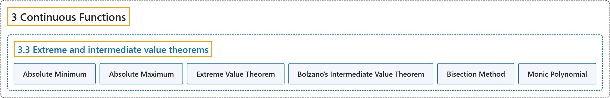

# 3.3 Extreme and intermediate value theorems

## Classification

## Glossary

| Term | Definition | 中文翻译 | Source |
|---|---|---|---|
| **3.3 Extreme and intermediate value theorems** 最值定理与介值定理 | (No definition) | （无定义） | [Lebl, 2026, section 3.3](https://www.jirka.org/ra/html/sec_minmaxint.html) |
| **Absolute Minimum** 绝对最小值 | "Recall from calculus that $f \colon S \to \mathbb{R}$ **achieves an absolute minimum** at $c \in S$ if **$f(x) \geq f(c) \qquad \text{for all } x \in S.$**" | 回忆微积分：若 **$f(x) \geq f(c) \qquad \text{for all } x \in S.$**，则 $f \colon S \to \mathbb{R}$ 在 $c \in S$ 处**取得绝对最小值**。 | [Lebl, 2026, section 3.3](https://www.jirka.org/ra/html/sec_minmaxint.html#sec_minmaxint-3-6) |
| **Absolute Maximum** 绝对最大值 | "On the other hand, $f$ **achieves an absolute maximum** at $c \in S$ if **$f(x) \leq f(c) \qquad \text{for all } x \in S.$**" | 另一方面，若 **$f(x) \leq f(c) \qquad \text{for all } x \in S.$**，则 $f$ 在 $c \in S$ 处**取得绝对最大值**。 | [Lebl, 2026, section 3.3](https://www.jirka.org/ra/html/sec_minmaxint.html#sec_minmaxint-3-6) |
| **Extreme Value Theorem** 最值定理 | "A **continuous function $f \colon [a,b] \to \mathbb{R}$** achieves **both an absolute minimum and an absolute maximum on $[a,b]$**." | **连续函数 $f \colon [a,b] \to \mathbb{R}$** 在 $[a,b]$ 上**既取得绝对最小值，也取得绝对最大值**。 | [Lebl, 2026, Theorem 3.3.2](https://www.jirka.org/ra/html/sec_minmaxint.html#sec_minmaxint-3-11) |
| **Bolzano’s Intermediate Value Theorem** 波尔查诺介值定理 | "Let $f \colon [a,b] \to \mathbb{R}$ be a continuous function. Suppose $y \in \mathbb{R}$ is such that **$f(a) < y < f(b)$ or $f(a) > y > f(b)$**. Then **there exists a $c \in (a,b)$ such that $f(c) = y$**." | 设 $f \colon [a,b] \to \mathbb{R}$ 是连续函数，$y \in \mathbb{R}$ 满足 **$f(a) < y < f(b)$ 或 $f(a) > y > f(b)$**，则**存在 $c \in (a,b)$ 使得 $f(c) = y$**。 | [Lebl, 2026, Theorem 3.3.8](https://www.jirka.org/ra/html/sec_minmaxint.html#IVT_thm) |
| **Bisection Method** 二分法 | "The proof of the lemma tells us **how to find the root $c$**. The proof is not only useful for us pure mathematicians, it is a useful idea in applied mathematics, where it is called the **bisection method**." | 引理的证明告诉我们**如何找到根 $c$**。这个证明不仅对纯粹数学家有用，在应用数学里也是一个有用的思想，在那里称为**二分法**。 | [Lebl, 2026, section 3.3](https://www.jirka.org/ra/html/sec_minmaxint.html#sec_minmaxint-4-9) |
| **Monic Polynomial** 首一多项式 | "We divide by $a_d$ to obtain a **monic polynomial**. The word monic means that **the coefficient of $x^d$ is 1**." | 用 $a_d$ 去除，得到一个**首一多项式**。“首一”是指 **$x^d$ 的系数为 1**。 | [Lebl, 2026, Proposition 3.3.10, proof](https://www.jirka.org/ra/html/sec_minmaxint.html#sec_minmaxint-4-15) |

## References

Lebl, J. (2026). *Basic analysis I & II: Introduction to real analysis* (May 22, 2026 edition). Retrieved October 29, 2026, from <https://www.jirka.org/ra/html/>
