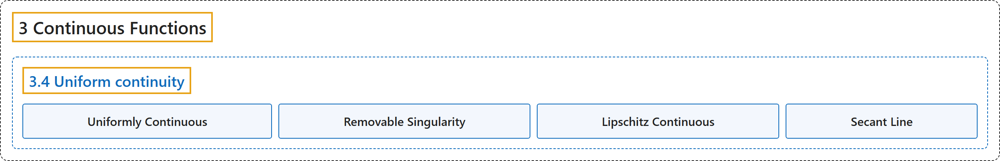

# 3.4 Uniform continuity

## Classification

## Glossary

| Term | Definition | 中文翻译 | Source |
|---|---|---|---|
| **3.4 Uniform continuity** 一致连续 | (No definition) | （无定义） | [Lebl, 2026, section 3.4](https://www.jirka.org/ra/html/sec_unifcont.html) |
| **Uniformly Continuous** 一致连续 | "Let $S \subset \mathbb{R}$, and let $f \colon S \to \mathbb{R}$ be a function. Suppose **for every $\epsilon > 0$ there exists a $\delta > 0$ such that whenever $x, c \in S$ and $\lvert x-c \rvert < \delta$, then $\bigl\lvert f(x)-f(c) \bigr\rvert < \epsilon$**. Then we say $f$ is **uniformly continuous**." | 设 $S \subset \mathbb{R}$，$f \colon S \to \mathbb{R}$ 是函数。若**对每个 $\epsilon > 0$，存在 $\delta > 0$，只要 $x, c \in S$ 且 $\lvert x-c \rvert < \delta$，就有 $\bigl\lvert f(x)-f(c) \bigr\rvert < \epsilon$**，则称 $f$ **一致连续**。 | [Lebl, 2026, Definition 3.4.1](https://www.jirka.org/ra/html/sec_unifcont.html#sec_unifcont-3-3) |
| **Removable Singularity** 可去奇点 | "If $f \colon (-1,0) \cup (0,1) \to \mathbb{R}$ is uniformly continuous, then $\lim_{x\to 0} f(x)$ exists and the function has a **removable singularity**. That is, **we can extend the function to a continuous function on $(-1,1)$**." | 若 $f \colon (-1,0) \cup (0,1) \to \mathbb{R}$ 一致连续，则 $\lim_{x\to 0} f(x)$ 存在，该函数有一个**可去奇点**。也就是说，**可以把这个函数延拓成 $(-1,1)$ 上的连续函数**。 | [Lebl, 2026, section 3.4](https://www.jirka.org/ra/html/sec_unifcont.html#sec_unifcont-4-8) |
| **Lipschitz Continuous** 利普希茨连续 | "A function $f \colon S \to \mathbb{R}$ is **Lipschitz continuous** if **there exists a $K \in \mathbb{R}$ such that $\bigl\lvert f(x)-f(y) \bigr\rvert \leq K \lvert x-y \rvert \qquad \text{for all } x \text{ and } y \text{ in } S.$**" | 若**存在 $K \in \mathbb{R}$ 使得 $\bigl\lvert f(x)-f(y) \bigr\rvert \leq K \lvert x-y \rvert \qquad \text{for all } x \text{ and } y \text{ in } S.$**，则称函数 $f \colon S \to \mathbb{R}$ **利普希茨连续**。 | [Lebl, 2026, Definition 3.4.7](https://www.jirka.org/ra/html/sec_unifcont.html#sec_unifcont-5-2) |
| **Secant Line** 割线 | "The quantity $\frac{f(x)-f(y)}{x-y}$ is the slope of **the line between the points $\bigl(x,f(x)\bigr)$ and $\bigl(y,f(y)\bigr)$**, that is, a **secant line**." | 量 $\frac{f(x)-f(y)}{x-y}$ 是**点 $\bigl(x,f(x)\bigr)$ 与 $\bigl(y,f(y)\bigr)$ 之间直线**的斜率，这条直线就是**割线**。 | [Lebl, 2026, section 3.4](https://www.jirka.org/ra/html/sec_unifcont.html#sec_unifcont-5-6) |

## References

Lebl, J. (2026). *Basic analysis I & II: Introduction to real analysis* (May 22, 2026 edition). Retrieved October 29, 2026, from <https://www.jirka.org/ra/html/>
