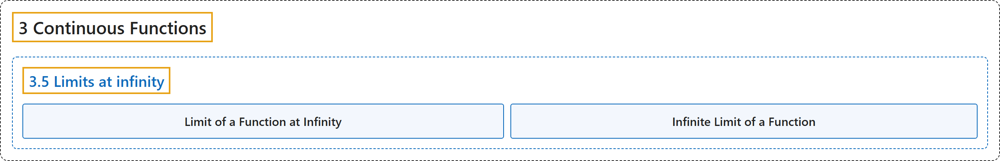

# 3.5 Limits at infinity

## Classification

## Glossary

| Term | Definition | 中文翻译 | Source |
|---|---|---|---|
| **3.5 Limits at infinity** 无穷远处的极限 | (No definition) | （无定义） | [Lebl, 2026, section 3.5](https://www.jirka.org/ra/html/sec_limitatinf.html) |
| **Limit of a Function at Infinity** 函数在无穷远处的极限 | "Let $f \colon S \to \mathbb{R}$ be a function, where $\infty$ is a cluster point of $S$. If there exists an $L \in \mathbb{R}$ with the property that **for every $\epsilon > 0$, there is an $M \in \mathbb{R}$ such that $\bigl\lvert f(x) - L \bigr\rvert < \epsilon$ whenever $x \in S$ and $x \geq M$**, then we say $f(x)$ **converges to $L$ as $x$ goes to $\infty$**." | 设 $f \colon S \to \mathbb{R}$ 是函数，$\infty$ 是 $S$ 的聚点。若存在 $L \in \mathbb{R}$，使得**对每个 $\epsilon > 0$，存在 $M \in \mathbb{R}$，只要 $x \in S$ 且 $x \geq M$，就有 $\bigl\lvert f(x) - L \bigr\rvert < \epsilon$**，则说**当 $x$ 趋于 $\infty$ 时 $f(x)$ 收敛到 $L$**。 | [Lebl, 2026, Definition 3.5.1](https://www.jirka.org/ra/html/sec_limitatinf.html#sec_limitatinf-3-3) |
| **Infinite Limit of a Function** 函数的无穷极限 | "Let $f \colon S \to \mathbb{R}$ be a function and suppose $S$ has $\infty$ as a cluster point. We say $f(x)$ **diverges to infinity as $x$ goes to $\infty$** if **for every $N \in \mathbb{R}$ there exists an $M \in \mathbb{R}$ such that $f(x) > N$ whenever $x \in S$ and $x \geq M$**." | 设 $f \colon S \to \mathbb{R}$ 是函数，$S$ 以 $\infty$ 为聚点。若**对每个 $N \in \mathbb{R}$，存在 $M \in \mathbb{R}$，只要 $x \in S$ 且 $x \geq M$，就有 $f(x) > N$**，则说**当 $x$ 趋于 $\infty$ 时 $f(x)$ 发散到无穷**。 | [Lebl, 2026, Definition 3.5.6](https://www.jirka.org/ra/html/sec_limitatinf.html#sec_limitatinf-4-3) |

## References

Lebl, J. (2026). *Basic analysis I & II: Introduction to real analysis* (May 22, 2026 edition). Retrieved October 29, 2026, from <https://www.jirka.org/ra/html/>
