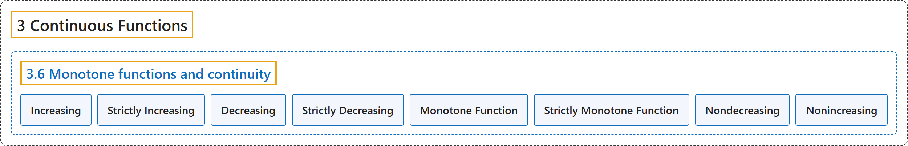

# 3.6 Monotone functions and continuity

## Classification

## Glossary

| Term | Definition | 中文翻译 | Source |
|---|---|---|---|
| **3.6 Monotone functions and continuity** 单调函数与连续性 | (No definition) | （无定义） | [Lebl, 2026, section 3.6](https://www.jirka.org/ra/html/sec_monotonefunc.html) |
| **Increasing** 递增 | "Let $S \subset \mathbb{R}$. We say $f \colon S \to \mathbb{R}$ is **increasing** (resp. strictly increasing) if **$x,y \in S$ with $x < y$ implies $f(x) \leq f(y)$** (resp. $f(x) < f(y)$)." | 设 $S \subset \mathbb{R}$。若 **$x,y \in S$ 且 $x < y$ 蕴含 $f(x) \leq f(y)$**（相应地 $f(x) < f(y)$），则称 $f \colon S \to \mathbb{R}$ **递增**（相应地严格递增）。 | [Lebl, 2026, Definition 3.6.1](https://www.jirka.org/ra/html/sec_monotonefunc.html#sec_monotonefunc-2-2) |
| **Strictly Increasing** 严格递增 | "Let $S \subset \mathbb{R}$. We say $f \colon S \to \mathbb{R}$ is increasing (resp. **strictly increasing**) if $x,y \in S$ with $x < y$ implies $f(x) \leq f(y)$ (resp. **$f(x) < f(y)$**)." | 设 $S \subset \mathbb{R}$。若 $x,y \in S$ 且 $x < y$ 蕴含 $f(x) \leq f(y)$（相应地 **$f(x) < f(y)$**），则称 $f \colon S \to \mathbb{R}$ 递增（相应地**严格递增**）。 | [Lebl, 2026, Definition 3.6.1](https://www.jirka.org/ra/html/sec_monotonefunc.html#sec_monotonefunc-2-2) |
| **Decreasing** 递减 | "We define **decreasing** and strictly decreasing in the same way **by switching the inequalities for $f$**." | 把关于 $f$ 的**不等式反过来**，以同样方式定义**递减**和严格递减。 | [Lebl, 2026, Definition 3.6.1](https://www.jirka.org/ra/html/sec_monotonefunc.html#sec_monotonefunc-2-2) |
| **Strictly Decreasing** 严格递减 | "We define decreasing and **strictly decreasing** in the same way **by switching the inequalities for $f$**." | 把关于 $f$ 的**不等式反过来**，以同样方式定义递减和**严格递减**。 | [Lebl, 2026, Definition 3.6.1](https://www.jirka.org/ra/html/sec_monotonefunc.html#sec_monotonefunc-2-2) |
| **Monotone Function** 单调函数 | "If a function is **either increasing or decreasing**, we say it is **monotone**." | 若函数**递增或递减**，就说它是**单调的**。 | [Lebl, 2026, Definition 3.6.1](https://www.jirka.org/ra/html/sec_monotonefunc.html#sec_monotonefunc-2-2) |
| **Strictly Monotone Function** 严格单调函数 | "If it is **strictly increasing or strictly decreasing**, we say it is **strictly monotone**." | 若它**严格递增或严格递减**，就说它是**严格单调的**。 | [Lebl, 2026, Definition 3.6.1](https://www.jirka.org/ra/html/sec_monotonefunc.html#sec_monotonefunc-2-2) |
| **Nondecreasing** 不减 | "Sometimes **nondecreasing** (resp. nonincreasing) is used for **increasing** (resp. decreasing) function **to emphasize it is not strictly increasing** (resp. strictly decreasing)." | 有时用**不减**（相应地不增）来称呼**递增**（相应地递减）函数，**以强调它不是严格递增的**（相应地严格递减的）。 | [Lebl, 2026, section 3.6](https://www.jirka.org/ra/html/sec_monotonefunc.html#sec_monotonefunc-2-3) |
| **Nonincreasing** 不增 | "Sometimes nondecreasing (resp. **nonincreasing**) is used for increasing (resp. **decreasing**) function to emphasize it is not strictly increasing (resp. **strictly decreasing**)." | 有时用不减（相应地**不增**）来称呼递增（相应地**递减**）函数，以强调它不是严格递增的（相应地**严格递减的**）。 | [Lebl, 2026, section 3.6](https://www.jirka.org/ra/html/sec_monotonefunc.html#sec_monotonefunc-2-3) |

## References

Lebl, J. (2026). *Basic analysis I & II: Introduction to real analysis* (May 22, 2026 edition). Retrieved October 29, 2026, from <https://www.jirka.org/ra/html/>
