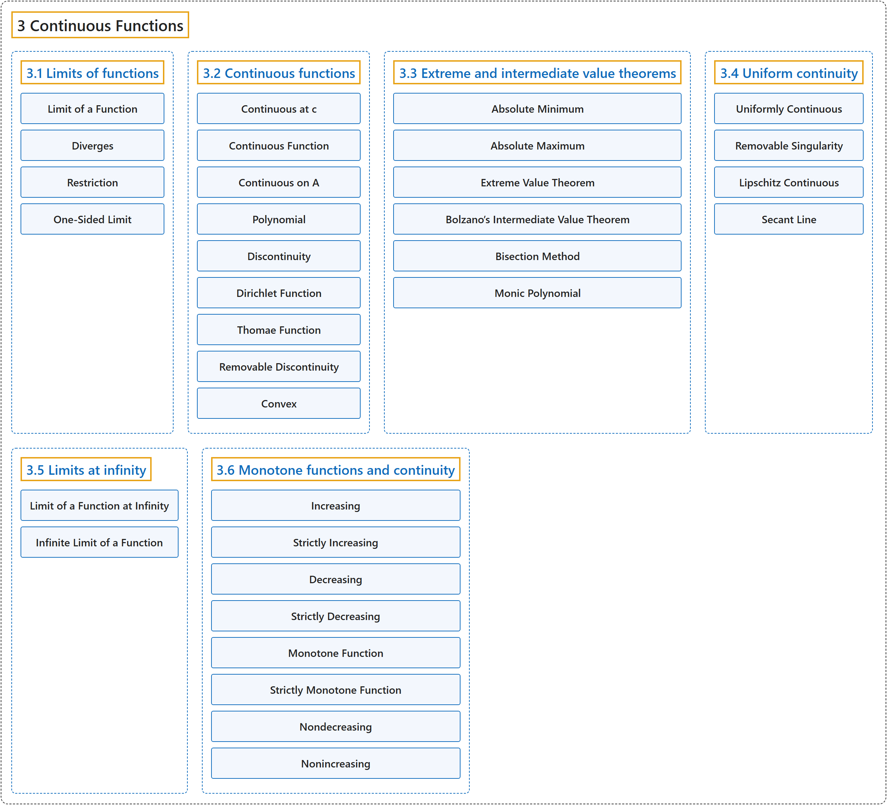

# 3 Continuous Functions

## Classification

## Glossary

| Term | Definition | 中文翻译 | Source |
|---|---|---|---|
| **3 Continuous Functions** 连续函数 | (No definition) | （无定义） | [Lebl, 2026, chapter 3](https://www.jirka.org/ra/html/lim_chapter.html) |
| **[3.1 Limits of functions](3-1-limits-of-functions.md)** 函数的极限 | (No definition) | （无定义） | [Lebl, 2026, section 3.1](https://www.jirka.org/ra/html/sec_limoffunc.html) |
| **[3.2 Continuous functions](3-2-continuous-functions.md)** 连续函数 | (No definition) | （无定义） | [Lebl, 2026, section 3.2](https://www.jirka.org/ra/html/sec_cont.html) |
| **[3.3 Extreme and intermediate value theorems](3-3-extreme-and-intermediate-value-theorems.md)** 最值定理与介值定理 | (No definition) | （无定义） | [Lebl, 2026, section 3.3](https://www.jirka.org/ra/html/sec_minmaxint.html) |
| **[3.4 Uniform continuity](3-4-uniform-continuity.md)** 一致连续 | (No definition) | （无定义） | [Lebl, 2026, section 3.4](https://www.jirka.org/ra/html/sec_unifcont.html) |
| **[3.5 Limits at infinity](3-5-limits-at-infinity.md)** 无穷远处的极限 | (No definition) | （无定义） | [Lebl, 2026, section 3.5](https://www.jirka.org/ra/html/sec_limitatinf.html) |
| **[3.6 Monotone functions and continuity](3-6-monotone-functions-and-continuity.md)** 单调函数与连续性 | (No definition) | （无定义） | [Lebl, 2026, section 3.6](https://www.jirka.org/ra/html/sec_monotonefunc.html) |

## References

Lebl, J. (2026). *Basic analysis I & II: Introduction to real analysis* (May 22, 2026 edition). Retrieved October 29, 2026, from <https://www.jirka.org/ra/html/>
