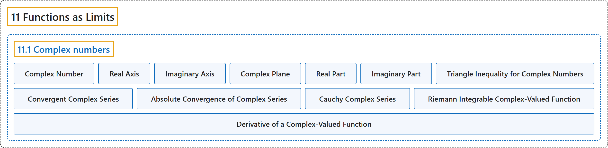

# 11.1 Complex numbers

## Classification

## Glossary

| Term | Definition | 中文翻译 | Source |
|---|---|---|---|
| **11.1 Complex numbers** 复数 | (No definition) | （无定义） | [Lebl, 2026, section 11.1](https://www.jirka.org/ra/html/sec_complexnums.html) |
| **Complex Number** 复数 | "A **complex number** is just **a pair $(x,y) \in \mathbb{R}^2$ on which we define multiplication**. We call the set the complex numbers and denote it by $\mathbb{C}$." | **复数**就是**在其上定义了乘法的数对 $(x,y) \in \mathbb{R}^2$**。这个集合称为复数集，记作 $\mathbb{C}$。 | [Lebl, 2026, section 11.1](https://www.jirka.org/ra/html/sec_complexnums.html#sec_complexnums-3-3) |
| **Real Axis** 实轴 | "We identify $x \in \mathbb{R}$ with $(x,0) \in \mathbb{C}$. The **$x$-axis** is then called the **real axis** and the $y$-axis is called the imaginary axis." | 把 $x \in \mathbb{R}$ 等同于 $(x,0) \in \mathbb{C}$。于是 **$x$ 轴**称为**实轴**，$y$ 轴称为虚轴。 | [Lebl, 2026, section 11.1](https://www.jirka.org/ra/html/sec_complexnums.html#sec_complexnums-3-3) |
| **Imaginary Axis** 虚轴 | "The $x$-axis is then called the real axis and the **$y$-axis** is called the **imaginary axis**." | 于是 $x$ 轴称为实轴，**$y$ 轴**称为**虚轴**。 | [Lebl, 2026, section 11.1](https://www.jirka.org/ra/html/sec_complexnums.html#sec_complexnums-3-3) |
| **Complex Plane** 复平面 | "As **$\mathbb{C}$ is just the plane**, we also call the set $\mathbb{C}$ the **complex plane**." | 由于 **$\mathbb{C}$ 就是平面**，也把集合 $\mathbb{C}$ 称为**复平面**。 | [Lebl, 2026, section 11.1](https://www.jirka.org/ra/html/sec_complexnums.html#sec_complexnums-3-3) |
| **Real Part** 实部 | "Suppose $z= x+iy$. We call **$x$** the **real part** of $z$, and we call $y$ the imaginary part of $z$. We write $\operatorname{Re}\, z := x , \qquad \operatorname{Im}\, z := y .$" | 设 $z= x+iy$。称 **$x$** 为 $z$ 的**实部**，称 $y$ 为 $z$ 的虚部，记作 $\operatorname{Re}\, z := x , \qquad \operatorname{Im}\, z := y .$ | [Lebl, 2026, Definition 11.1.1](https://www.jirka.org/ra/html/sec_complexnums.html#sec_complexnums-3-9) |
| **Imaginary Part** 虚部 | "We call $x$ the real part of $z$, and we call **$y$** the **imaginary part** of $z$." | 称 $x$ 为 $z$ 的实部，称 **$y$** 为 $z$ 的**虚部**。 | [Lebl, 2026, Definition 11.1.1](https://www.jirka.org/ra/html/sec_complexnums.html#sec_complexnums-3-9) |
| **Triangle Inequality for Complex Numbers** 复数的三角不等式 | "As $\lvert z \rvert$ is the euclidean norm on $\mathbb{R}^2$, we have the **triangle inequality** of both flavors: **$\lvert z+w \rvert \leq \lvert z \rvert+\lvert w \rvert \qquad \text{and} \qquad \big\lvert \lvert z \rvert-\lvert w \rvert \big\rvert \leq \lvert z-w \rvert$**." | 由于 $\lvert z \rvert$ 是 $\mathbb{R}^2$ 上的欧几里得范数，两种**三角不等式**都成立：**$\lvert z+w \rvert \leq \lvert z \rvert+\lvert w \rvert \qquad \text{and} \qquad \big\lvert \lvert z \rvert-\lvert w \rvert \big\rvert \leq \lvert z-w \rvert$**。 | [Lebl, 2026, section 11.1](https://www.jirka.org/ra/html/sec_complexnums.html#sec_complexnums-3-11) |
| **Convergent Complex Series** 收敛的复级数 | "Let $\{ z_n \}_{n=1}^\infty$ be a sequence of complex numbers. The series $\sum_{n=1}^\infty z_n$ **converges** if **the sequence of partial sums converges**, that is, if $\lim_{k\to\infty} \sum_{n=1}^k z_n \qquad \text{exists.}$" | 设 $\{ z_n \}_{n=1}^\infty$ 是复数序列。若**部分和序列收敛**，即 $\lim_{k\to\infty} \sum_{n=1}^k z_n \qquad \text{exists.}$，则级数 $\sum_{n=1}^\infty z_n$ **收敛**。 | [Lebl, 2026, section 11.1](https://www.jirka.org/ra/html/sec_complexnums.html#sec_complexnums-4-6) |
| **Absolute Convergence of Complex Series** 复级数的绝对收敛 | "A series **converges absolutely** if **$\sum_{n=1}^\infty \lvert z_n \rvert$ converges**." | 若 **$\sum_{n=1}^\infty \lvert z_n \rvert$ 收敛**，则称级数**绝对收敛**。 | [Lebl, 2026, section 11.1](https://www.jirka.org/ra/html/sec_complexnums.html#sec_complexnums-4-6) |
| **Cauchy Complex Series** 柯西复级数 | "We say a series is **Cauchy** if **the sequence of partial sums is Cauchy**." | 若**部分和序列是柯西序列**，则称级数是**柯西的**。 | [Lebl, 2026, section 11.1](https://www.jirka.org/ra/html/sec_complexnums.html#sec_complexnums-4-7) |
| **Riemann Integrable Complex-Valued Function** 黎曼可积的复值函数 | "Suppose we wish to integrate $f \colon [a,b] \to \mathbb{C}$. We write $f = u+i\,v$ for real-valued $u$ and $v$. We say that $f$ is **Riemann integrable** if **$u$ and $v$ are Riemann integrable**, and in this case we define $\int_a^b f := \int_a^b u + i \int_a^b v$." | 要对 $f \colon [a,b] \to \mathbb{C}$ 积分，写 $f = u+i\,v$，其中 $u$、$v$ 是实值函数。若 **$u$ 与 $v$ 黎曼可积**，则称 $f$ **黎曼可积**，并定义 $\int_a^b f := \int_a^b u + i \int_a^b v$。 | [Lebl, 2026, section 11.1](https://www.jirka.org/ra/html/sec_complexnums.html#sec_complexnums-5-3) |
| **Derivative of a Complex-Valued Function** 复值函数的导数 | "Similarly when we differentiate, write $f \colon [a,b] \to \mathbb{C}$ as $f = u+i\,v$. Thinking of $\mathbb{C}$ as $\mathbb{R}^2$, we say that $f$ is differentiable if **$u$ and $v$ are differentiable**. In other words, we write the **derivative** as **$f'(t) := u'(t) + i \, v'(t)$**." | 类似地，求导时把 $f \colon [a,b] \to \mathbb{C}$ 写成 $f = u+i\,v$。把 $\mathbb{C}$ 看作 $\mathbb{R}^2$，若 **$u$ 与 $v$ 可微**，则称 $f$ 可微。换言之，把**导数**写成 **$f'(t) := u'(t) + i \, v'(t)$**。 | [Lebl, 2026, section 11.1](https://www.jirka.org/ra/html/sec_complexnums.html#sec_complexnums-5-4) |

## References

Lebl, J. (2026). *Basic analysis I & II: Introduction to real analysis* (May 22, 2026 edition). Retrieved October 29, 2026, from <https://www.jirka.org/ra/html/>
