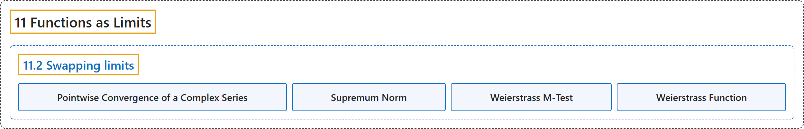

# 11.2 Swapping limits

## Classification

## Glossary

| Term | Definition | 中文翻译 | Source |
|---|---|---|---|
| **11.2 Swapping limits** 交换极限 | (No definition) | （无定义） | [Lebl, 2026, section 11.2](https://www.jirka.org/ra/html/sec_swaplim.html) |
| **Pointwise Convergence of a Complex Series** 复函数项级数的逐点收敛 | "For $Y=\mathbb{C}$, a series of functions **converges pointwise** to $f$ if **for every $x \in X$, we have $f(x) = \lim_{n\to \infty} \sum_{k=1}^n f_k(x) = \sum_{k=1}^\infty f_k(x)$**." | 对 $Y=\mathbb{C}$，若**对每个 $x \in X$ 有 $f(x) = \lim_{n\to \infty} \sum_{k=1}^n f_k(x) = \sum_{k=1}^\infty f_k(x)$**，则称函数项级数**逐点收敛**到 $f$。 | [Lebl, 2026, section 11.2](https://www.jirka.org/ra/html/sec_swaplim.html#sec_swaplim-3-3) |
| **Supremum Norm** 上确界范数 | "For $f \colon X \to \mathbb{C}$, we write **$\lVert f \rVert_X := \sup_{x \in X} \bigl\lvert f(x) \bigr\rvert$**. We call $\lVert \cdot \rVert_X$ the **supremum norm** or uniform norm, and the subscript denotes the set over which the supremum is taken." | 对 $f \colon X \to \mathbb{C}$，记 **$\lVert f \rVert_X := \sup_{x \in X} \bigl\lvert f(x) \bigr\rvert$**。称 $\lVert \cdot \rVert_X$ 为**上确界范数**或一致范数，下标表示取上确界的集合。 | [Lebl, 2026, section 11.2](https://www.jirka.org/ra/html/sec_swaplim.html#sec_swaplim-3-12) |
| **Weierstrass M-Test** 魏尔斯特拉斯 M 判别法 | "Let $X$ be a set. Suppose $f_n \colon X \to \mathbb{C}$ are functions and $M_n > 0$ numbers such that **$\bigl\lvert f_n(x) \bigr\rvert\leq M_n \quad \text{for all } x \in X, \qquad \text{and} \qquad \sum_{n=1}^\infty M_n \quad \text{converges}.$** Then **$\sum_{n=1}^\infty f_n(x) \quad \text{converges uniformly}.$**" | 设 $X$ 是集合，$f_n \colon X \to \mathbb{C}$ 是函数，$M_n > 0$ 是数，满足 **$\bigl\lvert f_n(x) \bigr\rvert\leq M_n \quad \text{for all } x \in X, \qquad \text{and} \qquad \sum_{n=1}^\infty M_n \quad \text{converges}.$** 则 **$\sum_{n=1}^\infty f_n(x) \quad \text{converges uniformly}.$** | [Lebl, 2026, Theorem 11.2.4](https://www.jirka.org/ra/html/sec_swaplim.html#thm_weiermtest) |
| **Weierstrass Function** 魏尔斯特拉斯函数 | "There exist **continuous nowhere differentiable functions**. Such functions are often called **Weierstrass functions**, although this particular one, essentially due to Takagi, is a different example than what Weierstrass gave." | 存在**处处连续而处处不可微的函数**。这样的函数常被称为**魏尔斯特拉斯函数**，不过这里这个例子本质上出自高木，与魏尔斯特拉斯给出的例子不同。 | [Lebl, 2026, Example 11.2.15](https://www.jirka.org/ra/html/sec_swaplim.html#sec_swaplim-5-6) |

## References

Lebl, J. (2026). *Basic analysis I & II: Introduction to real analysis* (May 22, 2026 edition). Retrieved October 29, 2026, from <https://www.jirka.org/ra/html/>
