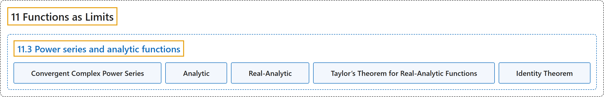

# 11.3 Power series and analytic functions

## Classification

## Glossary

| Term | Definition | 中文翻译 | Source |
|---|---|---|---|
| **11.3 Power series and analytic functions** 幂级数与解析函数 | (No definition) | （无定义） | [Lebl, 2026, section 11.3](https://www.jirka.org/ra/html/sec_analfuncs.html) |
| **Convergent Complex Power Series** 收敛的复幂级数 | "A (complex) power series is a series of the form $\sum_{n=0}^\infty c_n {(z-a)}^n$ for $c_n, z, a \in \mathbb{C}$. We say the series **converges** if **the series converges for some $z \neq a$**." | （复）幂级数是形如 $\sum_{n=0}^\infty c_n {(z-a)}^n$ 的级数，其中 $c_n, z, a \in \mathbb{C}$。若**级数对某个 $z \neq a$ 收敛**，则称该级数**收敛**。 | [Lebl, 2026, section 11.3](https://www.jirka.org/ra/html/sec_analfuncs.html#sec_analfuncs-3-2) |
| **Analytic** 解析 | "Let $U \subset \mathbb{C}$ be an open set and $f \colon U \to \mathbb{C}$ a function. Suppose that for every $a \in U$ there exists a $\rho > 0$ and **a power series that converges to the function $f(z) = \sum_{n=0}^\infty c_n {(z-a)}^n$ for all $z \in B(a,\rho)$**. Then we say $f$ is an **analytic** function." | 设 $U \subset \mathbb{C}$ 是开集，$f \colon U \to \mathbb{C}$ 是函数。若对每个 $a \in U$，存在 $\rho > 0$ 以及**一个幂级数，对所有 $z \in B(a,\rho)$ 收敛到函数 $f(z) = \sum_{n=0}^\infty c_n {(z-a)}^n$**，则称 $f$ 是**解析**函数。 | [Lebl, 2026, section 11.3](https://www.jirka.org/ra/html/sec_analfuncs.html#sec_analfuncs-3-3) |
| **Real-Analytic** 实解析 | "Similarly, given an interval $(a,b) \subset \mathbb{R}$, we say that $f \colon (a,b) \to \mathbb{C}$ is analytic or perhaps **real-analytic** if **for each point $c \in (a,b)$ there is a power series around $c$ that converges in some $(c-\rho,c+\rho)$ for some $\rho > 0$**." | 类似地，给定区间 $(a,b) \subset \mathbb{R}$，若**对每个点 $c \in (a,b)$，都有一个以 $c$ 为中心、在某个 $(c-\rho,c+\rho)$（$\rho > 0$）内收敛的幂级数**，则称 $f \colon (a,b) \to \mathbb{C}$ 是解析的，或**实解析的**。 | [Lebl, 2026, section 11.3](https://www.jirka.org/ra/html/sec_analfuncs.html#sec_analfuncs-3-3) |
| **Taylor’s Theorem for Real-Analytic Functions** 实解析函数的泰勒定理 | "Let $f(x) := \sum_{k=0}^\infty a_k x^k$ be a power series converging in $(-\rho,\rho)$ for some $\rho > 0$. Given any $a \in (-\rho,\rho)$, and $x$ such that $\lvert x-a \rvert < \rho-\lvert a \rvert$, we have **$f(x) = \sum_{k=0}^\infty \frac{f^{(k)}(a)}{k!} {(x-a)}^{k}$**." | 设 $f(x) := \sum_{k=0}^\infty a_k x^k$ 是在某个 $(-\rho,\rho)$（$\rho > 0$）内收敛的幂级数。对任意 $a \in (-\rho,\rho)$ 及满足 $\lvert x-a \rvert < \rho-\lvert a \rvert$ 的 $x$，有 **$f(x) = \sum_{k=0}^\infty \frac{f^{(k)}(a)}{k!} {(x-a)}^{k}$**。 | [Lebl, 2026, Theorem 11.3.6](https://www.jirka.org/ra/html/sec_analfuncs.html#thm_tayloranal) |
| **Identity Theorem** 恒等定理 | "Let $U \subset \mathbb{C}$ be open and connected. If $f \colon U \to \mathbb{C}$ and $g \colon U \to \mathbb{C}$ are analytic functions that are **equal on a set $E \subset U$, and $E$ has a cluster point in $U$**, then **$f(z) = g(z)$ for all $z \in U$**." | 设 $U \subset \mathbb{C}$ 是连通开集。若解析函数 $f \colon U \to \mathbb{C}$ 与 $g \colon U \to \mathbb{C}$ **在集合 $E \subset U$ 上相等，且 $E$ 在 $U$ 中有聚点**，则**对所有 $z \in U$ 有 $f(z) = g(z)$**。 | [Lebl, 2026, Theorem 11.3.9](https://www.jirka.org/ra/html/sec_analfuncs.html#thm_identityanalytic) |

## References

Lebl, J. (2026). *Basic analysis I & II: Introduction to real analysis* (May 22, 2026 edition). Retrieved October 29, 2026, from <https://www.jirka.org/ra/html/>
