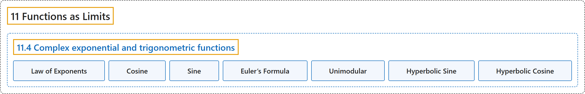

# 11.4 Complex exponential and trigonometric functions

## Classification

## Glossary

| Term | Definition | 中文翻译 | Source |
|---|---|---|---|
| **11.4 Complex exponential and trigonometric functions** 复指数函数与三角函数 | (No definition) | （无定义） | [Lebl, 2026, section 11.4](https://www.jirka.org/ra/html/sec_complexexp.html) |
| **Law of Exponents** 指数律 | "Let $z,w \in \mathbb{C}$ be complex numbers. Then **$e^{z+w} = e^z e^w$**." | 设 $z,w \in \mathbb{C}$ 是复数，则 **$e^{z+w} = e^z e^w$**。 | [Lebl, 2026, Proposition 11.4.1](https://www.jirka.org/ra/html/sec_complexexp.html#sec_complexexp-3-7) |
| **Cosine** 余弦 | "In fact, we define sine and **cosine** for all complex $z$: **$\cos(z) := \frac{e^{iz} + e^{-iz}}{2}$** and $\sin(z) := \frac{e^{iz} - e^{-iz}}{2i}$." | 实际上，我们对所有复数 $z$ 定义正弦与**余弦**：**$\cos(z) := \frac{e^{iz} + e^{-iz}}{2}$**，$\sin(z) := \frac{e^{iz} - e^{-iz}}{2i}$。 | [Lebl, 2026, section 11.4](https://www.jirka.org/ra/html/sec_complexexp.html#sec_complexexp-4-2) |
| **Sine** 正弦 | "In fact, we define **sine** and cosine for all complex $z$: $\cos(z) := \frac{e^{iz} + e^{-iz}}{2}$ and **$\sin(z) := \frac{e^{iz} - e^{-iz}}{2i}$**." | 实际上，我们对所有复数 $z$ 定义**正弦**与余弦：$\cos(z) := \frac{e^{iz} + e^{-iz}}{2}$，**$\sin(z) := \frac{e^{iz} - e^{-iz}}{2i}$**。 | [Lebl, 2026, section 11.4](https://www.jirka.org/ra/html/sec_complexexp.html#sec_complexexp-4-2) |
| **Euler’s Formula** 欧拉公式 | "For all $z \in \mathbb{C}$, **$e^{iz} = \cos(z) + i\sin(z)$** (**Euler's formula**)." | 对所有 $z \in \mathbb{C}$，**$e^{iz} = \cos(z) + i\sin(z)$**（**欧拉公式**）。 | [Lebl, 2026, Proposition 11.4.2](https://www.jirka.org/ra/html/sec_complexexp.html#sec_complexexp-4-4) |
| **Unimodular** 单模 | "In particular, $e^{ix}$ is **unimodular** for real $x$; **the values lie on the unit circle**." | 特别地，对实数 $x$，$e^{ix}$ 是**单模的**；**它的值位于单位圆上**。 | [Lebl, 2026, section 11.4](https://www.jirka.org/ra/html/sec_complexexp.html#sec_complexexp-4-6) |
| **Hyperbolic Sine** 双曲正弦 | "Define the **hyperbolic sine** and hyperbolic cosine by **$\sinh(z) := \frac{e^z-e^{-z}}{2}$**, $\cosh(z) := \frac{e^z+e^{-z}}{2}$." | 定义**双曲正弦**和双曲余弦为 **$\sinh(z) := \frac{e^z-e^{-z}}{2}$**，$\cosh(z) := \frac{e^z+e^{-z}}{2}$。 | [Lebl, 2026, Exercises 11.4](https://www.jirka.org/ra/html/sec_complexexp.html#sec_complexexp-6-9) |
| **Hyperbolic Cosine** 双曲余弦 | "Define the hyperbolic sine and **hyperbolic cosine** by $\sinh(z) := \frac{e^z-e^{-z}}{2}$, **$\cosh(z) := \frac{e^z+e^{-z}}{2}$**." | 定义双曲正弦和**双曲余弦**为 $\sinh(z) := \frac{e^z-e^{-z}}{2}$，**$\cosh(z) := \frac{e^z+e^{-z}}{2}$**。 | [Lebl, 2026, Exercises 11.4](https://www.jirka.org/ra/html/sec_complexexp.html#sec_complexexp-6-9) |

## References

Lebl, J. (2026). *Basic analysis I & II: Introduction to real analysis* (May 22, 2026 edition). Retrieved October 29, 2026, from <https://www.jirka.org/ra/html/>
