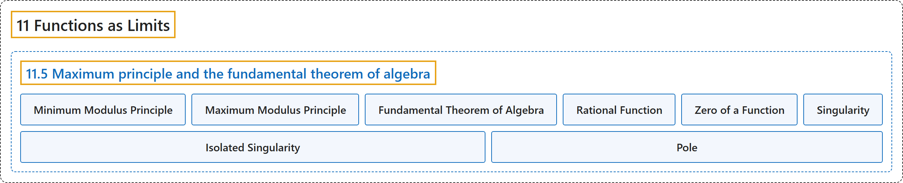

# 11.5 Maximum principle and the fundamental theorem of algebra

## Classification

## Glossary

| Term | Definition | 中文翻译 | Source |
|---|---|---|---|
| **11.5 Maximum principle and the fundamental theorem of algebra** 最大模原理与代数基本定理 | (No definition) | （无定义） | [Lebl, 2026, section 11.5](https://www.jirka.org/ra/html/sec_fundalgeb.html) |
| **Minimum Modulus Principle** 最小模原理 | "What the lemma says is that **the only minima the modulus of analytic functions has are precisely at the zeros**. It is sometimes called the **minimum modulus principle**." | 这个引理说的是：**解析函数的模的极小值只出现在零点处**。它有时称为**最小模原理**。 | [Lebl, 2026, section 11.5](https://www.jirka.org/ra/html/sec_fundalgeb.html#sec_fundalgeb-6) |
| **Maximum Modulus Principle** 最大模原理 | "If $U \subset \mathbb{C}$ is open and connected, $f \colon U \to \mathbb{C}$ is analytic, and **$\bigl\lvert f(z) \bigr\rvert$ attains a relative maximum at $z_0 \in U$, then $f$ is constant**." | 若 $U \subset \mathbb{C}$ 是连通开集，$f \colon U \to \mathbb{C}$ 解析，且 **$\bigl\lvert f(z) \bigr\rvert$ 在 $z_0 \in U$ 处取得相对极大值，则 $f$ 是常数**。 | [Lebl, 2026, Theorem 11.5.2](https://www.jirka.org/ra/html/sec_fundalgeb.html#thm_maxprinciple) |
| **Fundamental Theorem of Algebra** 代数基本定理 | "Let $p(z)$ be **a nonconstant complex polynomial**, then **there exists a $z_0 \in \mathbb{C}$ such that $p(z_0) = 0$**." | 设 $p(z)$ 是**非常数的复多项式**，则**存在 $z_0 \in \mathbb{C}$ 使得 $p(z_0) = 0$**。 | [Lebl, 2026, Theorem 11.5.5](https://www.jirka.org/ra/html/sec_fundalgeb.html#sec_fundalgeb-15) |
| **Rational Function** 有理函数 | "A **rational function** is **a function $f(z) := \frac{p(z)}{q(z)}$ where $p$ and $q$ are polynomials and $q$ is not identically zero**." | **有理函数**是**形如 $f(z) := \frac{p(z)}{q(z)}$ 的函数，其中 $p$、$q$ 是多项式且 $q$ 不恒为零**。 | [Lebl, 2026, Exercises 11.5](https://www.jirka.org/ra/html/sec_fundalgeb.html#sec_fundalgeb-18-4) |
| **Zero of a Function** 函数的零点 | "A point **$z_0 \in \mathbb{C}$ where $f(z_0) = 0$** (and therefore $p(z_0) = 0$) is called a **zero**." | 使 **$f(z_0) = 0$ 的点 $z_0 \in \mathbb{C}$**（因而 $p(z_0) = 0$）称为**零点**。 | [Lebl, 2026, Exercises 11.5](https://www.jirka.org/ra/html/sec_fundalgeb.html#sec_fundalgeb-18-4) |
| **Singularity** 奇点 | "A point $z_0 \in \mathbb{C}$ is called a **singularity** of $f$ if **$q(z_0) = 0$**." | 若 **$q(z_0) = 0$**，则点 $z_0 \in \mathbb{C}$ 称为 $f$ 的**奇点**。 | [Lebl, 2026, Exercises 11.5](https://www.jirka.org/ra/html/sec_fundalgeb.html#sec_fundalgeb-18-4) |
| **Isolated Singularity** 孤立奇点 | "As **zeros of polynomials are isolated**, singularities of rational functions are isolated and so are called **isolated singularities**." | 由于**多项式的零点是孤立的**，有理函数的奇点是孤立的，因而称为**孤立奇点**。 | [Lebl, 2026, Exercises 11.5](https://www.jirka.org/ra/html/sec_fundalgeb.html#sec_fundalgeb-18-4) |
| **Pole** 极点 | "An isolated singularity is called a **pole** if **$\lim_{z \to z_0} \bigl\lvert f(z) \bigr\rvert = \infty$**." | 若 **$\lim_{z \to z_0} \bigl\lvert f(z) \bigr\rvert = \infty$**，则孤立奇点称为**极点**。 | [Lebl, 2026, Exercises 11.5](https://www.jirka.org/ra/html/sec_fundalgeb.html#sec_fundalgeb-18-4) |

## References

Lebl, J. (2026). *Basic analysis I & II: Introduction to real analysis* (May 22, 2026 edition). Retrieved October 29, 2026, from <https://www.jirka.org/ra/html/>
