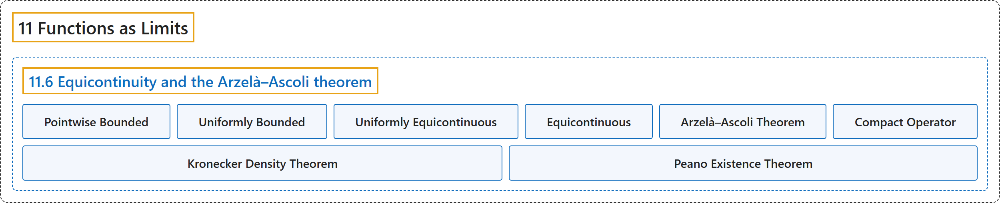

# 11.6 Equicontinuity and the Arzelà–Ascoli theorem

## Classification

## Glossary

| Term | Definition | 中文翻译 | Source |
|---|---|---|---|
| **11.6 Equicontinuity and the Arzelà–Ascoli theorem** 等度连续与阿尔泽拉–阿斯科利定理 | (No definition) | （无定义） | [Lebl, 2026, section 11.6](https://www.jirka.org/ra/html/sec_arzelaascoli.html) |
| **Pointwise Bounded** 逐点有界 | "Let $X$ be a set and $f_n \colon X \to \mathbb{C}$ be a sequence of functions. We say that $\{ f_n \}_{n=1}^\infty$ is **pointwise bounded** if **for every $x \in X$, there is an $M_x \in \mathbb{R}$ such that $\bigl\lvert f_n(x) \bigr\rvert \leq M_x \qquad \text{for all } n \in \mathbb{N} .$**" | 设 $X$ 是集合，$f_n \colon X \to \mathbb{C}$ 是函数序列。若**对每个 $x \in X$，存在 $M_x \in \mathbb{R}$ 使得 $\bigl\lvert f_n(x) \bigr\rvert \leq M_x \qquad \text{for all } n \in \mathbb{N} .$**，则称 $\{ f_n \}_{n=1}^\infty$ **逐点有界**。 | [Lebl, 2026, Definition 11.6.1](https://www.jirka.org/ra/html/sec_arzelaascoli.html#sec_arzelaascoli-4) |
| **Uniformly Bounded** 一致有界 | "We say that $\{ f_n \}_{n=1}^\infty$ is **uniformly bounded** if **there is an $M \in \mathbb{R}$ such that $\bigl\lvert f_n(x) \bigr\rvert \leq M \qquad \text{for all } n \in \mathbb{N} \text{ and all } x \in X.$**" | 若**存在 $M \in \mathbb{R}$ 使得 $\bigl\lvert f_n(x) \bigr\rvert \leq M \qquad \text{for all } n \in \mathbb{N} \text{ and all } x \in X.$**，则称 $\{ f_n \}_{n=1}^\infty$ **一致有界**。 | [Lebl, 2026, Definition 11.6.1](https://www.jirka.org/ra/html/sec_arzelaascoli.html#sec_arzelaascoli-4) |
| **Uniformly Equicontinuous** 一致等度连续 | "Let $(X,d)$ be a metric space. A set $S$ of functions $f \colon X \to \mathbb{C}$ is **uniformly equicontinuous** if **for every $\epsilon > 0$, there is a $\delta > 0$ such that if $x,y \in X$ with $d(x,y) < \delta$, we have $\bigl\lvert f(x)-f(y) \bigr\rvert < \epsilon \qquad \text{for all } f \in S .$**" | 设 $(X,d)$ 是度量空间。若**对每个 $\epsilon > 0$，存在 $\delta > 0$，使得只要 $x,y \in X$ 且 $d(x,y) < \delta$，就有 $\bigl\lvert f(x)-f(y) \bigr\rvert < \epsilon \qquad \text{for all } f \in S .$**，则称函数 $f \colon X \to \mathbb{C}$ 的集合 $S$ **一致等度连续**。 | [Lebl, 2026, Definition 11.6.6](https://www.jirka.org/ra/html/sec_arzelaascoli.html#sec_arzelaascoli-13) |
| **Equicontinuous** 等度连续 | "Just as for continuity, one can define equicontinuity at a point. That is, $S$ is **equicontinuous** at $x \in X$ if **for every $\epsilon > 0$, there is a $\delta > 0$ such that for $y \in X$ with $d(x,y) < \delta$, we have $\bigl\lvert f(x)-f(y) \bigr\rvert < \epsilon$ for all $f \in S$**." | 和连续性一样，可以定义在一点处的等度连续性：若**对每个 $\epsilon > 0$，存在 $\delta > 0$，使得对满足 $d(x,y) < \delta$ 的 $y \in X$，对所有 $f \in S$ 有 $\bigl\lvert f(x)-f(y) \bigr\rvert < \epsilon$**，则称 $S$ 在 $x \in X$ 处**等度连续**。 | [Lebl, 2026, section 11.6](https://www.jirka.org/ra/html/sec_arzelaascoli.html#sec_arzelaascoli-15) |
| **Arzelà–Ascoli Theorem** 阿尔泽拉–阿斯科利定理 | "Let $(X,d)$ be a compact metric space, and let $\{ f_n \}_{n=1}^\infty$ be **pointwise bounded and uniformly equicontinuous** sequence of functions $f_n \in C(X,\mathbb{C})$. Then **$\{f_n\}_{n=1}^\infty$ is uniformly bounded and $\{ f_n \}_{n=1}^\infty$ contains a uniformly convergent subsequence**." | 设 $(X,d)$ 是紧度量空间，$\{ f_n \}_{n=1}^\infty$ 是**逐点有界且一致等度连续**的函数序列，$f_n \in C(X,\mathbb{C})$，则 **$\{f_n\}_{n=1}^\infty$ 一致有界，且含有一致收敛的子序列**。 | [Lebl, 2026, Theorem 11.6.9](https://www.jirka.org/ra/html/sec_arzelaascoli.html#thm_arzelaascoli) |
| **Compact Operator** 紧算子 | "Via Arzelà–Ascoli, we also find (exercise) that the image of the unit ball of functions $T\bigl( B(0,1) \bigr)$ **has compact closure**, usually called relatively compact. Such an operator is called a **compact operator**." | 借助阿尔泽拉–阿斯科利定理还可以得到（习题）：函数单位球的像 $T\bigl( B(0,1) \bigr)$ **有紧闭包**，通常称为相对紧。这样的算子称为**紧算子**。 | [Lebl, 2026, section 11.6](https://www.jirka.org/ra/html/sec_arzelaascoli.html#sec_arzelaascoli-30) |
| **Kronecker Density Theorem** 克罗内克稠密性定理 | "Hint: Feel free to use the **Kronecker density theorem**: **The sequence $\{ e^{in} \}_{n=1}^\infty$ is dense in the unit circle.**" | 提示：可以使用**克罗内克稠密性定理**：**序列 $\{ e^{in} \}_{n=1}^\infty$ 在单位圆中稠密。** | [Lebl, 2026, Exercise 11.6.10](https://www.jirka.org/ra/html/sec_arzelaascoli.html#sec_arzelaascoli-31-10) |
| **Peano Existence Theorem** 皮亚诺存在定理 | "Prove the **Peano existence theorem** (note the weaker hypotheses than Picard, but also the lack of uniqueness in this theorem): Theorem: Suppose $F \colon I \times J \to \mathbb{R}$ is **a continuous function** where $I, J \subset \mathbb{R}$ are closed bounded intervals, let $I^\circ$ and $J^\circ$ be their interiors, and let $(x_0,y_0) \in I^\circ \times J^\circ$. Then **there exists an $h > 0$ and a differentiable function $f \colon [x_0 - h, x_0 + h] \to J \subset \mathbb{R}$, such that $f'(x) = F\bigl(x,f(x)\bigr)$ and $f(x_0) = y_0$**." | 证明**皮亚诺存在定理**（注意它的假设比皮卡定理弱，但也没有唯一性）：定理：设 $F \colon I \times J \to \mathbb{R}$ 是**连续函数**，$I, J \subset \mathbb{R}$ 是有界闭区间，$I^\circ$、$J^\circ$ 是它们的内部，$(x_0,y_0) \in I^\circ \times J^\circ$，则**存在 $h > 0$ 和可微函数 $f \colon [x_0 - h, x_0 + h] \to J \subset \mathbb{R}$，满足 $f'(x) = F\bigl(x,f(x)\bigr)$ 且 $f(x_0) = y_0$**。 | [Lebl, 2026, Exercise 11.6.11](https://www.jirka.org/ra/html/sec_arzelaascoli.html#exercise_peanoexistence) |

## References

Lebl, J. (2026). *Basic analysis I & II: Introduction to real analysis* (May 22, 2026 edition). Retrieved October 29, 2026, from <https://www.jirka.org/ra/html/>
