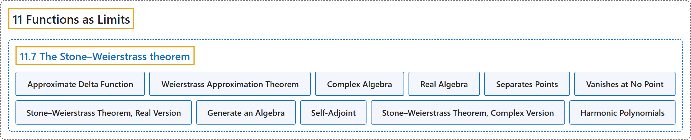

# 11.7 The Stone–Weierstrass theorem

## Classification

## Glossary

| Term | Definition | 中文翻译 | Source |
|---|---|---|---|
| **11.7 The Stone–Weierstrass theorem** 斯通–魏尔斯特拉斯定理 | (No definition) | （无定义） | [Lebl, 2026, section 11.7](https://www.jirka.org/ra/html/sec_stoneweier.html) |
| **Approximate Delta Function** 近似 δ 函数 | "The idea of the proof is **a very common approximation or “smoothing” idea** (convolution with an **approximate delta function**) that has applications far beyond pure mathematics." | 证明的思路是**一种非常常见的逼近或“光滑化”思想**（与**近似 δ 函数**作卷积），它的应用远远超出纯粹数学。 | [Lebl, 2026, section 11.7](https://www.jirka.org/ra/html/sec_stoneweier.html#sec_stoneweier-3) |
| **Weierstrass Approximation Theorem** 魏尔斯特拉斯逼近定理 | "If $f \colon [a,b] \to \mathbb{C}$ is continuous, then **there exists a sequence $\{ p_n \}_{n=1}^\infty$ of polynomials converging to $f$ uniformly on $[a,b]$**. Furthermore, if $f$ is real-valued, we can find $p_n$ with real coefficients." | 若 $f \colon [a,b] \to \mathbb{C}$ 连续，则**存在在 $[a,b]$ 上一致收敛到 $f$ 的多项式序列 $\{ p_n \}_{n=1}^\infty$**。此外，若 $f$ 是实值的，可以取实系数的 $p_n$。 | [Lebl, 2026, Theorem 11.7.1](https://www.jirka.org/ra/html/sec_stoneweier.html#sec_stoneweier-3-3) |
| **Complex Algebra** 复代数 | "A set $\mathcal{A}$ of complex-valued functions $f \colon X \to \mathbb{C}$ is said to be an algebra (sometimes **complex algebra** or algebra over $\mathbb{C}$) if **for all $f, g \in \mathcal{A}$ and $c \in \mathbb{C}$, we have $f+g \in \mathcal{A}$. $fg \in \mathcal{A}$. $cg \in \mathcal{A}$.**" | 若**对所有 $f, g \in \mathcal{A}$ 和 $c \in \mathbb{C}$，有 $f+g \in \mathcal{A}$、$fg \in \mathcal{A}$、$cg \in \mathcal{A}$**，则复值函数 $f \colon X \to \mathbb{C}$ 的集合 $\mathcal{A}$ 称为代数（有时称为**复代数**或 $\mathbb{C}$ 上的代数）。 | [Lebl, 2026, Definition 11.7.5](https://www.jirka.org/ra/html/sec_stoneweier.html#sec_stoneweier-4-3) |
| **Real Algebra** 实代数 | "A **real algebra** or an algebra over $\mathbb{R}$ is **a set of real-valued functions that satisfies the three properties above for $c \in \mathbb{R}$**." | **实代数**或 $\mathbb{R}$ 上的代数是**对 $c \in \mathbb{R}$ 满足上述三条性质的实值函数集合**。 | [Lebl, 2026, Definition 11.7.5](https://www.jirka.org/ra/html/sec_stoneweier.html#sec_stoneweier-4-3) |
| **Separates Points** 分离点 | "Let $\mathcal{A}$ be a set of complex-valued functions defined on a set $X$. $\mathcal{A}$ **separates points** if **for every $x,y \in X$ with $x \neq y$, there is an $f \in \mathcal{A}$ such that $f(x) \neq f(y)$**." | 设 $\mathcal{A}$ 是定义在集合 $X$ 上的复值函数的集合。若**对每对 $x \neq y$ 的 $x,y \in X$，存在 $f \in \mathcal{A}$ 使得 $f(x) \neq f(y)$**，则称 $\mathcal{A}$ **分离点**。 | [Lebl, 2026, Definition 11.7.7](https://www.jirka.org/ra/html/sec_stoneweier.html#sec_stoneweier-4-9) |
| **Vanishes at No Point** 处处不为零 | "$\mathcal{A}$ **vanishes at no point** if **for every $x \in X$ there is an $f \in \mathcal{A}$ such that $f(x) \neq 0$**." | 若**对每个 $x \in X$，存在 $f \in \mathcal{A}$ 使得 $f(x) \neq 0$**，则称 $\mathcal{A}$ **处处不为零**。 | [Lebl, 2026, Definition 11.7.7](https://www.jirka.org/ra/html/sec_stoneweier.html#sec_stoneweier-4-9) |
| **Stone–Weierstrass Theorem, Real Version** 斯通–魏尔斯特拉斯定理（实版本） | "Let $X$ be a compact metric space and $\mathcal{A}$ a real algebra of real-valued continuous functions on $X$, such that **$\mathcal{A}$ separates points and vanishes at no point**. Then **the closure $\overline{\mathcal{A}} = C(X,\mathbb{R})$**." | 设 $X$ 是紧度量空间，$\mathcal{A}$ 是 $X$ 上实值连续函数构成的实代数，且 **$\mathcal{A}$ 分离点、处处不为零**，则**闭包 $\overline{\mathcal{A}} = C(X,\mathbb{R})$**。 | [Lebl, 2026, Theorem 11.7.12](https://www.jirka.org/ra/html/sec_stoneweier.html#thm_SWreal) |
| **Generate an Algebra** 生成代数 | "In general, given a set of functions that separates points and does not vanish at any point, we let these functions **generate** an algebra by **considering all the linear combinations of arbitrary multiples of such functions**." | 一般地，给定一组分离点且处处不为零的函数，通过**考虑这些函数的任意乘积的全部线性组合**，让它们**生成**一个代数。 | [Lebl, 2026, section 11.7](https://www.jirka.org/ra/html/sec_stoneweier.html#sec_stoneweier-4-33) |
| **Self-Adjoint** 自伴 | "An algebra $\mathcal{A}$ is **self-adjoint** if **for all $f \in \mathcal{A}$, the function $\bar{f}$ defined by $\bar{f}(x) := \overline{f(x)}$ is in $\mathcal{A}$**, where by the bar we mean the complex conjugate." | 若**对所有 $f \in \mathcal{A}$，由 $\bar{f}(x) := \overline{f(x)}$ 定义的函数 $\bar{f}$ 也属于 $\mathcal{A}$**（横线表示复共轭），则称代数 $\mathcal{A}$ **自伴**。 | [Lebl, 2026, Definition 11.7.15](https://www.jirka.org/ra/html/sec_stoneweier.html#sec_stoneweier-4-36) |
| **Stone–Weierstrass Theorem, Complex Version** 斯通–魏尔斯特拉斯定理（复版本） | "Let $X$ be a compact metric space and $\mathcal{A}$ an algebra of complex-valued continuous functions on $X$, such that **$\mathcal{A}$ separates points, vanishes at no point, and is self-adjoint**. Then **the closure $\overline{\mathcal{A}} = C(X,\mathbb{C})$**." | 设 $X$ 是紧度量空间，$\mathcal{A}$ 是 $X$ 上复值连续函数构成的代数，且 **$\mathcal{A}$ 分离点、处处不为零并且自伴**，则**闭包 $\overline{\mathcal{A}} = C(X,\mathbb{C})$**。 | [Lebl, 2026, Theorem 11.7.16](https://www.jirka.org/ra/html/sec_stoneweier.html#thm_SWcomplex) |
| **Harmonic Polynomials** 调和多项式 | "Show that functions of the form **$c_0 + \sum_{k=1}^n c_k \, z^k + \sum_{k=1}^n c_{-k}\, \bar{z}^k$** are dense in $C(S^1,\mathbb{C})$. These functions are called **harmonic polynomials**." | 证明形如 **$c_0 + \sum_{k=1}^n c_k \, z^k + \sum_{k=1}^n c_{-k}\, \bar{z}^k$** 的函数在 $C(S^1,\mathbb{C})$ 中稠密。这些函数称为**调和多项式**。 | [Lebl, 2026, Exercise 11.7.7](https://www.jirka.org/ra/html/sec_stoneweier.html#sec_stoneweier-5-7) |

## References

Lebl, J. (2026). *Basic analysis I & II: Introduction to real analysis* (May 22, 2026 edition). Retrieved October 29, 2026, from <https://www.jirka.org/ra/html/>
