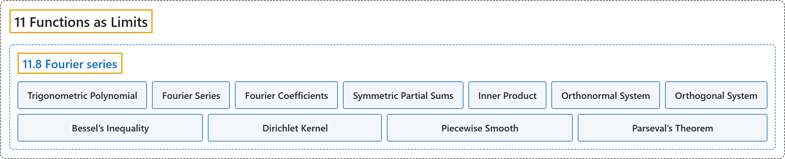

# 11.8 Fourier series

## Classification

## Glossary

| Term | Definition | 中文翻译 | Source |
|---|---|---|---|
| **11.8 Fourier series** 傅里叶级数 | (No definition) | （无定义） | [Lebl, 2026, section 11.8](https://www.jirka.org/ra/html/sec_fourier.html) |
| **Trigonometric Polynomial** 三角多项式 | "A **trigonometric polynomial** is **an expression of the form $a_0 + \sum_{n=1}^N \bigl(a_n \cos(nx) + b_n \sin(nx) \bigr)$**, or equivalently, thanks to Euler’s formula ($e^{i\theta} = \cos(\theta) + i \sin(\theta)$): $\sum_{n=-N}^N c_n e^{inx}$." | **三角多项式**是**形如 $a_0 + \sum_{n=1}^N \bigl(a_n \cos(nx) + b_n \sin(nx) \bigr)$ 的表达式**，借助欧拉公式（$e^{i\theta} = \cos(\theta) + i \sin(\theta)$），等价地写成 $\sum_{n=-N}^N c_n e^{inx}$。 | [Lebl, 2026, section 11.8](https://www.jirka.org/ra/html/sec_fourier.html#sec_fourier-3-2) |
| **Fourier Series** 傅里叶级数 | "We now take limits. The series **$\sum_{n=-\infty}^\infty c_n \, e^{inx}$** is called the **Fourier series** and the numbers $c_n$ the Fourier coefficients." | 现在取极限。级数 **$\sum_{n=-\infty}^\infty c_n \, e^{inx}$** 称为**傅里叶级数**，数 $c_n$ 称为傅里叶系数。 | [Lebl, 2026, section 11.8](https://www.jirka.org/ra/html/sec_fourier.html#sec_fourier-4-2) |
| **Fourier Coefficients** 傅里叶系数 | "The series $\sum_{n=-\infty}^\infty c_n \, e^{inx}$ is called the Fourier series and **the numbers $c_n$** the **Fourier coefficients**." | 级数 $\sum_{n=-\infty}^\infty c_n \, e^{inx}$ 称为傅里叶级数，**数 $c_n$** 称为**傅里叶系数**。 | [Lebl, 2026, section 11.8](https://www.jirka.org/ra/html/sec_fourier.html#sec_fourier-4-2) |
| **Symmetric Partial Sums** 对称部分和 | "In light of this, define the **symmetric partial sums** **$s_N(f;x) := \sum_{n=-N}^N c_n \,e^{inx}$**." | 据此，定义**对称部分和** **$s_N(f;x) := \sum_{n=-N}^N c_n \,e^{inx}$**。 | [Lebl, 2026, section 11.8](https://www.jirka.org/ra/html/sec_fourier.html#sec_fourier-4-3) |
| **Inner Product** 内积 | "Let $f$ and $g$ be complex-valued Riemann integrable functions on $[a,b]$ and define the **inner product** **$\langle f , g \rangle := \int_a^b f(x) \overline{g(x)} \, dx$**." | 设 $f$ 与 $g$ 是 $[a,b]$ 上黎曼可积的复值函数，定义**内积** **$\langle f , g \rangle := \int_a^b f(x) \overline{g(x)} \, dx$**。 | [Lebl, 2026, section 11.8](https://www.jirka.org/ra/html/sec_fourier.html#sec_fourier-5-2) |
| **Orthonormal System** 规范正交系 | "Let $\{ \varphi_n \}_{n=1}^\infty$ be a sequence of integrable complex-valued functions on $[a,b]$. We say that this is an **orthonormal system** if **$\langle \varphi_n , \varphi_m \rangle = \int_a^b \varphi_n(x) \, \overline{\varphi_m(x)} \, dx = \begin{cases} 1 & \text{if } n=m, \\ 0 & \text{otherwise.} \end{cases}$**" | 设 $\{ \varphi_n \}_{n=1}^\infty$ 是 $[a,b]$ 上可积复值函数的序列。若 **$\langle \varphi_n , \varphi_m \rangle = \int_a^b \varphi_n(x) \, \overline{\varphi_m(x)} \, dx = \begin{cases} 1 & \text{if } n=m, \\ 0 & \text{otherwise.} \end{cases}$**，则称它是**规范正交系**。 | [Lebl, 2026, Definition 11.8.7](https://www.jirka.org/ra/html/sec_fourier.html#sec_fourier-5-5) |
| **Orthogonal System** 正交系 | "If we only require that **$\langle \varphi_n , \varphi_m \rangle = 0$ for $m \neq n$**, then the system would be called an **orthogonal system**." | 若只要求**当 $m \neq n$ 时 $\langle \varphi_n , \varphi_m \rangle = 0$**，则该函数系称为**正交系**。 | [Lebl, 2026, Definition 11.8.7](https://www.jirka.org/ra/html/sec_fourier.html#sec_fourier-5-5) |
| **Bessel’s Inequality** 贝塞尔不等式 | "Suppose $f$ is a Riemann integrable function on $[a,b]$. Let $\{ \varphi_n \}_{n=1}^\infty$ be an orthonormal system on $[a,b]$ and suppose $f(x) \sim \sum_{n=1}^\infty c_n \varphi_n(x)$. Then **$\sum_{n=1}^\infty \lvert c_n \rvert^2 \leq \int_a^b \lvert f \rvert^2 = \lVert f \rVert_2^2$**." | 设 $f$ 是 $[a,b]$ 上的黎曼可积函数，$\{ \varphi_n \}_{n=1}^\infty$ 是 $[a,b]$ 上的规范正交系，且 $f(x) \sim \sum_{n=1}^\infty c_n \varphi_n(x)$，则 **$\sum_{n=1}^\infty \lvert c_n \rvert^2 \leq \int_a^b \lvert f \rvert^2 = \lVert f \rVert_2^2$**。 | [Lebl, 2026, Theorem 11.8.9](https://www.jirka.org/ra/html/sec_fourier.html#thm_bessels) |
| **Dirichlet Kernel** 狄利克雷核 | "Let the **Dirichlet kernel** be **$D_N(x) := \sum_{n=-N}^N e^{inx}$**." | 令**狄利克雷核**为 **$D_N(x) := \sum_{n=-N}^N e^{inx}$**。 | [Lebl, 2026, section 11.8](https://www.jirka.org/ra/html/sec_fourier.html#sec_fourier-6-4) |
| **Piecewise Smooth** 分段光滑 | "A function $f \colon [a,b] \to \mathbb{C}$ is continuous **piecewise smooth** if it is continuous and **there exist points $x_0 = a < x_1 < x_2 < \cdots < x_k = b$ such that for every $j$, $f$ restricted to $[x_j,x_{j+1}]$ is continuously differentiable (up to the endpoints)**." | 若函数 $f \colon [a,b] \to \mathbb{C}$ 连续，且**存在点 $x_0 = a < x_1 < x_2 < \cdots < x_k = b$，使得对每个 $j$，$f$ 在 $[x_j,x_{j+1}]$ 上的限制（直到端点）连续可微**，则称 $f$ 是连续**分段光滑**的。 | [Lebl, 2026, section 11.8](https://www.jirka.org/ra/html/sec_fourier.html#sec_fourier-7-4) |
| **Parseval’s Theorem** 帕塞瓦尔定理 | "Let $f$ and $g$ be $2\pi$-periodic functions, Riemann integrable on $[-\pi,\pi]$ with $f(x) \sim \sum_{n=-\infty}^\infty c_n \,e^{inx}$ and $g(x) \sim \sum_{n=-\infty}^\infty d_n \,e^{inx}$. Then **$\lim_{N\to\infty} \bigl\lVert f-s_N(f) \bigr\rVert_2^2 = 0$**. Also **$\langle f , g \rangle = \sum_{n=-\infty}^\infty c_n \overline{d_n}$**, and **$\lVert f \rVert_2^2 = \sum_{n=-\infty}^\infty \lvert c_n \rvert^2$**." | 设 $f$ 与 $g$ 是以 $2\pi$ 为周期、在 $[-\pi,\pi]$ 上黎曼可积的函数，$f(x) \sim \sum_{n=-\infty}^\infty c_n \,e^{inx}$，$g(x) \sim \sum_{n=-\infty}^\infty d_n \,e^{inx}$，则 **$\lim_{N\to\infty} \bigl\lVert f-s_N(f) \bigr\rVert_2^2 = 0$**；并且 **$\langle f , g \rangle = \sum_{n=-\infty}^\infty c_n \overline{d_n}$**，**$\lVert f \rVert_2^2 = \sum_{n=-\infty}^\infty \lvert c_n \rvert^2$**。 | [Lebl, 2026, Theorem 11.8.13](https://www.jirka.org/ra/html/sec_fourier.html#sec_fourier-8-3) |

## References

Lebl, J. (2026). *Basic analysis I & II: Introduction to real analysis* (May 22, 2026 edition). Retrieved October 29, 2026, from <https://www.jirka.org/ra/html/>
