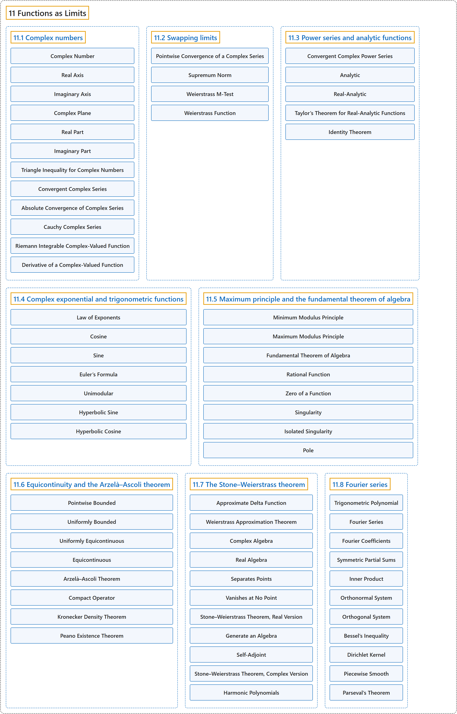

# 11 Functions as Limits

## Classification

## Glossary

| Term | Definition | 中文翻译 | Source |
|---|---|---|---|
| **11 Functions as Limits** 作为极限的函数 | (No definition) | （无定义） | [Lebl, 2026, chapter 11](https://www.jirka.org/ra/html/approx_chapter.html) |
| **[11.1 Complex numbers](11-1-complex-numbers.md)** 复数 | (No definition) | （无定义） | [Lebl, 2026, section 11.1](https://www.jirka.org/ra/html/sec_complexnums.html) |
| **[11.2 Swapping limits](11-2-swapping-limits.md)** 交换极限 | (No definition) | （无定义） | [Lebl, 2026, section 11.2](https://www.jirka.org/ra/html/sec_swaplim.html) |
| **[11.3 Power series and analytic functions](11-3-power-series-and-analytic-functions.md)** 幂级数与解析函数 | (No definition) | （无定义） | [Lebl, 2026, section 11.3](https://www.jirka.org/ra/html/sec_analfuncs.html) |
| **[11.4 Complex exponential and trigonometric functions](11-4-complex-exponential-and-trigonometric-functions.md)** 复指数函数与三角函数 | (No definition) | （无定义） | [Lebl, 2026, section 11.4](https://www.jirka.org/ra/html/sec_complexexp.html) |
| **[11.5 Maximum principle and the fundamental theorem of algebra](11-5-maximum-principle-and-the-fundamental-theorem-of-algebra.md)** 最大模原理与代数基本定理 | (No definition) | （无定义） | [Lebl, 2026, section 11.5](https://www.jirka.org/ra/html/sec_fundalgeb.html) |
| **[11.6 Equicontinuity and the Arzelà–Ascoli theorem](11-6-equicontinuity-and-the-arzela-ascoli-theorem.md)** 等度连续与阿尔泽拉–阿斯科利定理 | (No definition) | （无定义） | [Lebl, 2026, section 11.6](https://www.jirka.org/ra/html/sec_arzelaascoli.html) |
| **[11.7 The Stone–Weierstrass theorem](11-7-the-stone-weierstrass-theorem.md)** 斯通–魏尔斯特拉斯定理 | (No definition) | （无定义） | [Lebl, 2026, section 11.7](https://www.jirka.org/ra/html/sec_stoneweier.html) |
| **[11.8 Fourier series](11-8-fourier-series.md)** 傅里叶级数 | (No definition) | （无定义） | [Lebl, 2026, section 11.8](https://www.jirka.org/ra/html/sec_fourier.html) |

## References

Lebl, J. (2026). *Basic analysis I & II: Introduction to real analysis* (May 22, 2026 edition). Retrieved October 29, 2026, from <https://www.jirka.org/ra/html/>
