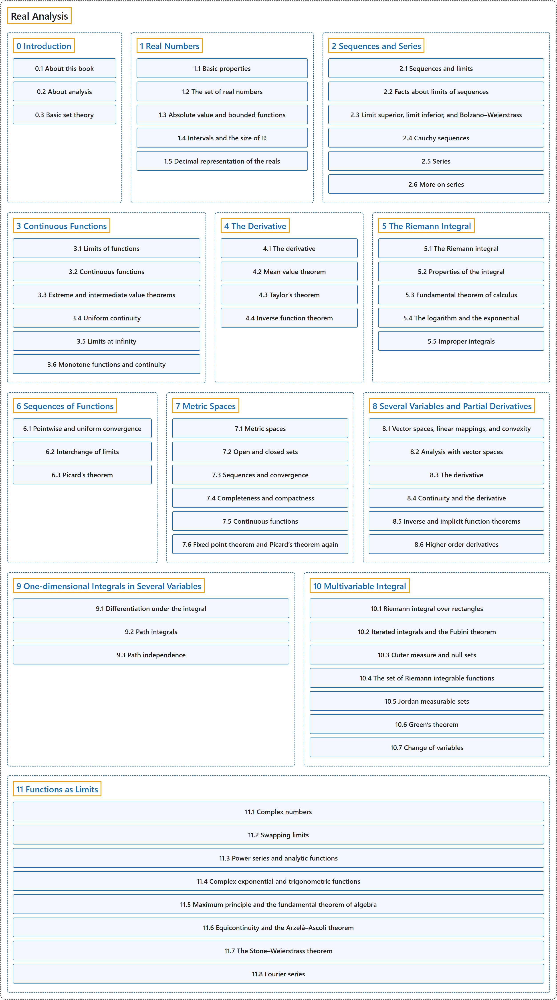

# Real Analysis

## Classification

## Glossary

| Term | Definition | 中文翻译 | Source |
|---|---|---|---|
| **Real Analysis** 实分析 | (No definition) | （无定义） | [Lebl, 2026](https://www.jirka.org/ra/html/) |
| **[0 Introduction](introduction/index.md)** 引言 | (No definition) | （无定义） | [Lebl, 2026, chapter 0](https://www.jirka.org/ra/html/ra-4.html) |
| **[1 Real Numbers](real-numbers/index.md)** 实数 | (No definition) | （无定义） | [Lebl, 2026, chapter 1](https://www.jirka.org/ra/html/rn_chapter.html) |
| **[2 Sequences and Series](sequences-and-series/index.md)** 序列与级数 | (No definition) | （无定义） | [Lebl, 2026, chapter 2](https://www.jirka.org/ra/html/seq_chapter.html) |
| **[3 Continuous Functions](continuous-functions/index.md)** 连续函数 | (No definition) | （无定义） | [Lebl, 2026, chapter 3](https://www.jirka.org/ra/html/lim_chapter.html) |
| **[4 The Derivative](the-derivative/index.md)** 导数 | (No definition) | （无定义） | [Lebl, 2026, chapter 4](https://www.jirka.org/ra/html/der_chapter.html) |
| **[5 The Riemann Integral](the-riemann-integral/index.md)** 黎曼积分 | (No definition) | （无定义） | [Lebl, 2026, chapter 5](https://www.jirka.org/ra/html/int_chapter.html) |
| **[6 Sequences of Functions](sequences-of-functions/index.md)** 函数序列 | (No definition) | （无定义） | [Lebl, 2026, chapter 6](https://www.jirka.org/ra/html/fs_chapter.html) |
| **[7 Metric Spaces](metric-spaces/index.md)** 度量空间 | (No definition) | （无定义） | [Lebl, 2026, chapter 7](https://www.jirka.org/ra/html/ms_chapter.html) |
| **[8 Several Variables and Partial Derivatives](several-variables-and-partial-derivatives/index.md)** 多变量与偏导数 | (No definition) | （无定义） | [Lebl, 2026, chapter 8](https://www.jirka.org/ra/html/pd_chapter.html) |
| **[9 One-dimensional Integrals in Several Variables](one-dimensional-integrals-in-several-variables/index.md)** 多变量中的一维积分 | (No definition) | （无定义） | [Lebl, 2026, chapter 9](https://www.jirka.org/ra/html/path_chapter.html) |
| **[10 Multivariable Integral](multivariable-integral/index.md)** 多变量积分 | (No definition) | （无定义） | [Lebl, 2026, chapter 10](https://www.jirka.org/ra/html/mi_chapter.html) |
| **[11 Functions as Limits](functions-as-limits/index.md)** 作为极限的函数 | (No definition) | （无定义） | [Lebl, 2026, chapter 11](https://www.jirka.org/ra/html/approx_chapter.html) |

## References

Lebl, J. (2026). *Basic analysis I & II: Introduction to real analysis* (May 22, 2026 edition). Retrieved October 29, 2026, from <https://www.jirka.org/ra/html/>
