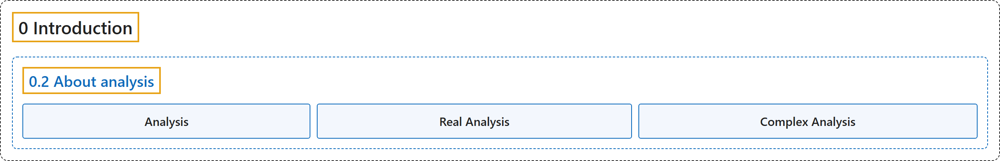

# 0.2 About analysis

## Classification

## Glossary

| Term | Definition | 中文翻译 | Source |
|---|---|---|---|
| **0.2 About analysis** 关于分析 | (No definition) | （无定义） | [Lebl, 2026, section 0.2](https://www.jirka.org/ra/html/sec_aboutra.html) |
| **Analysis** 分析 | "**Analysis** is **the branch of mathematics that deals with inequalities and limits**." | **分析**是**处理不等式与极限的数学分支**。 | [Lebl, 2026, section 0.2](https://www.jirka.org/ra/html/sec_aboutra.html#sec_aboutra-2) |
| **Real Analysis** 实分析 | "The term **real analysis** is **a little bit of a misnomer**. I prefer to use simply analysis." | **实分析**这个名称**有点名不副实**。我更喜欢简单地叫它分析。 | [Lebl, 2026, section 0.2](https://www.jirka.org/ra/html/sec_aboutra.html#sec_aboutra-9) |
| **Complex Analysis** 复分析 | "The other type of analysis, **complex analysis**, **really builds upon the present material**, rather than being distinct." | 另一种分析，即**复分析**，其实是**建立在本书内容之上的**，而不是与之不同的东西。 | [Lebl, 2026, section 0.2](https://www.jirka.org/ra/html/sec_aboutra.html#sec_aboutra-9) |

## References

Lebl, J. (2026). *Basic analysis I & II: Introduction to real analysis* (May 22, 2026 edition). Retrieved October 29, 2026, from <https://www.jirka.org/ra/html/>
