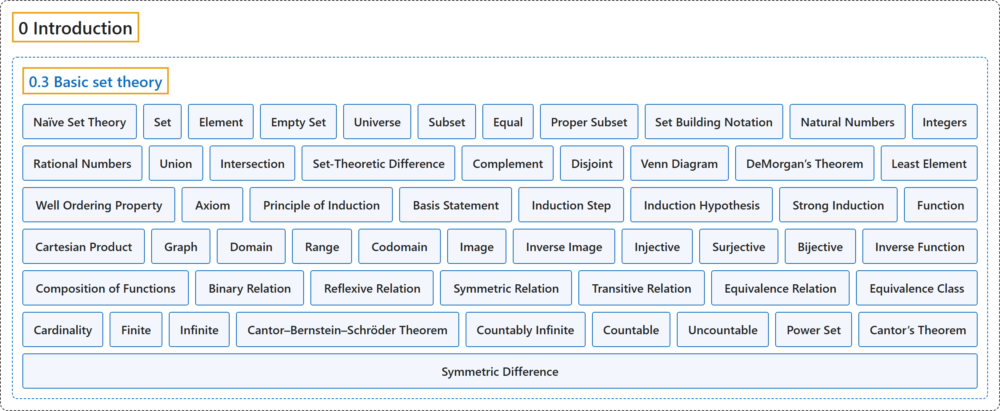

# 0.3 Basic set theory

## Classification

## Glossary

| Term | Definition | 中文翻译 | Source |
|---|---|---|---|
| **0.3 Basic set theory** 基本集合论 | (No definition) | （无定义） | [Lebl, 2026, section 0.3](https://www.jirka.org/ra/html/sec_basicset.html) |
| **Naïve Set Theory** 朴素集合论 | "We talk about sets **in a rather informal way**, using what is usually called “**naïve set theory**.”" | 我们以**一种相当非正式的方式**谈论集合，用的是通常所说的“**朴素集合论**”。 | [Lebl, 2026, section 0.3](https://www.jirka.org/ra/html/sec_basicset.html#sec_basicset-3-2) |
| **Set** 集合 | "A **set** is **a collection of objects called elements or members**." | **集合**是**由称为元素或成员的对象组成的一个总体**。 | [Lebl, 2026, Definition 0.3.1](https://www.jirka.org/ra/html/sec_basicset.html#sec_basicset-4-2) |
| **Element** 元素 | "A set is **a collection of objects** called **elements** or **members**." | 集合是由称为**元素**或**成员**的**对象组成的一个总体**。 | [Lebl, 2026, Definition 0.3.1](https://www.jirka.org/ra/html/sec_basicset.html#sec_basicset-4-2) |
| **Empty Set** 空集 | "A set with **no objects** is called the **empty set** and is denoted by $\emptyset$ (or sometimes by $\{ \}$)." | **不含任何对象**的集合称为**空集**，记作 $\emptyset$（有时也记作 $\{ \}$）。 | [Lebl, 2026, Definition 0.3.1](https://www.jirka.org/ra/html/sec_basicset.html#sec_basicset-4-2) |
| **Universe** 全集 | "The elements of all sets under consideration come from **some set** we call the **universe**." | 所考虑的一切集合的元素都来自**某个集合**，我们称之为**全集**。 | [Lebl, 2026, section 0.3](https://www.jirka.org/ra/html/sec_basicset.html#sec_basicset-4-6) |
| **Subset** 子集 | "A set $A$ is a **subset** of a set $B$ if **$x \in A$ implies $x \in B$**, and we write $A \subset B$." | 若 **$x \in A$ 蕴含 $x \in B$**，则集合 $A$ 是集合 $B$ 的**子集**，记作 $A \subset B$。 | [Lebl, 2026, Definition 0.3.2](https://www.jirka.org/ra/html/sec_basicset.html#sec_basicset-4-11-1-2-1) |
| **Equal** 相等 | "Two sets $A$ and $B$ are **equal** if **$A \subset B$ and $B \subset A$**." | 若 **$A \subset B$ 且 $B \subset A$**，则两个集合 $A$ 与 $B$ **相等**。 | [Lebl, 2026, Definition 0.3.2](https://www.jirka.org/ra/html/sec_basicset.html#sec_basicset-4-11-1-2-2) |
| **Proper Subset** 真子集 | "A set $A$ is a **proper subset** of $B$ if **$A \subset B$ and $A \neq B$**." | 若 **$A \subset B$ 且 $A \neq B$**，则集合 $A$ 是 $B$ 的**真子集**。 | [Lebl, 2026, Definition 0.3.2](https://www.jirka.org/ra/html/sec_basicset.html#sec_basicset-4-11-1-2-3) |
| **Set Building Notation** 集合构造记号 | "To define new sets, one often uses the **set building notation**, $\bigl\{ x \in A : P(x) \bigr\}$. This notation refers to **a subset of the set $A$ containing all elements of $A$ that satisfy the property $P(x)$**." | 定义新集合时常用**集合构造记号** $\bigl\{ x \in A : P(x) \bigr\}$。这个记号表示**集合 $A$ 中由满足性质 $P(x)$ 的全部元素组成的子集**。 | [Lebl, 2026, section 0.3](https://www.jirka.org/ra/html/sec_basicset.html#sec_basicset-4-13) |
| **Natural Numbers** 自然数 | "The set of **natural numbers**, **$\mathbb{N} := \{ 1, 2, 3, \ldots \}$**." | **自然数**集，**$\mathbb{N} := \{ 1, 2, 3, \ldots \}$**。 | [Lebl, 2026, Example 0.3.3](https://www.jirka.org/ra/html/sec_basicset.html#sec_basicset-4-14) |
| **Integers** 整数 | "The set of **integers**, **$\mathbb{Z} := \{ 0, -1, 1, -2, 2, \ldots \}$**." | **整数**集，**$\mathbb{Z} := \{ 0, -1, 1, -2, 2, \ldots \}$**。 | [Lebl, 2026, Example 0.3.3](https://www.jirka.org/ra/html/sec_basicset.html#sec_basicset-4-14) |
| **Rational Numbers** 有理数 | "The set of **rational numbers**, **$\mathbb{Q} := \bigl\{ \frac{m}{n} : m, n \in \mathbb{Z} \text{ and } n \neq 0 \bigr\}$**." | **有理数**集，**$\mathbb{Q} := \bigl\{ \frac{m}{n} : m, n \in \mathbb{Z} \text{ and } n \neq 0 \bigr\}$**。 | [Lebl, 2026, Example 0.3.3](https://www.jirka.org/ra/html/sec_basicset.html#sec_basicset-4-14) |
| **Union** 并集 | "A **union** of two sets $A$ and $B$ is defined as **$A \cup B := \{ x : x \in A \text{ or } x \in B \}$**." | 两个集合 $A$ 与 $B$ 的**并集**定义为 **$A \cup B := \{ x : x \in A \text{ or } x \in B \}$**。 | [Lebl, 2026, Definition 0.3.4](https://www.jirka.org/ra/html/sec_basicset.html#sec_basicset-4-16-1-2-1) |
| **Intersection** 交集 | "An **intersection** of two sets $A$ and $B$ is defined as **$A \cap B := \{ x : x \in A \text{ and } x \in B \}$**." | 两个集合 $A$ 与 $B$ 的**交集**定义为 **$A \cap B := \{ x : x \in A \text{ and } x \in B \}$**。 | [Lebl, 2026, Definition 0.3.4](https://www.jirka.org/ra/html/sec_basicset.html#sec_basicset-4-16-1-2-2) |
| **Set-Theoretic Difference** 差集 | "A **complement of $B$ relative to $A$** (or **set-theoretic difference** of $A$ and $B$) is defined as **$A \setminus B := \{ x : x \in A \text{ and } x \notin B \}$**." | **$B$ 相对于 $A$ 的补集**（或 $A$ 与 $B$ 的**差集**）定义为 **$A \setminus B := \{ x : x \in A \text{ and } x \notin B \}$**。 | [Lebl, 2026, Definition 0.3.4](https://www.jirka.org/ra/html/sec_basicset.html#sec_basicset-4-16-1-2-3) |
| **Complement** 补集 | "We say **complement** of $B$ and write $B^c$ instead of $A \setminus B$ if **the set $A$ is either the entire universe or if it is the obvious set containing $B$**, and is understood from context." | 如果**集合 $A$ 是整个全集，或者是包含 $B$ 的显而易见的集合**，并且从上下文可以明白，我们就说 $B$ 的**补集**，记作 $B^c$ 而不写 $A \setminus B$。 | [Lebl, 2026, Definition 0.3.4](https://www.jirka.org/ra/html/sec_basicset.html#sec_basicset-4-16-1-2-4) |
| **Disjoint** 不相交 | "We say sets $A$ and $B$ are **disjoint** if **$A \cap B = \emptyset$**." | 若 **$A \cap B = \emptyset$**，则称集合 $A$ 与 $B$ **不相交**。 | [Lebl, 2026, Definition 0.3.4](https://www.jirka.org/ra/html/sec_basicset.html#sec_basicset-4-16-1-2-5) |
| **Venn Diagram** 维恩图 | "We **illustrate the operations** on the **Venn diagrams** in Figure 2." | 我们在图 2 的**维恩图**上**图示这些运算**。 | [Lebl, 2026, section 0.3](https://www.jirka.org/ra/html/sec_basicset.html#sec_basicset-4-21) |
| **DeMorgan’s Theorem** 德摩根定理 | "Let $A, B, C$ be sets. Then **${(B \cup C)}^c = B^c \cap C^c , \qquad {(B \cap C)}^c = B^c \cup C^c ,$** or, more generally, $A \setminus (B \cup C) = (A \setminus B) \cap (A \setminus C) , \qquad A \setminus (B \cap C) = (A \setminus B) \cup (A \setminus C) .$" | 设 $A, B, C$ 是集合，则 **${(B \cup C)}^c = B^c \cap C^c , \qquad {(B \cap C)}^c = B^c \cup C^c ,$** 更一般地，$A \setminus (B \cup C) = (A \setminus B) \cap (A \setminus C) , \qquad A \setminus (B \cap C) = (A \setminus B) \cup (A \setminus C) .$ | [Lebl, 2026, Theorem 0.3.5](https://www.jirka.org/ra/html/sec_basicset.html#sec_basicset-4-22) |
| **Least Element** 最小元 | "By $S \subset \mathbb{N}$ having a **least element**, we mean that **there exists an $x \in S$, such that for every $y \in S$, we have $x \leq y$**." | 说 $S \subset \mathbb{N}$ 有**最小元**，是指**存在 $x \in S$，使得对每个 $y \in S$ 都有 $x \leq y$**。 | [Lebl, 2026, section 0.3](https://www.jirka.org/ra/html/sec_basicset.html#sec_basicset-5-2) |
| **Well Ordering Property** 良序性 | "**Every nonempty subset of $\mathbb{N}$ has a least (smallest) element**" | **$\mathbb{N}$ 的每个非空子集都有最小元** | [Lebl, 2026, Axiom (Well ordering property of ℕ)](https://www.jirka.org/ra/html/sec_basicset.html#wop_link) |
| **Axiom** 公理 | "The natural numbers $\mathbb{N}$ ordered in the natural way possess the well ordering property. We take this property as an **axiom**; we **simply assume it is true**." | 按自然顺序排列的自然数 $\mathbb{N}$ 具有良序性。我们把这个性质当作**公理**，即**直接假定它成立**。 | [Lebl, 2026, section 0.3](https://www.jirka.org/ra/html/sec_basicset.html#sec_basicset-5-3) |
| **Principle of Induction** 归纳原理 | "Let $P(n)$ be a statement depending on a natural number $n$. Suppose that (basis statement) $P(1)$ is true. (induction step) If $P(n)$ is true, then $P(n+1)$ is true. Then **$P(n)$ is true for all $n \in \mathbb{N}$**." | 设 $P(n)$ 是依赖于自然数 $n$ 的命题。假设（基础命题）$P(1)$ 为真；（归纳步骤）若 $P(n)$ 为真，则 $P(n+1)$ 为真。那么**对所有 $n \in \mathbb{N}$，$P(n)$ 为真**。 | [Lebl, 2026, Theorem 0.3.6](https://www.jirka.org/ra/html/sec_basicset.html#induction_thm) |
| **Basis Statement** 基础命题 | "(**basis statement**) **$P(1)$ is true**." | （**基础命题**）**$P(1)$ 为真**。 | [Lebl, 2026, Theorem 0.3.6](https://www.jirka.org/ra/html/sec_basicset.html#induction_thm-2-2-1) |
| **Induction Step** 归纳步骤 | "(**induction step**) **If $P(n)$ is true, then $P(n+1)$ is true**." | （**归纳步骤**）**若 $P(n)$ 为真，则 $P(n+1)$ 为真**。 | [Lebl, 2026, Theorem 0.3.6](https://www.jirka.org/ra/html/sec_basicset.html#induction_thm-2-2-2) |
| **Induction Hypothesis** 归纳假设 | "**The assumption that $P(n)$ is true** in “if $P(n)$ is true, then $P(n+1)$ is true” is usually called the **induction hypothesis**." | “若 $P(n)$ 为真，则 $P(n+1)$ 为真”中**假定 $P(n)$ 为真的那个假设**，通常称为**归纳假设**。 | [Lebl, 2026, section 0.3](https://www.jirka.org/ra/html/sec_basicset.html#sec_basicset-5-8) |
| **Strong Induction** 强归纳法 | "Sometimes, it is easier to use in the inductive step that **$P(k)$ is true for all $k = 1,2,\ldots,n$, not just for $k=n$**. This principle is called **strong induction** and is equivalent to the normal induction above." | 有时在归纳步骤中用**对所有 $k = 1,2,\ldots,n$（而不只是 $k=n$）$P(k)$ 都为真**会更方便。这个原理称为**强归纳法**，它与上面的普通归纳法等价。 | [Lebl, 2026, section 0.3](https://www.jirka.org/ra/html/sec_basicset.html#sec_basicset-5-11) |
| **Function** 函数 | "Informally, a **set-theoretic function** $f$ taking a set $A$ to a set $B$ is **a mapping that to each $x \in A$ assigns a unique $y \in B$**." | 非正式地说，把集合 $A$ 带到集合 $B$ 的**集合论函数** $f$ 是**一个给每个 $x \in A$ 指定唯一 $y \in B$ 的映射**。 | [Lebl, 2026, section 0.3](https://www.jirka.org/ra/html/sec_basicset.html#sec_basicset-6-2) |
| **Cartesian Product** 笛卡儿积 | "Let $A$ and $B$ be sets. The **Cartesian product** is **the set of tuples** defined as $A \times B := \bigl\{ (x,y) : x \in A, y \in B \bigr\}$." | 设 $A$ 与 $B$ 是集合。**笛卡儿积**是如下定义的**有序组的集合**：$A \times B := \bigl\{ (x,y) : x \in A, y \in B \bigr\}$。 | [Lebl, 2026, Definition 0.3.10](https://www.jirka.org/ra/html/sec_basicset.html#sec_basicset-6-4) |
| **Graph** 图像 | "If we consider $f$ simply as **a subset in $A \times B$**, then we call this set the **graph** of the function." | 如果把 $f$ 单纯看作 **$A \times B$ 中的一个子集**，就称这个集合为函数的**图像**。 | [Lebl, 2026, Definition 0.3.11](https://www.jirka.org/ra/html/sec_basicset.html#sec_basicset-6-6) |
| **Domain** 定义域 | "The **set $A$** is called the **domain** of $f$ (and sometimes confusingly denoted $D(f)$)." | **集合 $A$** 称为 $f$ 的**定义域**（有时也容易混淆地记作 $D(f)$）。 | [Lebl, 2026, Definition 0.3.11](https://www.jirka.org/ra/html/sec_basicset.html#sec_basicset-6-6) |
| **Range** 值域 | "The set **$R(f) := \{ y \in B : \text{there exists an } x \in A \text{ such that } f(x)=y \}$** is called the **range** of $f$." | 集合 **$R(f) := \{ y \in B : \text{there exists an } x \in A \text{ such that } f(x)=y \}$** 称为 $f$ 的**值域**。 | [Lebl, 2026, Definition 0.3.11](https://www.jirka.org/ra/html/sec_basicset.html#sec_basicset-6-6) |
| **Codomain** 陪域 | "The **set $B$** is called the **codomain** of $f$." | **集合 $B$** 称为 $f$ 的**陪域**。 | [Lebl, 2026, Definition 0.3.11](https://www.jirka.org/ra/html/sec_basicset.html#sec_basicset-6-6) |
| **Image** 像 | "Define the **image** (or **direct image**) of a subset $C \subset A$ as **$f(C) := \bigl\{ f(x) \in B : x \in C \bigr\}$**." | 子集 $C \subset A$ 的**像**（或**正像**）定义为 **$f(C) := \bigl\{ f(x) \in B : x \in C \bigr\}$**。 | [Lebl, 2026, Definition 0.3.13](https://www.jirka.org/ra/html/sec_basicset.html#sec_basicset-6-9) |
| **Inverse Image** 原像 | "Define the **inverse image** of a subset $D \subset B$ as **$f^{-1}(D) := \bigl\{ x \in A : f(x) \in D \bigr\}$**." | 子集 $D \subset B$ 的**原像**定义为 **$f^{-1}(D) := \bigl\{ x \in A : f(x) \in D \bigr\}$**。 | [Lebl, 2026, Definition 0.3.13](https://www.jirka.org/ra/html/sec_basicset.html#sec_basicset-6-9) |
| **Injective** 单射的 | "Let $f \colon A \to B$ be a function. The function $f$ is said to be **injective** or **one-to-one** if **$f(x_1) = f(x_2)$ implies $x_1 = x_2$**. In other words, $f$ is injective if for all $y \in B$, the set $f^{-1}(\{y\})$ is empty or consists of a single element. We call such an $f$ an **injection**." | 设 $f \colon A \to B$ 是函数。若 **$f(x_1) = f(x_2)$ 蕴含 $x_1 = x_2$**，则称 $f$ 是**单射的**或**一对一的**。换句话说，若对所有 $y \in B$，集合 $f^{-1}(\{y\})$ 为空或只含一个元素，则 $f$ 是单射的。这样的 $f$ 称为**单射**。 | [Lebl, 2026, Definition 0.3.17](https://www.jirka.org/ra/html/sec_basicset.html#sec_basicset-6-21) |
| **Surjective** 满射的 | "If **$f(A) = B$**, then we say $f$ is **surjective** or **onto**. In other words, $f$ is surjective if the range and the codomain of $f$ are equal. We call such an $f$ a **surjection**." | 若 **$f(A) = B$**，则称 $f$ 是**满射的**或**映上的**。换句话说，若 $f$ 的值域与陪域相等，则 $f$ 是满射的。这样的 $f$ 称为**满射**。 | [Lebl, 2026, Definition 0.3.17](https://www.jirka.org/ra/html/sec_basicset.html#sec_basicset-6-21) |
| **Bijective** 双射的 | "If $f$ is **both surjective and injective**, then we say $f$ is **bijective** or that $f$ is a **bijection**." | 若 $f$ **既是满射的又是单射的**，则称 $f$ 是**双射的**，或称 $f$ 是一个**双射**。 | [Lebl, 2026, Definition 0.3.17](https://www.jirka.org/ra/html/sec_basicset.html#sec_basicset-6-21) |
| **Inverse Function** 反函数 | "When $f \colon A \to B$ is a bijection, then the inverse image of a single element, $f^{-1}(\{y\})$, is always a unique element of $A$. We then consider **$f^{-1}$ as a function $f^{-1} \colon B \to A$** and we write simply $f^{-1}(y)$. In this case, we call $f^{-1}$ the **inverse function** of $f$." | 当 $f \colon A \to B$ 是双射时，单个元素的原像 $f^{-1}(\{y\})$ 总是 $A$ 中唯一的一个元素。这时我们把 **$f^{-1}$ 看作函数 $f^{-1} \colon B \to A$**，并简单地写作 $f^{-1}(y)$。在这种情况下，称 $f^{-1}$ 为 $f$ 的**反函数**。 | [Lebl, 2026, section 0.3](https://www.jirka.org/ra/html/sec_basicset.html#sec_basicset-6-22) |
| **Composition of Functions** 函数的复合 | "Consider $f \colon A \to B$ and $g \colon B \to C$. The **composition** of the functions $f$ and $g$ is the function **$g \circ f \colon A \to C$** defined as $(g \circ f)(x) := g\bigl(f(x)\bigr)$." | 考虑 $f \colon A \to B$ 与 $g \colon B \to C$。函数 $f$ 与 $g$ 的**复合**是如下定义的函数 **$g \circ f \colon A \to C$**：$(g \circ f)(x) := g\bigl(f(x)\bigr)$。 | [Lebl, 2026, Definition 0.3.18](https://www.jirka.org/ra/html/sec_basicset.html#sec_basicset-6-23) |
| **Binary Relation** 二元关系 | "Given a set $A$, a **binary relation** on $A$ is **a subset $\mathcal{R} \subset A \times A$**, which consists of those pairs where the relation is said to hold." | 给定集合 $A$，$A$ 上的**二元关系**是**一个子集 $\mathcal{R} \subset A \times A$**，由关系成立的那些有序对组成。 | [Lebl, 2026, Definition 0.3.19](https://www.jirka.org/ra/html/sec_basicset.html#sec_basicset-7-3) |
| **Reflexive Relation** 自反关系 | "A relation $\mathcal{R}$ on a set $A$ is said to be **Reflexive** if **$a\, \mathcal{R} \, a$ for all $a \in A$**." | 集合 $A$ 上的关系 $\mathcal{R}$ 称为**自反的**，如果**对所有 $a \in A$ 有 $a\, \mathcal{R} \, a$**。 | [Lebl, 2026, Definition 0.3.21](https://www.jirka.org/ra/html/sec_basicset.html#sec_basicset-7-5-1-2-1) |
| **Symmetric Relation** 对称关系 | "A relation $\mathcal{R}$ on a set $A$ is said to be **Symmetric** if **$a\, \mathcal{R} \, b$ implies $b \, \mathcal{R} \, a$**." | 集合 $A$ 上的关系 $\mathcal{R}$ 称为**对称的**，如果 **$a\, \mathcal{R} \, b$ 蕴含 $b \, \mathcal{R} \, a$**。 | [Lebl, 2026, Definition 0.3.21](https://www.jirka.org/ra/html/sec_basicset.html#sec_basicset-7-5-1-2-2) |
| **Transitive Relation** 传递关系 | "A relation $\mathcal{R}$ on a set $A$ is said to be **Transitive** if **$a\, \mathcal{R} \, b$ and $b \, \mathcal{R} \, c$ implies $a\, \mathcal{R} \, c$**." | 集合 $A$ 上的关系 $\mathcal{R}$ 称为**传递的**，如果 **$a\, \mathcal{R} \, b$ 且 $b \, \mathcal{R} \, c$ 蕴含 $a\, \mathcal{R} \, c$**。 | [Lebl, 2026, Definition 0.3.21](https://www.jirka.org/ra/html/sec_basicset.html#sec_basicset-7-5-1-2-3) |
| **Equivalence Relation** 等价关系 | "If $\mathcal{R}$ is **reflexive, symmetric, and transitive**, then it is said to be an **equivalence relation**." | 若 $\mathcal{R}$ 是**自反的、对称的和传递的**，则称它为**等价关系**。 | [Lebl, 2026, Definition 0.3.21](https://www.jirka.org/ra/html/sec_basicset.html#sec_basicset-7-5) |
| **Equivalence Class** 等价类 | "Let $A$ be a set and $\mathcal{R}$ an equivalence relation. An **equivalence class** of $a \in A$, often denoted by $[a]$, is **the set $\{ x \in A : a\, \mathcal{R} \, x \}$**." | 设 $A$ 是集合，$\mathcal{R}$ 是等价关系。$a \in A$ 的**等价类**常记作 $[a]$，它是**集合 $\{ x \in A : a\, \mathcal{R} \, x \}$**。 | [Lebl, 2026, Definition 0.3.23](https://www.jirka.org/ra/html/sec_basicset.html#sec_basicset-7-8) |
| **Cardinality** 基数 | "Let $A$ and $B$ be sets. We say $A$ and $B$ have the same cardinality when **there exists a bijection $f \colon A \to B$**. We denote by $\lvert A \rvert$ the equivalence class of all sets with the same cardinality as $A$, and we simply call $\lvert A \rvert$ the **cardinality** of $A$." | 设 $A$ 与 $B$ 是集合。当**存在双射 $f \colon A \to B$** 时，称 $A$ 与 $B$ 有相同的基数。用 $\lvert A \rvert$ 表示与 $A$ 有相同基数的全体集合构成的等价类，并简单地称 $\lvert A \rvert$ 为 $A$ 的**基数**。 | [Lebl, 2026, Definition 0.3.26](https://www.jirka.org/ra/html/sec_basicset.html#sec_basicset-8-3) |
| **Finite** 有限 | "If $A$ has the same cardinality as $\{ 1,2,3,\ldots,n \}$ for some $n \in \mathbb{N}$, we write $\lvert A \rvert := n$. If $A$ is empty, we write $\lvert A \rvert := 0$. In either case, we say that $A$ is **finite**." | 若对某个 $n \in \mathbb{N}$，$A$ 与 $\{ 1,2,3,\ldots,n \}$ 有相同的基数，就写 $\lvert A \rvert := n$。若 $A$ 为空，就写 $\lvert A \rvert := 0$。在这两种情况下，都称 $A$ 是**有限的**。 | [Lebl, 2026, Definition 0.3.27](https://www.jirka.org/ra/html/sec_basicset.html#sec_basicset-8-6) |
| **Infinite** 无限 | "We say $A$ is **infinite** or “of infinite cardinality” if **$A$ is not finite**." | 若 **$A$ 不是有限的**，则称 $A$ 是**无限的**或“具有无限基数”。 | [Lebl, 2026, Definition 0.3.27](https://www.jirka.org/ra/html/sec_basicset.html#sec_basicset-8-6) |
| **Cantor–Bernstein–Schröder Theorem** 康托尔–伯恩斯坦–施罗德定理 | "We state without proof that $A$ and $B$ have the same cardinality if and only if **$\lvert A \rvert \leq \lvert B \rvert$ and $\lvert B \rvert \leq \lvert A \rvert$**. This result is the **Cantor–Bernstein–Schröder theorem**." | 我们不加证明地指出：$A$ 与 $B$ 有相同的基数，当且仅当 **$\lvert A \rvert \leq \lvert B \rvert$ 且 $\lvert B \rvert \leq \lvert A \rvert$**。这个结果就是**康托尔–伯恩斯坦–施罗德定理**。 | [Lebl, 2026, section 0.3](https://www.jirka.org/ra/html/sec_basicset.html#sec_basicset-8-10) |
| **Countably Infinite** 可数无穷 | "If **$\lvert A \rvert = \lvert \mathbb{N} \rvert$**, then we say $A$ is **countably infinite**." | 若 **$\lvert A \rvert = \lvert \mathbb{N} \rvert$**，则称 $A$ 是**可数无穷的**。 | [Lebl, 2026, Definition 0.3.29](https://www.jirka.org/ra/html/sec_basicset.html#sec_basicset-8-12) |
| **Countable** 可数 | "If $A$ is **finite or countably infinite**, then we say $A$ is **countable**." | 若 $A$ 是**有限的或可数无穷的**，则称 $A$ 是**可数的**。 | [Lebl, 2026, Definition 0.3.29](https://www.jirka.org/ra/html/sec_basicset.html#sec_basicset-8-12) |
| **Uncountable** 不可数 | "If $A$ is **not countable**, then $A$ is said to be **uncountable**." | 若 $A$ **不是可数的**，则称 $A$ 是**不可数的**。 | [Lebl, 2026, Definition 0.3.29](https://www.jirka.org/ra/html/sec_basicset.html#sec_basicset-8-12) |
| **Power Set** 幂集 | "The **power set** of a set $A$, denoted by $\mathcal{P}(A)$, is **the set of all subsets of $A$**." | 集合 $A$ 的**幂集**记作 $\mathcal{P}(A)$，是 **$A$ 的全部子集构成的集合**。 | [Lebl, 2026, Definition 0.3.33](https://www.jirka.org/ra/html/sec_basicset.html#sec_basicset-8-20) |
| **Cantor’s Theorem** 康托尔定理 | "Let $A$ be a set. Then **$\lvert A \rvert < \bigl\lvert \mathcal{P}(A) \bigr\rvert$**. In particular, there exists no surjection from $A$ onto $\mathcal{P}(A)$." | 设 $A$ 是集合，则 **$\lvert A \rvert < \bigl\lvert \mathcal{P}(A) \bigr\rvert$**。特别地，不存在从 $A$ 到 $\mathcal{P}(A)$ 的满射。 | [Lebl, 2026, Theorem 0.3.34](https://www.jirka.org/ra/html/sec_basicset.html#cantorspowersetthm) |
| **Symmetric Difference** 对称差 | "Let $A \Delta B$ denote the **symmetric difference**, that is, **the set of all elements that belong to either $A$ or $B$, but not to both $A$ and $B$**." | 用 $A \Delta B$ 表示**对称差**，即**属于 $A$ 或 $B$、但不同时属于 $A$ 和 $B$ 的全部元素构成的集合**。 | [Lebl, 2026, Exercise 0.3.7](https://www.jirka.org/ra/html/sec_basicset.html#sec_basicset-9-7) |

## References

Lebl, J. (2026). *Basic analysis I & II: Introduction to real analysis* (May 22, 2026 edition). Retrieved October 29, 2026, from <https://www.jirka.org/ra/html/>
