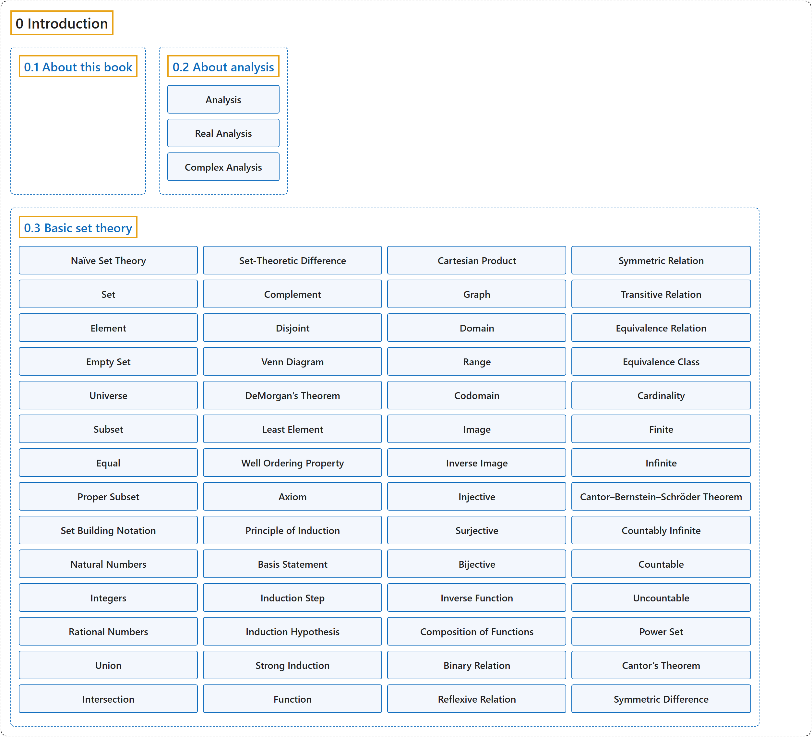

# 0 Introduction

## Classification

## Glossary

| Term | Definition | 中文翻译 | Source |
|---|---|---|---|
| **0 Introduction** 引言 | (No definition) | （无定义） | [Lebl, 2026, chapter 0](https://www.jirka.org/ra/html/ra-4.html) |
| **[0.1 About this book](0-1-about-this-book.md)** 关于本书 | (No definition) | （无定义） | [Lebl, 2026, section 0.1](https://www.jirka.org/ra/html/ra-4-2.html) |
| **[0.2 About analysis](0-2-about-analysis.md)** 关于分析 | (No definition) | （无定义） | [Lebl, 2026, section 0.2](https://www.jirka.org/ra/html/sec_aboutra.html) |
| **[0.3 Basic set theory](0-3-basic-set-theory.md)** 基本集合论 | (No definition) | （无定义） | [Lebl, 2026, section 0.3](https://www.jirka.org/ra/html/sec_basicset.html) |

## References

Lebl, J. (2026). *Basic analysis I & II: Introduction to real analysis* (May 22, 2026 edition). Retrieved October 29, 2026, from <https://www.jirka.org/ra/html/>
