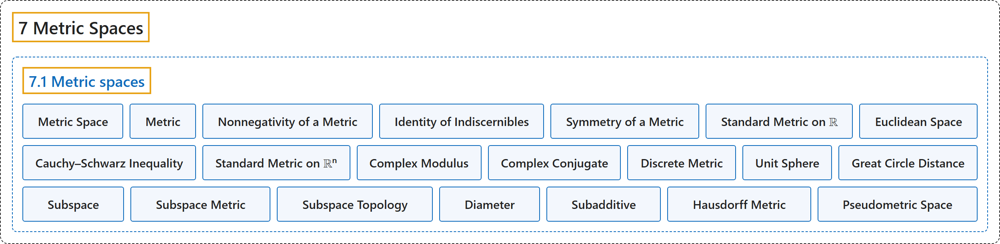

# 7.1 Metric spaces

## Classification

## Glossary

| Term | Definition | 中文翻译 | Source |
|---|---|---|---|
| **7.1 Metric spaces** 度量空间 | (No definition) | （无定义） | [Lebl, 2026, section 7.1](https://www.jirka.org/ra/html/sec_metric.html) |
| **Metric Space** 度量空间 | "Let $X$ be a set, and let $d \colon X \times X \to \mathbb{R}$ be a function such that for all $x,y,z \in X$ $d(x,y) \geq 0$. (nonnegativity) $d(x,y) = 0$ if and only if $x = y$. (identity of indiscernibles) $d(x,y) = d(y,x)$. (symmetry) $d(x,z) \leq d(x,y)+ d(y,z)$. (triangle inequality) **The pair $(X,d)$** is called a **metric space**." | 设 $X$ 是集合，$d \colon X \times X \to \mathbb{R}$ 是函数，使得对所有 $x,y,z \in X$：$d(x,y) \geq 0$（非负性）；$d(x,y) = 0$ 当且仅当 $x = y$（不可分辨者的同一性）；$d(x,y) = d(y,x)$（对称性）；$d(x,z) \leq d(x,y)+ d(y,z)$（三角不等式）。**二元组 $(X,d)$** 称为**度量空间**。 | [Lebl, 2026, Definition 7.1.1](https://www.jirka.org/ra/html/sec_metric.html#sec_metric-6) |
| **Metric** 度量 | "The **function $d$** is called the **metric** or the **distance function**." | **函数 $d$** 称为**度量**或**距离函数**。 | [Lebl, 2026, Definition 7.1.1](https://www.jirka.org/ra/html/sec_metric.html#sec_metric-6) |
| **Nonnegativity of a Metric** 度量的非负性 | "**$d(x,y) \geq 0$**. (**nonnegativity**)" | **$d(x,y) \geq 0$**。（**非负性**） | [Lebl, 2026, Definition 7.1.1](https://www.jirka.org/ra/html/sec_metric.html#metric_pos) |
| **Identity of Indiscernibles** 不可分辨者的同一性 | "**$d(x,y) = 0$ if and only if $x = y$**. (**identity of indiscernibles**)" | **$d(x,y) = 0$ 当且仅当 $x = y$**。（**不可分辨者的同一性**） | [Lebl, 2026, Definition 7.1.1](https://www.jirka.org/ra/html/sec_metric.html#metric_zero) |
| **Symmetry of a Metric** 度量的对称性 | "**$d(x,y) = d(y,x)$**. (**symmetry**)" | **$d(x,y) = d(y,x)$**。（**对称性**） | [Lebl, 2026, Definition 7.1.1](https://www.jirka.org/ra/html/sec_metric.html#metric_com) |
| **Standard Metric on ℝ** ℝ 上的标准度量 | "The set of real numbers $\mathbb{R}$ is a metric space with the metric **$d(x,y) := \lvert x-y \rvert$**. This metric is the **standard metric on $\mathbb{R}$**." | 实数集 $\mathbb{R}$ 在度量 **$d(x,y) := \lvert x-y \rvert$** 下是度量空间。这个度量是 **$\mathbb{R}$ 上的标准度量**。 | [Lebl, 2026, Example 7.1.2](https://www.jirka.org/ra/html/sec_metric.html#sec_metric-13) |
| **Euclidean Space** 欧几里得空间 | "An important metric space is the **$n$-dimensional euclidean space** **$\mathbb{R}^n = \mathbb{R} \times \mathbb{R} \times \cdots \times \mathbb{R}$**." | 一个重要的度量空间是 **$n$ 维欧几里得空间** **$\mathbb{R}^n = \mathbb{R} \times \mathbb{R} \times \cdots \times \mathbb{R}$**。 | [Lebl, 2026, section 7.1](https://www.jirka.org/ra/html/sec_metric.html#sec_metric-15) |
| **Cauchy–Schwarz Inequality** 柯西–施瓦茨不等式 | "Suppose $x =(x_1,x_2,\ldots,x_n) \in \mathbb{R}^n$, $y =(y_1,y_2,\ldots,y_n) \in \mathbb{R}^n$. Then **${\biggl( \sum_{k=1}^n x_k y_k \biggr)}^2 \leq \biggl(\sum_{k=1}^n x_k^2 \biggr) \biggl(\sum_{k=1}^n y_k^2 \biggr)$**." | 设 $x =(x_1,x_2,\ldots,x_n) \in \mathbb{R}^n$，$y =(y_1,y_2,\ldots,y_n) \in \mathbb{R}^n$，则 **${\biggl( \sum_{k=1}^n x_k y_k \biggr)}^2 \leq \biggl(\sum_{k=1}^n x_k^2 \biggr) \biggl(\sum_{k=1}^n y_k^2 \biggr)$**。 | [Lebl, 2026, Lemma 7.1.4](https://www.jirka.org/ra/html/sec_metric.html#sec_metric-16) |
| **Standard Metric on ℝⁿ** ℝⁿ 上的标准度量 | "Let us construct the **standard metric for $\mathbb{R}^n$**. Define **$d(x,y) := \sqrt{ {(x_1-y_1)}^2 + {(x_2-y_2)}^2 + \cdots + {(x_n-y_n)}^2 } = \sqrt{ \sum_{k=1}^n {(x_k-y_k)}^2 }$**." | 来构造 **$\mathbb{R}^n$ 上的标准度量**。定义 **$d(x,y) := \sqrt{ {(x_1-y_1)}^2 + {(x_2-y_2)}^2 + \cdots + {(x_n-y_n)}^2 } = \sqrt{ \sum_{k=1}^n {(x_k-y_k)}^2 }$**。 | [Lebl, 2026, Example 7.1.5](https://www.jirka.org/ra/html/sec_metric.html#sec_metric-18) |
| **Complex Modulus** 复数的模 | "For $z=x+iy$ define the **complex modulus** by **$\lvert z \rvert := \sqrt{x^2+y^2}$**." | 对 $z=x+iy$，定义**复数的模**为 **$\lvert z \rvert := \sqrt{x^2+y^2}$**。 | [Lebl, 2026, Example 7.1.6](https://www.jirka.org/ra/html/sec_metric.html#sec_metric-19) |
| **Complex Conjugate** 共轭复数 | "Furthermore, when working with complex numbers it is often convenient to write the metric in terms of the **complex conjugate**: The conjugate of $z=x+iy$ is **$\bar{z} := x-iy$**." | 此外，处理复数时，常常用**共轭复数**来写度量较为方便：$z=x+iy$ 的共轭是 **$\bar{z} := x-iy$**。 | [Lebl, 2026, Example 7.1.6](https://www.jirka.org/ra/html/sec_metric.html#sec_metric-19) |
| **Discrete Metric** 离散度量 | "An example to keep in mind is the **discrete metric**. For any set $X$, define **$d(x,y) := \begin{cases} 1 & \text{if } x \neq y, \\ 0 & \text{if } x = y. \end{cases}$** That is, all points are equally distant from each other." | 值得记住的一个例子是**离散度量**。对任意集合 $X$，定义 **$d(x,y) := \begin{cases} 1 & \text{if } x \neq y, \\ 0 & \text{if } x = y. \end{cases}$** 也就是说，所有点彼此等距。 | [Lebl, 2026, Example 7.1.7](https://www.jirka.org/ra/html/sec_metric.html#sec_metric-20) |
| **Unit Sphere** 单位球面 | "Let $S^2$ be the **unit sphere** in $\mathbb{R}^3$, that is **$S^2 := \{ x \in \mathbb{R}^3 : x_1^2+x_2^2+x_3^2 = 1 \}$**." | 设 $S^2$ 是 $\mathbb{R}^3$ 中的**单位球面**，即 **$S^2 := \{ x \in \mathbb{R}^3 : x_1^2+x_2^2+x_3^2 = 1 \}$**。 | [Lebl, 2026, Example 7.1.9](https://www.jirka.org/ra/html/sec_metric.html#sec_metric-22) |
| **Great Circle Distance** 大圆距离 | "Another useful example of a metric space is the sphere with a metric usually called the **great circle distance**. Take $x$ and $y$ in $S^2$, draw a line through the origin and $x$, and another line through the origin and $y$, and let $\theta$ be **the angle that the two lines make**. Then define **$d(x,y) := \theta$**." | 度量空间的另一个有用例子是球面，配以通常称为**大圆距离**的度量。在 $S^2$ 中取 $x$ 与 $y$，作过原点和 $x$ 的直线，再作过原点和 $y$ 的直线，令 $\theta$ 为**两直线所成的角**，然后定义 **$d(x,y) := \theta$**。 | [Lebl, 2026, Example 7.1.9](https://www.jirka.org/ra/html/sec_metric.html#sec_metric-22) |
| **Subspace** 子空间 | "If $(X,d)$ is a metric space, **$Y \subset X$, and $d' := d|_{Y \times Y}$**, then $(Y,d')$ is said to be a **subspace** of $(X,d)$." | 若 $(X,d)$ 是度量空间，**$Y \subset X$，且 $d' := d|_{Y \times Y}$**，则称 $(Y,d')$ 是 $(X,d)$ 的**子空间**。 | [Lebl, 2026, Definition 7.1.11](https://www.jirka.org/ra/html/sec_metric.html#sec_metric-25) |
| **Subspace Metric** 子空间度量 | "It is common to simply write $d$ for the metric on $Y$, as it is **the restriction of the metric on $X$**. Sometimes we say $d'$ is the **subspace metric** and $Y$ has the subspace topology." | 通常直接把 $Y$ 上的度量写成 $d$，因为它是 **$X$ 上度量的限制**。有时说 $d'$ 是**子空间度量**，$Y$ 具有子空间拓扑。 | [Lebl, 2026, section 7.1](https://www.jirka.org/ra/html/sec_metric.html#sec_metric-26) |
| **Subspace Topology** 子空间拓扑 | "Sometimes we say $d'$ is the subspace metric and **$Y$** has the **subspace topology**." | 有时说 $d'$ 是子空间度量，**$Y$** 具有**子空间拓扑**。 | [Lebl, 2026, section 7.1](https://www.jirka.org/ra/html/sec_metric.html#sec_metric-26) |
| **Diameter** 直径 | "**$\operatorname{diam}(S) := \sup \bigl\{ d(x,y) : x,y \in S \bigr\} < \infty$**. The quantity $\operatorname{diam}(S)$ is called the **diameter** of a set and is usually only defined for a nonempty set." | **$\operatorname{diam}(S) := \sup \bigl\{ d(x,y) : x,y \in S \bigr\} < \infty$**。量 $\operatorname{diam}(S)$ 称为集合的**直径**，通常只对非空集合定义。 | [Lebl, 2026, section 7.1](https://www.jirka.org/ra/html/sec_metric.html#sec_metric-33) |
| **Subadditive** 次可加 | "Also suppose $\varphi$ is **subadditive**, that is, **$\varphi(s+t) \leq \varphi(s)+\varphi(t)$**." | 再设 $\varphi$ 是**次可加的**，即 **$\varphi(s+t) \leq \varphi(s)+\varphi(t)$**。 | [Lebl, 2026, Exercise 7.1.5](https://www.jirka.org/ra/html/sec_metric.html#sec_metric-34-5) |
| **Hausdorff Metric** 豪斯多夫度量 | "Let $(X,d)$ be a metric space. For nonempty bounded subsets $A$ and $B$ let $d(x,B) := \inf \bigl\{ d(x,b) : b \in B \bigr\}$ and $d(A,B) := \sup \bigl\{ d(a,B) : a \in A \bigr\}$. Now define the **Hausdorff metric** as **$d_H(A,B) := \max \bigl\{ d(A,B) , d(B,A) \bigr\}$**." | 设 $(X,d)$ 是度量空间。对非空有界子集 $A$ 与 $B$，令 $d(x,B) := \inf \bigl\{ d(x,b) : b \in B \bigr\}$，$d(A,B) := \sup \bigl\{ d(a,B) : a \in A \bigr\}$。然后定义**豪斯多夫度量**为 **$d_H(A,B) := \max \bigl\{ d(A,B) , d(B,A) \bigr\}$**。 | [Lebl, 2026, Exercise 7.1.8](https://www.jirka.org/ra/html/sec_metric.html#exercise_mshausdorffpseudo) |
| **Pseudometric Space** 伪度量空间 | "Prove that $(Y,d_H)$ is what we call a **pseudometric space**: **$d_H$ satisfies the metric properties i, iii, iv, and further $d_H(A,A) = 0$ for all $A \in Y$**." | 证明 $(Y,d_H)$ 是我们所说的**伪度量空间**：**$d_H$ 满足度量的性质 i、iii、iv，并且对所有 $A \in Y$ 有 $d_H(A,A) = 0$**。 | [Lebl, 2026, Exercise 7.1.8](https://www.jirka.org/ra/html/sec_metric.html#exercise_mshausdorffpseudo) |

## References

Lebl, J. (2026). *Basic analysis I & II: Introduction to real analysis* (May 22, 2026 edition). Retrieved October 29, 2026, from <https://www.jirka.org/ra/html/>
