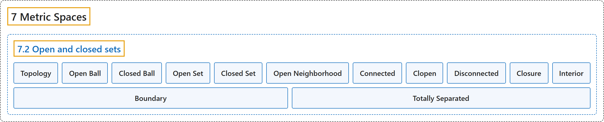

# 7.2 Open and closed sets

## Classification

## Glossary

| Term | Definition | 中文翻译 | Source |
|---|---|---|---|
| **7.2 Open and closed sets** 开集与闭集 | (No definition) | （无定义） | [Lebl, 2026, section 7.2](https://www.jirka.org/ra/html/sec_mettop.html) |
| **Topology** 拓扑 | "Before we get to convergence, we define the **topology**. That is, we define **the notion of open and closed sets**." | 在讨论收敛之前，先定义**拓扑**，即定义**开集与闭集的概念**。 | [Lebl, 2026, section 7.2](https://www.jirka.org/ra/html/sec_mettop.html#sec_mettop-3-2) |
| **Open Ball** 开球 | "Let $(X,d)$ be a metric space, $x \in X$, and $\delta > 0$. Define the **open ball**, or simply **ball**, of radius $\delta$ around $x$ as **$B(x,\delta) := \bigl\{ y \in X : d(x,y) < \delta \bigr\}$**." | 设 $(X,d)$ 是度量空间，$x \in X$，$\delta > 0$。定义以 $x$ 为中心、半径为 $\delta$ 的**开球**（或简称**球**）为 **$B(x,\delta) := \bigl\{ y \in X : d(x,y) < \delta \bigr\}$**。 | [Lebl, 2026, Definition 7.2.1](https://www.jirka.org/ra/html/sec_mettop.html#sec_mettop-3-3) |
| **Closed Ball** 闭球 | "Define the **closed ball** as **$C(x,\delta) := \bigl\{ y \in X : d(x,y) \leq \delta \bigr\}$**." | 定义**闭球**为 **$C(x,\delta) := \bigl\{ y \in X : d(x,y) \leq \delta \bigr\}$**。 | [Lebl, 2026, Definition 7.2.1](https://www.jirka.org/ra/html/sec_mettop.html#sec_mettop-3-3) |
| **Open Set** 开集 | "Let $(X,d)$ be a metric space. A subset $V \subset X$ is **open** if **for every $x \in V$, there exists a $\delta > 0$ such that $B(x,\delta) \subset V$**." | 设 $(X,d)$ 是度量空间。若**对每个 $x \in V$，存在 $\delta > 0$ 使得 $B(x,\delta) \subset V$**，则子集 $V \subset X$ 是**开的**。 | [Lebl, 2026, Definition 7.2.4](https://www.jirka.org/ra/html/sec_mettop.html#sec_mettop-3-7) |
| **Closed Set** 闭集 | "A subset $E \subset X$ is **closed** if **the complement $E^c = X \setminus E$ is open**." | 若**补集 $E^c = X \setminus E$ 是开的**，则子集 $E \subset X$ 是**闭的**。 | [Lebl, 2026, Definition 7.2.4](https://www.jirka.org/ra/html/sec_mettop.html#sec_mettop-3-7) |
| **Open Neighborhood** 开邻域 | "If **$x \in V$ and $V$ is open**, then we say $V$ is an **open neighborhood** of $x$ (or sometimes just **neighborhood**)." | 若 **$x \in V$ 且 $V$ 是开集**，则称 $V$ 是 $x$ 的**开邻域**（有时简称**邻域**）。 | [Lebl, 2026, Definition 7.2.4](https://www.jirka.org/ra/html/sec_mettop.html#sec_mettop-3-7) |
| **Connected** 连通 | "A nonempty metric space $(X,d)$ is **connected** if **the only subsets of $X$ that are both open and closed (sometimes called clopen subsets) are $\emptyset$ and $X$ itself**." | 若 **$X$ 中既开又闭的子集（有时称为既开又闭子集）只有 $\emptyset$ 和 $X$ 本身**，则称非空度量空间 $(X,d)$ 是**连通的**。 | [Lebl, 2026, Definition 7.2.13](https://www.jirka.org/ra/html/sec_mettop.html#sec_mettop-4-3) |
| **Clopen** 既开又闭 | "A nonempty metric space $(X,d)$ is connected if the only subsets of $X$ that are **both open and closed** (sometimes called **clopen** subsets) are $\emptyset$ and $X$ itself." | 若 $X$ 中**既开又闭**的子集（有时称为**既开又闭**子集）只有 $\emptyset$ 和 $X$ 本身，则称非空度量空间 $(X,d)$ 是连通的。 | [Lebl, 2026, Definition 7.2.13](https://www.jirka.org/ra/html/sec_mettop.html#sec_mettop-4-3) |
| **Disconnected** 不连通 | "If a nonempty $(X,d)$ is **not connected** we say it is **disconnected**." | 若非空的 $(X,d)$ **不是连通的**，就说它是**不连通的**。 | [Lebl, 2026, Definition 7.2.13](https://www.jirka.org/ra/html/sec_mettop.html#sec_mettop-4-3) |
| **Closure** 闭包 | "Let $(X,d)$ be a metric space and $A \subset X$. The **closure** of $A$ is the set **$\overline{A} := \bigcap \{ E \subset X : E \text{ is closed and } A \subset E \}$**." | 设 $(X,d)$ 是度量空间，$A \subset X$。$A$ 的**闭包**是集合 **$\overline{A} := \bigcap \{ E \subset X : E \text{ is closed and } A \subset E \}$**。 | [Lebl, 2026, Definition 7.2.18](https://www.jirka.org/ra/html/sec_mettop.html#sec_mettop-5-3) |
| **Interior** 内部 | "Let $(X,d)$ be a metric space and $A \subset X$. The **interior** of $A$ is the set **$A^\circ := \{ x \in A : \text{there exists a } \delta > 0 \text{ such that } B(x,\delta) \subset A \}$**." | 设 $(X,d)$ 是度量空间，$A \subset X$。$A$ 的**内部**是集合 **$A^\circ := \{ x \in A : \text{there exists a } \delta > 0 \text{ such that } B(x,\delta) \subset A \}$**。 | [Lebl, 2026, Definition 7.2.23](https://www.jirka.org/ra/html/sec_mettop.html#sec_mettop-5-13) |
| **Boundary** 边界 | "The **boundary** of $A$ is the set **$\partial A := \overline{A}\setminus A^\circ$**." | $A$ 的**边界**是集合 **$\partial A := \overline{A}\setminus A^\circ$**。 | [Lebl, 2026, Definition 7.2.23](https://www.jirka.org/ra/html/sec_mettop.html#sec_mettop-5-13) |
| **Totally Separated** 完全分离 | "Prove that $\mathbb{Q}$ is **totally separated**, that is, show that **for every $x, y \in \mathbb{Q}$ with $x \neq y$, there exist two open sets $U$ and $V$ such that $x \in U$, $y \in V$, $U \cap V = \emptyset$, and $U \cup V = \mathbb{Q}$**." | 证明 $\mathbb{Q}$ 是**完全分离的**，即证明**对每对 $x \neq y$ 的 $x, y \in \mathbb{Q}$，存在两个开集 $U$ 与 $V$，使得 $x \in U$，$y \in V$，$U \cap V = \emptyset$，且 $U \cup V = \mathbb{Q}$**。 | [Lebl, 2026, Exercise 7.2.5](https://www.jirka.org/ra/html/sec_mettop.html#sec_mettop-6-5) |

## References

Lebl, J. (2026). *Basic analysis I & II: Introduction to real analysis* (May 22, 2026 edition). Retrieved October 29, 2026, from <https://www.jirka.org/ra/html/>
