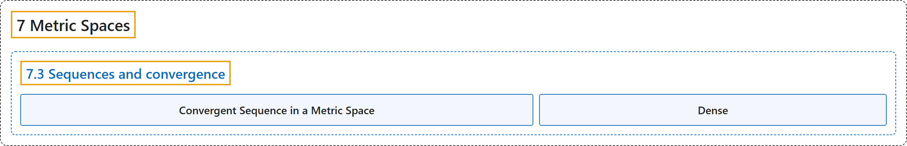

# 7.3 Sequences and convergence

## Classification

## Glossary

| Term | Definition | 中文翻译 | Source |
|---|---|---|---|
| **7.3 Sequences and convergence** 序列与收敛 | (No definition) | （无定义） | [Lebl, 2026, section 7.3](https://www.jirka.org/ra/html/sec_metseqs.html) |
| **Convergent Sequence in a Metric Space** 度量空间中的收敛序列 | "A sequence $\{ x_n \}_{n=1}^\infty$ in a metric space $(X,d)$ is said to **converge** to a point $p \in X$ if **for every $\epsilon > 0$, there exists an $M \in \mathbb{N}$ such that $d(x_n,p) < \epsilon$ for all $n \geq M$**. The point $p$ is said to be a **limit** of $\{ x_n \}_{n=1}^\infty$." | 若**对每个 $\epsilon > 0$，存在 $M \in \mathbb{N}$，使得对所有 $n \geq M$ 有 $d(x_n,p) < \epsilon$**，则称度量空间 $(X,d)$ 中的序列 $\{ x_n \}_{n=1}^\infty$ **收敛**到点 $p \in X$。点 $p$ 称为 $\{ x_n \}_{n=1}^\infty$ 的**极限**。 | [Lebl, 2026, Definition 7.3.2](https://www.jirka.org/ra/html/sec_metseqs.html#sec_metseqs-3-5) |
| **Dense** 稠密 | "A set $S \subset X$ is said to be **dense** in $X$ if **$X \subset \overline{S}$** or in other words if for every $p \in X$, there exists a sequence $\{ x_n \}_{n=1}^\infty$ in $S$ that converges to $p$." | 若 **$X \subset \overline{S}$**，换言之，若对每个 $p \in X$，都存在 $S$ 中收敛到 $p$ 的序列 $\{ x_n \}_{n=1}^\infty$，则称集合 $S \subset X$ 在 $X$ 中**稠密**。 | [Lebl, 2026, Exercise 7.3.7](https://www.jirka.org/ra/html/sec_metseqs.html#sec_metseqs-6-7) |

## References

Lebl, J. (2026). *Basic analysis I & II: Introduction to real analysis* (May 22, 2026 edition). Retrieved October 29, 2026, from <https://www.jirka.org/ra/html/>
