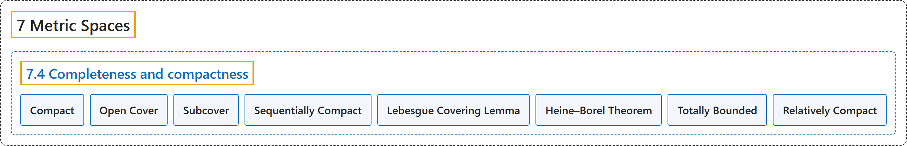

# 7.4 Completeness and compactness

## Classification

## Glossary

| Term | Definition | 中文翻译 | Source |
|---|---|---|---|
| **7.4 Completeness and compactness** 完备性与紧性 | (No definition) | （无定义） | [Lebl, 2026, section 7.4](https://www.jirka.org/ra/html/sec_metcompact.html) |
| **Compact** 紧 | "Let $(X,d)$ be a metric space and $K \subset X$. The set $K$ is said to be **compact** if **for every collection of open sets $\{ U_{\lambda} \}_{\lambda \in I}$ such that $K \subset \bigcup_{\lambda \in I} U_\lambda$, there exists a finite subset $\{ \lambda_1, \lambda_2,\ldots,\lambda_m \} \subset I$ such that $K \subset \bigcup_{j=1}^m U_{\lambda_j}$**." | 设 $(X,d)$ 是度量空间，$K \subset X$。若**对每个满足 $K \subset \bigcup_{\lambda \in I} U_\lambda$ 的开集族 $\{ U_{\lambda} \}_{\lambda \in I}$，都存在有限子集 $\{ \lambda_1, \lambda_2,\ldots,\lambda_m \} \subset I$ 使得 $K \subset \bigcup_{j=1}^m U_{\lambda_j}$**，则称集合 $K$ 是**紧的**。 | [Lebl, 2026, Definition 7.4.7](https://www.jirka.org/ra/html/sec_metcompact.html#sec_metcompact-4-2) |
| **Open Cover** 开覆盖 | "A **collection of open sets $\{ U_{\lambda} \}_{\lambda \in I}$ as above** is said to be an **open cover** of $K$." | **上述那样的开集族 $\{ U_{\lambda} \}_{\lambda \in I}$** 称为 $K$ 的**开覆盖**。 | [Lebl, 2026, section 7.4](https://www.jirka.org/ra/html/sec_metcompact.html#sec_metcompact-4-3) |
| **Subcover** 子覆盖 | "A way to say that $K$ is compact is to say that **every open cover of $K$** has a **finite subcover**." | 说 $K$ 是紧的，一种说法是：**$K$ 的每个开覆盖**都有**有限子覆盖**。 | [Lebl, 2026, section 7.4](https://www.jirka.org/ra/html/sec_metcompact.html#sec_metcompact-4-3) |
| **Sequentially Compact** 序列紧 | "A useful property of compact sets in a metric space is that **every sequence in the set has a convergent subsequence converging to a point in the set**. Such sets are called **sequentially compact**." | 度量空间中紧集的一个有用性质是：**集合中的每个序列都有收敛到集合中某点的收敛子序列**。这样的集合称为**序列紧的**。 | [Lebl, 2026, section 7.4](https://www.jirka.org/ra/html/sec_metcompact.html#sec_metcompact-4-12) |
| **Lebesgue Covering Lemma** 勒贝格覆盖引理 | "Let $(X,d)$ be a metric space and $K \subset X$. Suppose every sequence in $K$ has a subsequence convergent in $K$. Given an open cover $\{ U_\lambda \}_{\lambda \in I}$ of $K$, **there exists a $\delta > 0$ such that for every $x \in K$, there exists a $\lambda \in I$ with $B(x,\delta) \subset U_\lambda$**." | 设 $(X,d)$ 是度量空间，$K \subset X$，且 $K$ 中每个序列都有在 $K$ 中收敛的子序列。给定 $K$ 的开覆盖 $\{ U_\lambda \}_{\lambda \in I}$，**存在 $\delta > 0$，使得对每个 $x \in K$，存在 $\lambda \in I$ 满足 $B(x,\delta) \subset U_\lambda$**。 | [Lebl, 2026, Lemma 7.4.10](https://www.jirka.org/ra/html/sec_metcompact.html#ms_lebesgue) |
| **Heine–Borel Theorem** 海涅–博雷尔定理 | "**A closed bounded subset $K \subset \mathbb{R}^n$ is compact.**" | **$\mathbb{R}^n$ 的有界闭子集 $K \subset \mathbb{R}^n$ 是紧的。** | [Lebl, 2026, Theorem 7.4.14](https://www.jirka.org/ra/html/sec_metcompact.html#thm_msbw) |
| **Totally Bounded** 完全有界 | "Show that $K \subset X$ is compact if and only if $K$ is closed and such that **for every $\epsilon > 0$ there exists a finite set of points $x_1,x_2,\ldots,x_n$ with $K \subset \bigcup_{j=1}^n B(x_j,\epsilon)$**. Note: Such a set $K$ is said to be **totally bounded**." | 证明 $K \subset X$ 是紧的，当且仅当 $K$ 是闭集，且**对每个 $\epsilon > 0$，存在有限个点 $x_1,x_2,\ldots,x_n$ 使得 $K \subset \bigcup_{j=1}^n B(x_j,\epsilon)$**。注：这样的集合 $K$ 称为**完全有界的**。 | [Lebl, 2026, Exercise 7.4.12](https://www.jirka.org/ra/html/sec_metcompact.html#exercise_mstotbound) |
| **Relatively Compact** 相对紧 | "Let $(X,d)$ be a complete metric space. We say a set $S \subset X$ is **relatively compact** if **the closure $\overline{S}$ is compact**." | 设 $(X,d)$ 是完备度量空间。若**闭包 $\overline{S}$ 是紧的**，则称集合 $S \subset X$ **相对紧**。 | [Lebl, 2026, Exercise 7.4.20](https://www.jirka.org/ra/html/sec_metcompact.html#exercise_relativelycompactseq) |

## References

Lebl, J. (2026). *Basic analysis I & II: Introduction to real analysis* (May 22, 2026 edition). Retrieved October 29, 2026, from <https://www.jirka.org/ra/html/>
