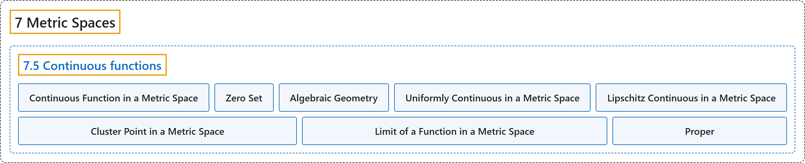

# 7.5 Continuous functions

## Classification

## Glossary

| Term | Definition | 中文翻译 | Source |
|---|---|---|---|
| **7.5 Continuous functions** 连续函数 | (No definition) | （无定义） | [Lebl, 2026, section 7.5](https://www.jirka.org/ra/html/sec_metcont.html) |
| **Continuous Function in a Metric Space** 度量空间中的连续函数 | "Let $(X,d_X)$ and $(Y,d_Y)$ be metric spaces and $c \in X$. Then $f \colon X \to Y$ is **continuous at $c$** if **for every $\epsilon > 0$ there is a $\delta > 0$ such that whenever $x \in X$ and $d_X(x,c) < \delta$, then $d_Y\bigl(f(x),f(c)\bigr) < \epsilon$**. When $f \colon X \to Y$ is continuous at all $c \in X$, we simply say that $f$ is a **continuous function**." | 设 $(X,d_X)$ 与 $(Y,d_Y)$ 是度量空间，$c \in X$。若**对每个 $\epsilon > 0$，存在 $\delta > 0$，只要 $x \in X$ 且 $d_X(x,c) < \delta$，就有 $d_Y\bigl(f(x),f(c)\bigr) < \epsilon$**，则称 $f \colon X \to Y$ **在 $c$ 处连续**。当 $f$ 在所有 $c \in X$ 处连续时，就简单地说 $f$ 是**连续函数**。 | [Lebl, 2026, Definition 7.5.1](https://www.jirka.org/ra/html/sec_metcont.html#sec_metcont-3-2) |
| **Zero Set** 零点集 | "Therefore, if we have a continuous function $f \colon X \to \mathbb{R}$, then the **zero set** of $f$, that is, **$f^{-1}(0) = \bigl\{ x \in X : f(x) = 0 \bigr\}$**, is closed." | 因此，若 $f \colon X \to \mathbb{R}$ 是连续函数，则 $f$ 的**零点集**，即 **$f^{-1}(0) = \bigl\{ x \in X : f(x) = 0 \bigr\}$**，是闭集。 | [Lebl, 2026, Example 7.5.9](https://www.jirka.org/ra/html/sec_metcont.html#sec_metcont-5-10) |
| **Algebraic Geometry** 代数几何 | "We have just proved the most basic result in **algebraic geometry**, **the study of zero sets of polynomials**: The zero set of a polynomial is closed." | 我们刚刚证明了**代数几何**（**研究多项式零点集的学科**）中最基本的结果：多项式的零点集是闭集。 | [Lebl, 2026, Example 7.5.9](https://www.jirka.org/ra/html/sec_metcont.html#sec_metcont-5-10) |
| **Uniformly Continuous in a Metric Space** 度量空间中的一致连续 | "Let $(X,d_X)$ and $(Y,d_Y)$ be metric spaces. Then $f \colon X \to Y$ is **uniformly continuous** if **for every $\epsilon > 0$ there is a $\delta > 0$ such that whenever $p,q \in X$ and $d_X(p,q) < \delta$, we have $d_Y\bigl(f(p),f(q)\bigr) < \epsilon$**." | 设 $(X,d_X)$ 与 $(Y,d_Y)$ 是度量空间。若**对每个 $\epsilon > 0$，存在 $\delta > 0$，只要 $p,q \in X$ 且 $d_X(p,q) < \delta$，就有 $d_Y\bigl(f(p),f(q)\bigr) < \epsilon$**，则称 $f \colon X \to Y$ **一致连续**。 | [Lebl, 2026, Definition 7.5.10](https://www.jirka.org/ra/html/sec_metcont.html#sec_metcont-6-3) |
| **Lipschitz Continuous in a Metric Space** 度量空间中的利普希茨连续 | "That is, if $(X,d_X)$ and $(Y,d_Y)$ are metric spaces, then $f \colon X \to Y$ is called **Lipschitz** or **$K$-Lipschitz** if **there exists a $K \in \mathbb{R}$ such that $d_Y\bigl(f(p),f(q)\bigr) \leq K \, d_X(p,q) \qquad \text{for all } p,q \in X.$**" | 即若 $(X,d_X)$ 与 $(Y,d_Y)$ 是度量空间，且**存在 $K \in \mathbb{R}$ 使得 $d_Y\bigl(f(p),f(q)\bigr) \leq K \, d_X(p,q) \qquad \text{for all } p,q \in X.$**，则称 $f \colon X \to Y$ 是**利普希茨的**或 **$K$-利普希茨的**。 | [Lebl, 2026, Example 7.5.13](https://www.jirka.org/ra/html/sec_metcont.html#sec_metcont-6-11) |
| **Cluster Point in a Metric Space** 度量空间中的聚点 | "Let $(X,d)$ be a metric space and $S \subset X$. A point $p \in X$ is called a **cluster point** of $S$ if **for every $\epsilon > 0$, the set $B(p,\epsilon) \cap S \setminus \{ p \}$ is not empty**." | 设 $(X,d)$ 是度量空间，$S \subset X$。若**对每个 $\epsilon > 0$，集合 $B(p,\epsilon) \cap S \setminus \{ p \}$ 非空**，则点 $p \in X$ 称为 $S$ 的**聚点**。 | [Lebl, 2026, Definition 7.5.14](https://www.jirka.org/ra/html/sec_metcont.html#sec_metcont-7-3) |
| **Limit of a Function in a Metric Space** 度量空间中函数的极限 | "Let $(X,d_X)$, $(Y,d_Y)$ be metric spaces, $S \subset X$, $p \in X$ a cluster point of $S$, and $f \colon S \to Y$ a function. Suppose there exists an $L \in Y$ and **for every $\epsilon > 0$, there exists a $\delta > 0$ such that whenever $x \in S \setminus \{ p \}$ and $d_X(x,p) < \delta$, then $d_Y\bigl(f(x),L\bigr) < \epsilon$**. Then we say $f(x)$ **converges to $L$ as $x$ goes to $p$**, and $L$ is a **limit** of $f(x)$ as $x$ goes to $p$." | 设 $(X,d_X)$、$(Y,d_Y)$ 是度量空间，$S \subset X$，$p \in X$ 是 $S$ 的聚点，$f \colon S \to Y$ 是函数。假设存在 $L \in Y$，使得**对每个 $\epsilon > 0$，存在 $\delta > 0$，只要 $x \in S \setminus \{ p \}$ 且 $d_X(x,p) < \delta$，就有 $d_Y\bigl(f(x),L\bigr) < \epsilon$**。这时说**当 $x$ 趋于 $p$ 时 $f(x)$ 收敛到 $L$**，$L$ 是 $x$ 趋于 $p$ 时 $f(x)$ 的**极限**。 | [Lebl, 2026, Definition 7.5.15](https://www.jirka.org/ra/html/sec_metcont.html#sec_metcont-7-5) |
| **Proper** 逆紧 | "A continuous $f \colon X \to Y$ between metric spaces $(X,d_X)$ and $(Y,d_Y)$ is said to be **proper** if **for every compact set $K \subset Y$, the set $f^{-1}(K)$ is compact**." | 度量空间 $(X,d_X)$ 与 $(Y,d_Y)$ 之间的连续映射 $f \colon X \to Y$ 称为**逆紧的**（proper），如果**对每个紧集 $K \subset Y$，集合 $f^{-1}(K)$ 是紧的**。 | [Lebl, 2026, Exercise 7.5.7](https://www.jirka.org/ra/html/sec_metcont.html#sec_metcont-8-7) |

## References

Lebl, J. (2026). *Basic analysis I & II: Introduction to real analysis* (May 22, 2026 edition). Retrieved October 29, 2026, from <https://www.jirka.org/ra/html/>
