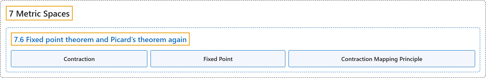

# 7.6 Fixed point theorem and Picard’s theorem again

## Classification

## Glossary

| Term | Definition | 中文翻译 | Source |
|---|---|---|---|
| **7.6 Fixed point theorem and Picard’s theorem again** 不动点定理与再论皮卡定理 | (No definition) | （无定义） | [Lebl, 2026, section 7.6](https://www.jirka.org/ra/html/sec_metpicard.html) |
| **Contraction** 压缩映射 | "Let $(X,d_X)$ and $(Y,d_Y)$ be metric spaces. A map $\varphi \colon X \to Y$ is a **contraction** (or a **contractive map**) if **it is a $k$-Lipschitz map for some $k < 1$**, i.e. if there exists a $k < 1$ such that $d_Y\bigl(\varphi(p),\varphi(q)\bigr) \leq k\, d_X(p,q) \qquad \text{for all } p,q \in X.$" | 设 $(X,d_X)$ 与 $(Y,d_Y)$ 是度量空间。若映射 $\varphi \colon X \to Y$ **对某个 $k < 1$ 是 $k$-利普希茨映射**，即存在 $k < 1$ 使得 $d_Y\bigl(\varphi(p),\varphi(q)\bigr) \leq k\, d_X(p,q) \qquad \text{for all } p,q \in X.$，则称 $\varphi$ 是**压缩**（或**压缩映射**）。 | [Lebl, 2026, Definition 7.6.1](https://www.jirka.org/ra/html/sec_metpicard.html#sec_metpicard-3-2) |
| **Fixed Point** 不动点 | "Given a map $\varphi \colon X \to X$, a point $x \in X$ is called a **fixed point** if **$\varphi(x)=x$**." | 给定映射 $\varphi \colon X \to X$，若 **$\varphi(x)=x$**，则点 $x \in X$ 称为**不动点**。 | [Lebl, 2026, Definition 7.6.1](https://www.jirka.org/ra/html/sec_metpicard.html#sec_metpicard-3-2) |
| **Contraction Mapping Principle** 压缩映射原理 | "Let $(X,d)$ be a nonempty complete metric space and $\varphi \colon X \to X$ a contraction. Then **$\varphi$ has a unique fixed point**." | 设 $(X,d)$ 是非空完备度量空间，$\varphi \colon X \to X$ 是压缩映射，则 **$\varphi$ 有唯一的不动点**。 | [Lebl, 2026, Theorem 7.6.2](https://www.jirka.org/ra/html/sec_metpicard.html#thm_contr) |

## References

Lebl, J. (2026). *Basic analysis I & II: Introduction to real analysis* (May 22, 2026 edition). Retrieved October 29, 2026, from <https://www.jirka.org/ra/html/>
